# Cash flow, stadium improvements and staff

[confirmed] Original One-Nil 96 supplied SAVE1. T52/session-r0001 explores
accounts/staff and one quick friendly; session-r0002 independently confirms
stadium scheduling. Full producer/release identities, inputs and rendered
screenshot digests are in [T52](../../runs/T52/). The sessions are separate
scratch games; the stadium order is not part of the scout-hire game's week.

## W047 — Read cash flow and club/staff information

[confirmed] From PLAY NEXT GAME, Up selects Cashflow; Enter opens CASH FLOW.
Initially every income/expenditure row is0, club funds452,000 and overdraft
facility2,920,000. The footer offers Insert to increase stadium capacity or
any other key to continue. Space returns to management.

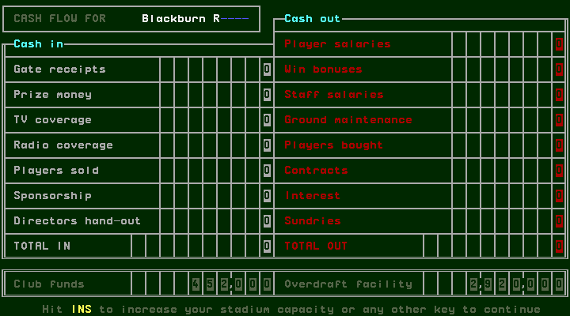

| Cash in | Cash out |
| --- | --- |
| Gate receipts | Player salaries |
| Prize money | Win bonuses |
| TV coverage | Staff salaries |
| Radio coverage | Ground maintenance |
| Players sold | Players bought |
| Sponsorship | Contracts |
| Directors hand-out | Interest |
| TOTAL IN | Sundries; TOTAL OUT |

[confirmed] Main-menu Insert cycles the team, club and staff panels. Club
information shows name/strips/country/league/position, stadium capacity31000,
support, squad size18, cash available452000 and maximum overdraft2920000.
Staff information shows manager, assistant, physio, scout and chairman with
name, country and rating. Initially these are K Dalglish/Very good,
R Harford/Good, S Foster/Talented, T Parkes/Observant, R Coar/Opulent, all England.
These labels do not prove performance effects or financial formulas.

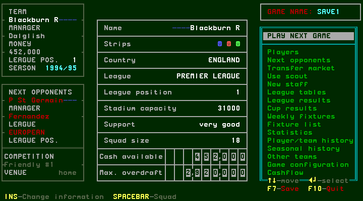
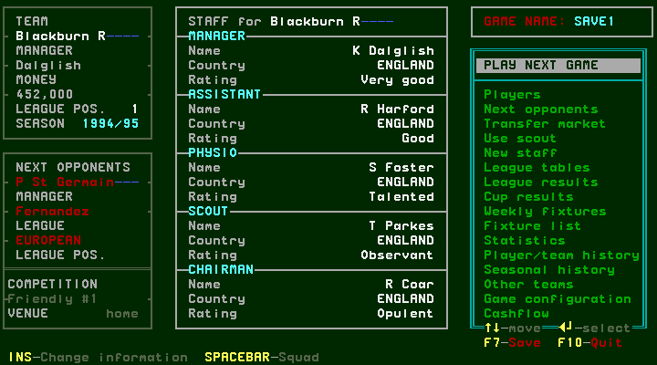

## W048 — Stadium quote, abort and scheduled improvements

[confirmed] Insert from CASH FLOW opens “Extra capacity:1,000”, cost500,000,
with Up/Down change, Enter proceed and Escape abort. Up changed the quote to
2,000/cost1,000,000; Down restored1,000/500,000. Escape aborted directly to
the main menu. It did not stay inside cash flow. The following exploratory
Insert changed the main information panel; Enter merely reopened Cashflow.
Thus session-r0001 did not actually place a stadium order, despite the intent
labels “stadium-reopen/proceed” on those captures.

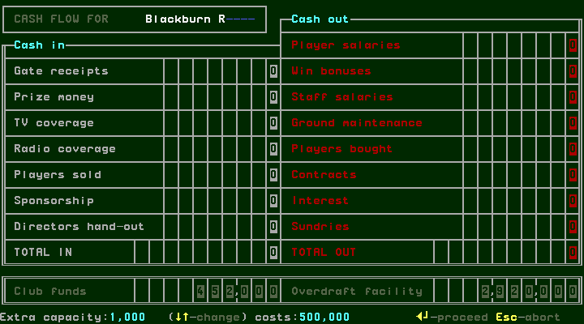
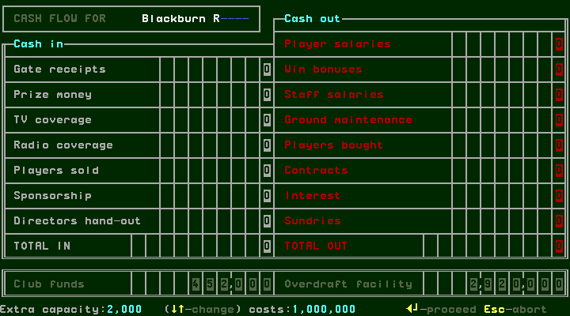
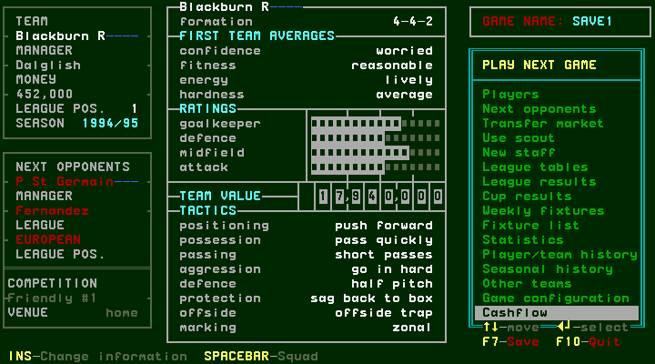

[confirmed] A separate fresh session takes Y→Up Cashflow→Enter→Insert quote→Enter.
The actual response is “Ok...improvements will take a few months : hit any key”.
Space acknowledges to management. Insert opens club information; capacity is
still31000, while cash available is−48,000 (452,000−500,000). F7 saves.
This confirms an order, immediate displayed charge and deferred completion
message. It does not confirm completed construction or an exact duration; the
later capacity completion remains for seasonal traversal.

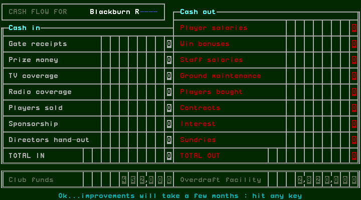
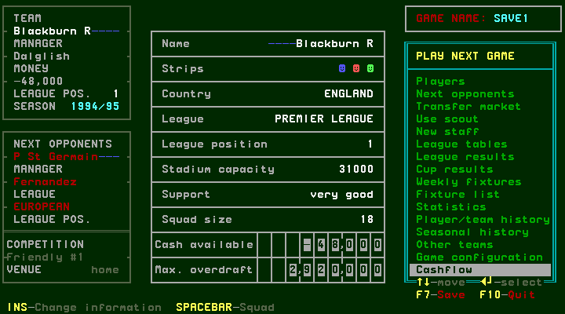

## W049 — Staff browser, refusals and a successful hire

[confirmed] Select New staff on the main menu and Enter. The browser initially
shows Assistants, with a name list and selected candidate's country, rating,
current/previous team, cost per game and signing-on bonus. Up/Down change
candidate. Insert cycles Assistants→Physios→Scouts→Assistants; Delete goes in
the reverse direction. The footer names the next category for each key, so
Delete from Physios returns to Assistants, not directly to Scouts.

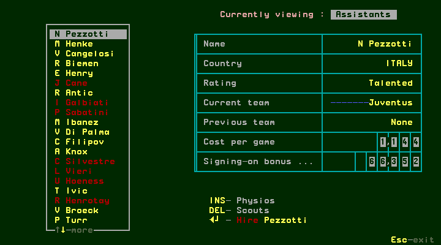
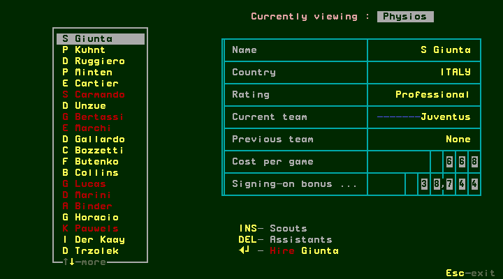
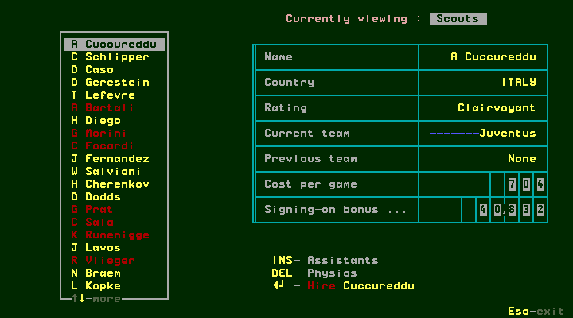

[confirmed] Enter on N Pezzotti reported not interested; Space dismissed it.
Scout A Cuccureddu and W Salvioni also refused. After scrolling farther,
Z Szulc of Katowice, Poland, Vigilant, cost per game516/signing bonus29928,
agreed to join and asked “Okay? (Y/N)”. N cancelled. Enter asked again; Y hired
him. His current team changed to Blackburn R and previous team to Katowice;
the action footer changed from Hire to SACK Szulc.

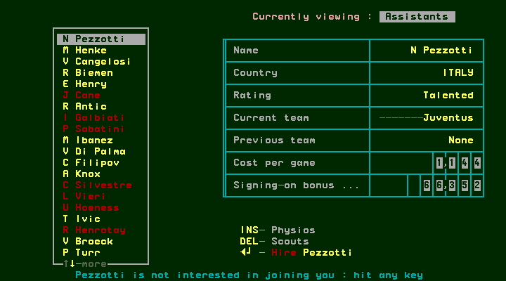
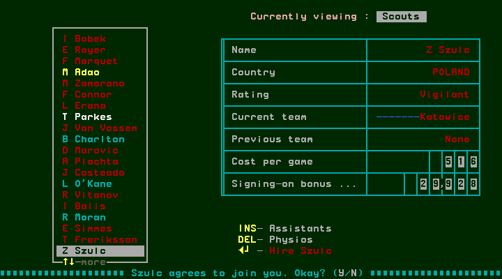
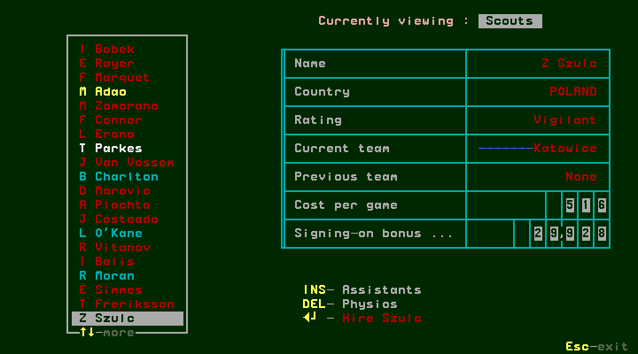
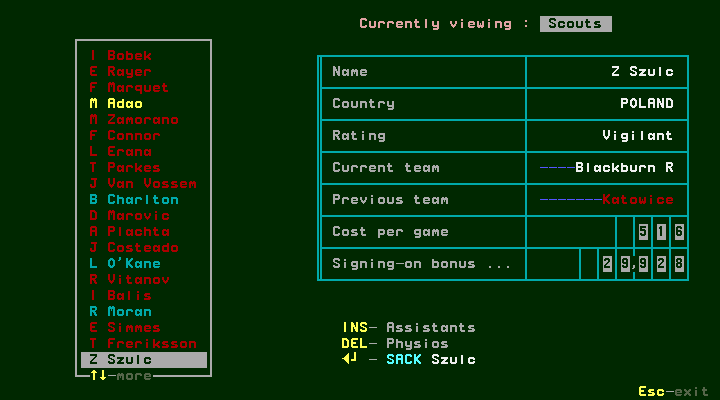

[confirmed] Enter now asked “Sack Szulc? (Y/N)”. N cancelled, retaining him.
Escape returned to management. Cycling information confirmed Z Szulc as the
club scout, replacing T Parkes in that displayed role. The main funds still
showed452000 before the week was played. Actual affirmative staff dismissal,
other role hiring and candidate willingness rules are not established.

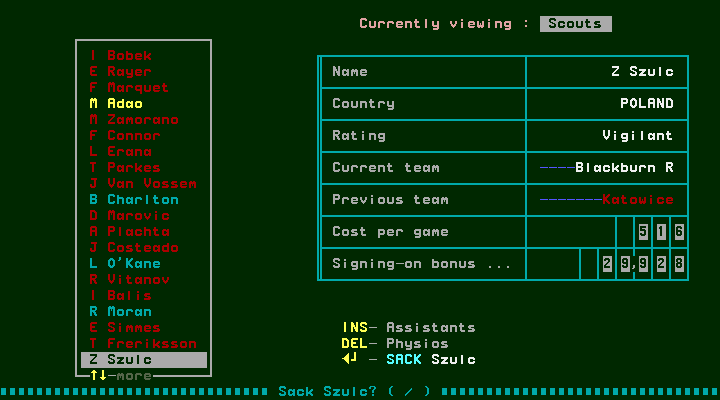
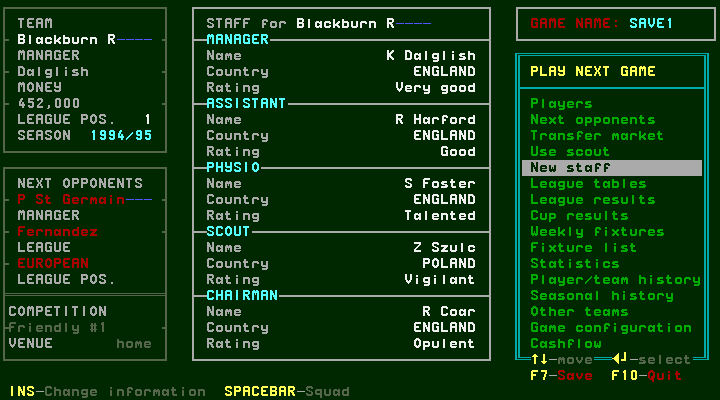

## W050 — Weekly account posting after the hire

[confirmed] The same scout-hire session disabled Watch match and completed the
first friendly through halftime bench/second-half quick result. Space at fulltime
opened the week's cash flow. It showed gate38761, player salaries57320,
staff salaries4236, ground maintenance7750 and Contracts29928; other displayed
rows0. Total in38761, total out99234, club funds391527 and overdraft2920000.

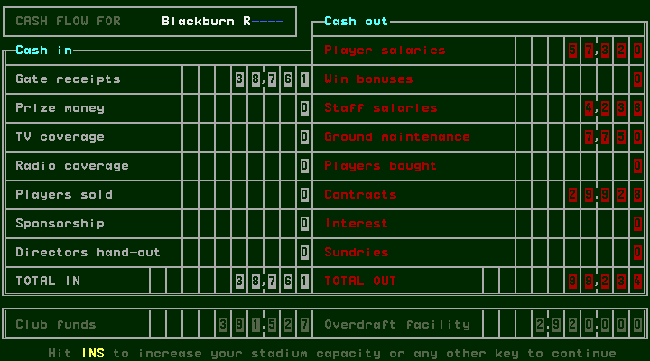

[derived] For this displayed period,452000+38761−99234=391527. The Contracts
row equals the quoted scout signing bonus29928. This supports posting during
this week's completion; it does not establish every expense's internal timing
or a universal salary/bonus formula. The earlier stadium order was cancelled
in this session and is not charged as a completed expansion here.

[confirmed] Space→transfer news, Space→management returned to Sevilla away
Friendly #2. Staff still showed Szulc and funds391527; capacity remained31000.
F7 saved. This game's saved state is separate from the fresh stadium-order save.

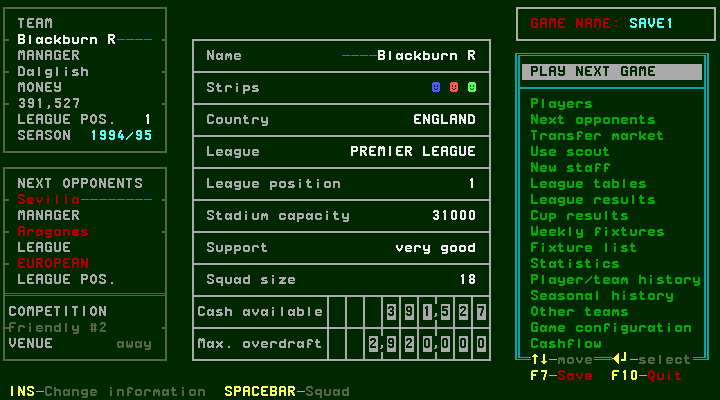
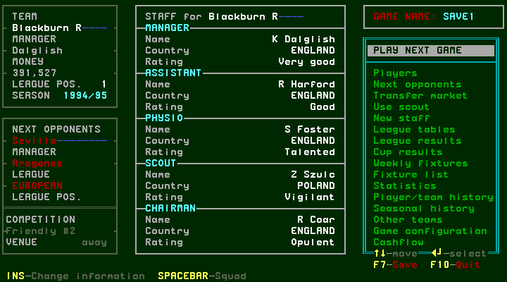

## Branch coverage

| Route | Observed | Remaining |
| --- | --- | --- |
| Cash flow | Initial/weekly fields, posting arithmetic and exits | Other income/expense events and periods |
| Stadium | Quote adjustment, abort, actual order accepted/deferred | Completion months, limits, further orders and final charge |
| Staff | Three role lists, refusals, hire cancel/accept and changed club role | Other role hires and willingness rules |
| Staff dismissal | Confirmation and N cancellation | Affirmative dismissal and any costs |
| Persistence | F7 on each final main menu | Fresh-process reload of these administration changes |

[designed] #141/#142 retain the remaining conditional and seasonal cases.
