# Autumn progression, cup ties and weekly interruptions

[confirmed] These original One-Nil96 observations continue T54's league-four
save through league10 in [T56/session-r0001](../../runs/T56/session-r0001/session.json),
producer commit `1bf1f5551dc4d2a268c26f48e9ae6d134bd6e7fb`. Adjacent step JSON
records identify commands, decoded text, screenshots and evidence-chain hashes.
Host clock/seed are uncontrolled; results describe this run, not fixed outcomes.

## W058 — Restore and inspect availability

[confirmed] The [input receipt](../../runs/T56/save-input-r0001.json) identifies
T54's final SAVE1, SHA256
`abad4b6945c6c9b6bb6f6045cc12df5d3dc79193ccee889355fe21c2acc7f93c`.
The [restart record](../../runs/T56/session-r0001/step-0001.json) authenticates
the before-mount copy of only the game save into a fresh original process,
without loading a savestate. Y loaded the same visible management state as
T54's saved menu (step2). Watch match remained off; the other four configuration
options were enabled, as later inspected at step80.

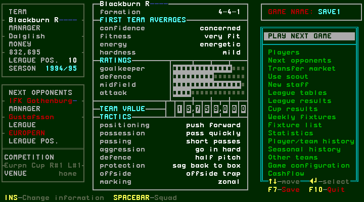

[confirmed] Steps3–13 inspect suspended Newell and eligible Wilcox, then move
Wilcox into the starting side. For a move, Enter picks up the selected player,
Up/Down selects the target, and Enter completes it. Inspect the availability
marks and rating first. The original reorders the starters after moves;
remembered row indices cannot safely be reused.

## W059 — Complete a European two-leg tie

[confirmed] PLAY NEXT GAME→Enter opens preparation. Enter on PLAY GAME plays
the quick first half; Space at halftime returns to the bench; Enter resumes.
The first European leg at home to IFK ended0–0, with Gale sent off (step19).
Space opened European results, then the other European competition results,
then accounts/news and management (steps20–25). League5 against Liverpool
intervened before the return leg and finished2–0, with Berg sent off (step36).

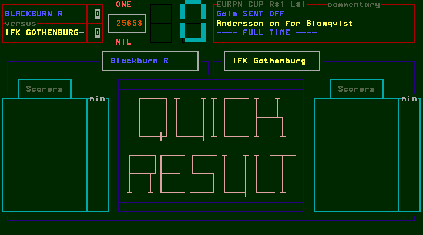

[confirmed] Before the return, Gale's suspension mark was clear while Berg's
details showed suspended and Can't play. Enter on Gale→Up seven to Berg→Enter
swapped them (steps43–46). The resulting main menu showed4-5-1 (step48).

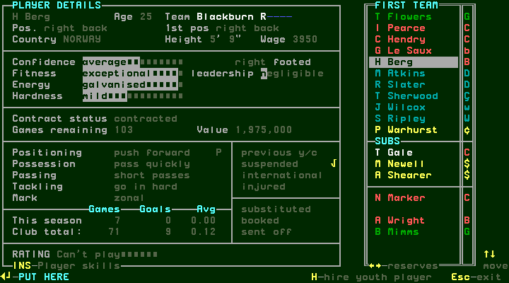

[confirmed] After the injury interruption in W060, the return finished IFK0–3
Blackburn, with Atkins48/53 and Ripley63 (step60). Space opened the completed
tie: Blackburn3v0IFK, first leg0v0, second leg0v3 (step61). Preserve the displayed
orientation of each leg rather than assuming the aggregate row's team order.
Space then advanced through Cup Winners/UEFA results and three separate Round2
draws (steps62–66), followed by accounts/news/main (steps67–69).

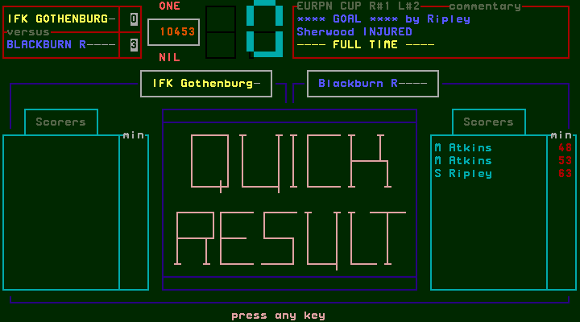
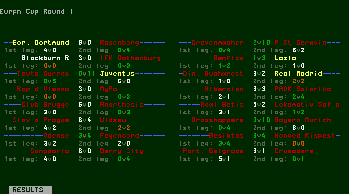
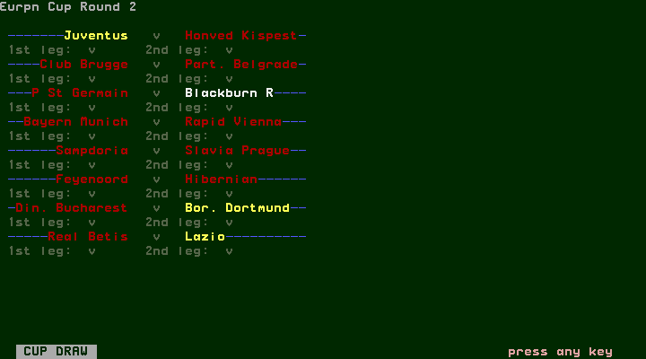

[confirmed] The draw pairs P St Germain with Blackburn but has blank score/leg
fields. This is future scheduling, not evidence of a played Round2 fixture.

## W060 — Injury replacement and recovery

[confirmed] At3–0 the return leg stopped with Sherwood INJURED and SUBSTITUTION
OPPORTUNITY (step52). Space opened the bench with2 remaining subs; Space opened
the squad. Down ten selected Sherwood, with injured mark and Can't play rating.
Enter→Down twice selected eligible Newell; Enter made the substitution.
Escape returned to the bench with1 remaining sub and4-4-2; Enter resumed to
actual fulltime (steps53–60). Later Sherwood's details showed no injury and an
excellent rating (step82); he replaced suspended Wilcox at steps83–86. This
observes recovery in this run, not a general injury-duration formula.

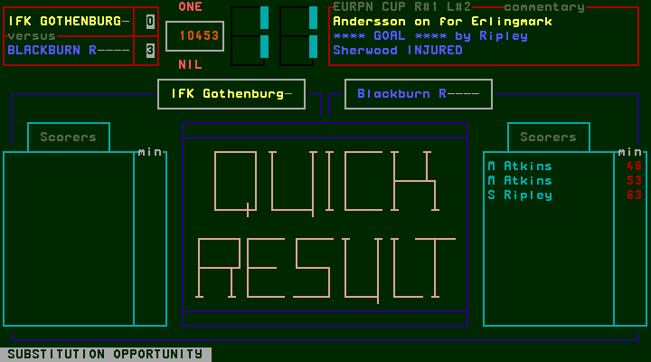
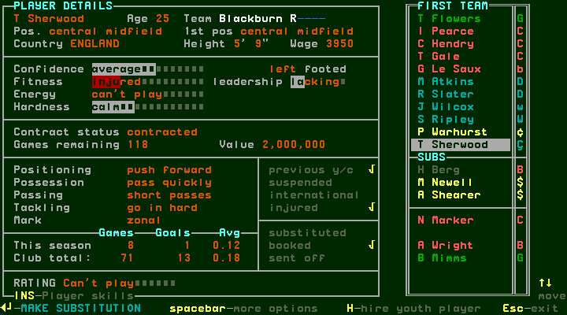
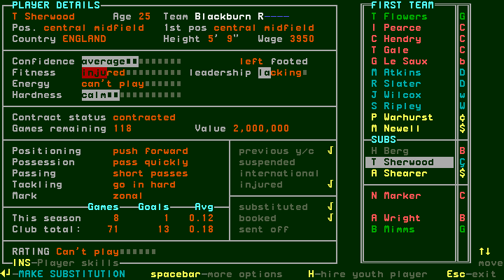
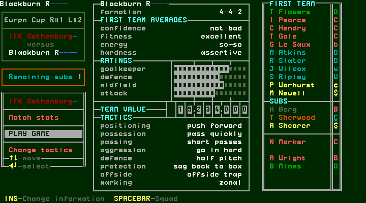

## W061 — Ineligible-player refusal and extra time

[confirmed] PLAY GAME before Luton in League Cup Round2 refused because the
first team contained an ineligible player (step93). Space dismissed; Space
opened the squad. Ripley's details showed suspended and Can't play (step96).
Enter on Ripley→Down to eligible Berg→Enter moved Berg into the side. Escape
returned to preparation; Enter now started play. This is a different message
from the earlier insufficient-player refusal in [match preparation](match-preparation.md).

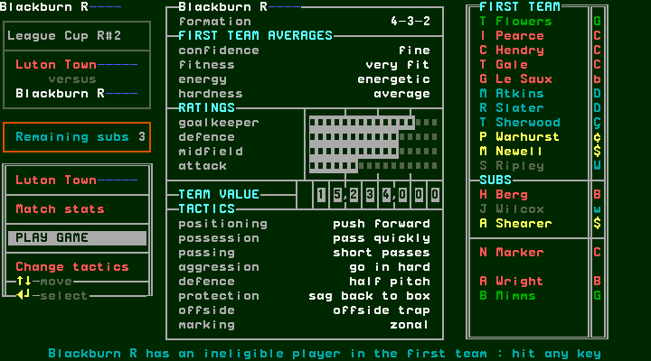
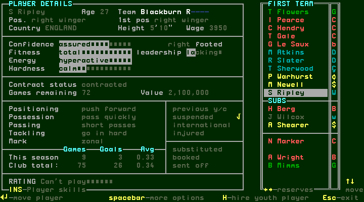

[confirmed] Halftime was0–0 (step101). Space returned to the bench; successive
Enter commands on PLAY GAME produced two further bench states (steps103/104),
then fulltime0–1, Berg102 (step105). These captures establish additional playing
intervals and a goal beyond90 minutes. The bench screens do not label exact
period boundaries, so no unobserved minute is assigned to either arrival.
Halftime text remains in the fulltime commentary; identify completion from
the explicit FULL TIME line and subsequent results screen.

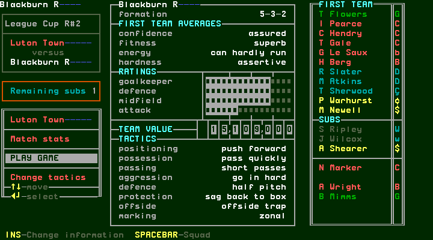
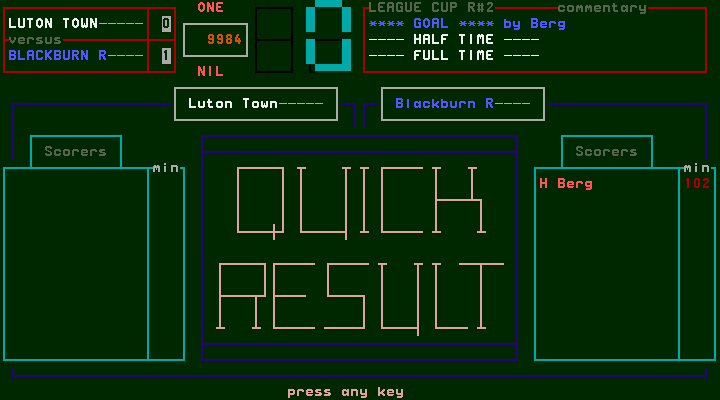

[confirmed] Space opened results, Round3 draw, accounts/news/main (steps106–110).
Later the actual Round3 match finished Blackburn2–1Ipswich (step159). Results
and the quarter-final draw followed (steps160/161), listing Chelsea versus
Blackburn with blank scores. Checkmarks beside other clubs' tied results are
visible; their resolution mechanism was not exercised by this managed team.

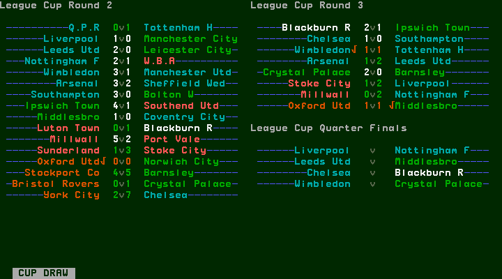

## W062 — Ten-week contract warnings

[confirmed] After league7 accounts, Marker triggered a HAS ONLY10WEEKS warning
and Y/N renewal question (step118). N continued to transfer news without opening
the editor (step119). After league9 accounts, retiring Gale triggered the same
warning (step152). Y opened the editor with1year, wage1500, signing fee75000,
despite his displayed Retiring this year status (step153). Escape from the
first category cancelled into news (step154). No renewal was submitted or
accepted; later expiry and retirement remain unvisited.

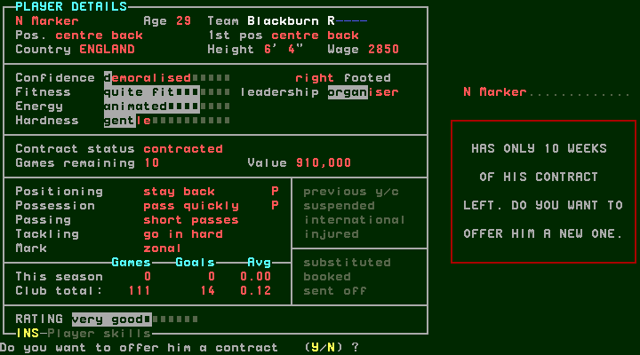
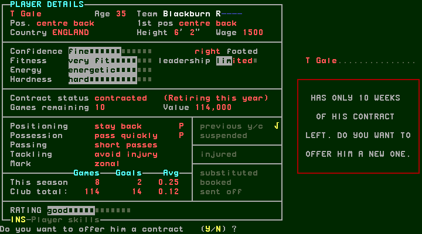
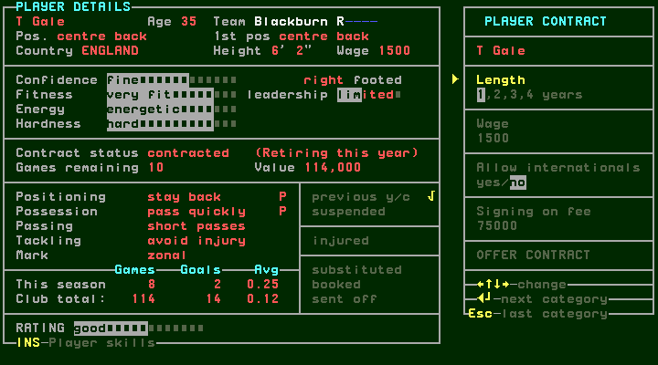

## W063 — Managerial approach, deferred decision and refusal

[confirmed] Space on transfer news produced H Ellis's approach to Dalglish to
manage Aston Villa, with Press ESC (step120). Escape returned to Blackburn
management (step121). After the next match the news screen explicitly asked
whether to join Aston Villa (step142). N returned to Blackburn management
(step143). The earlier Escape return therefore must not be called a completed
refusal. Acceptance and job-change effects were not exercised.

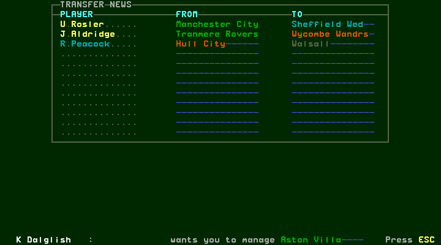
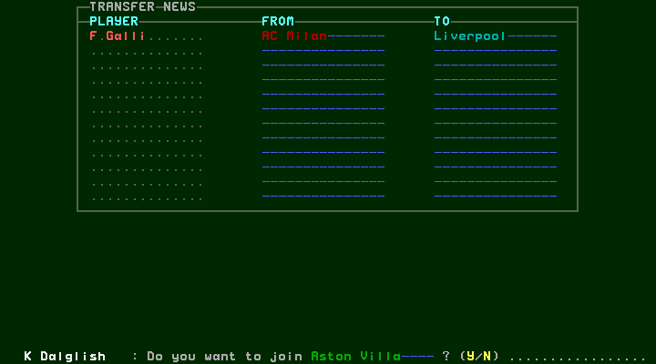

## W064 — Scenario changes and league-ten checkpoint

[confirmed] Before league8, Change tactics→Enter opened team instructions.
From Positioning, Down three→Enter changed aggression from go in hard to avoid
injury (step124); Escape returned to preparation. This deliberate scenario
change does not establish its effect on injury or suspension probability.
Returning Ripley and Wilcox replaced suspended Gale and Berg (steps126–132).
Preparation then showed3-5-2; Up selected PLAY GAME before Enter started play.
Step87's exploratory ID mentions Slater but its actual screen is Berg; the
Slater inspection is step88. Captured screens, not intent labels, define views.

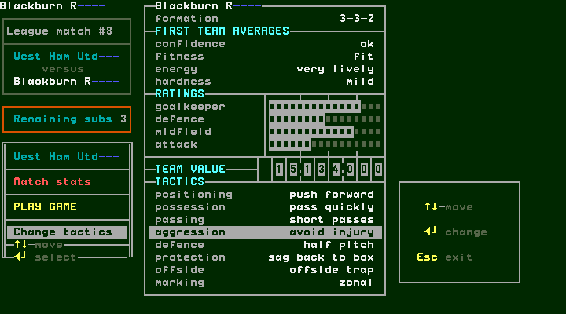
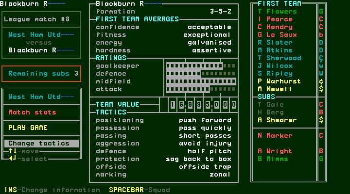

| Fixture | Actual result | Fulltime capture |
| --- | --- | --- |
| League5 home Liverpool | Blackburn2–0Liverpool | [36](../../runs/T56/session-r0001/step-0036.png) |
| League6 away Q.P.R | Q.P.R1–4Blackburn | [73](../../runs/T56/session-r0001/step-0073.png) |
| League7 home Manchester Utd | Blackburn2–1Manchester Utd | [114](../../runs/T56/session-r0001/step-0114.png) |
| League8 away West Ham | West Ham0–4Blackburn | [137](../../runs/T56/session-r0001/step-0137.png) |
| League9 home Leeds | Blackburn3–2Leeds | [148](../../runs/T56/session-r0001/step-0148.png) |
| League10 away Everton | Everton2–2Blackburn | [169](../../runs/T56/session-r0001/step-0169.png) |

[confirmed] Fulltime Space→results→Space table→Space accounts→Space news→Space
management completed league10 processing (steps169–174). Blackburn's table
row shows P10,F21,A12,PTS14, fourth. Accounts show in53806,out85010,funds768408.
The next fixture is European Round2Leg1 away to P St Germain. F7 saved from
management at step175; the original session then ended cleanly. The
[private-save receipt](../../runs/T56/autumn-private-backup-pending-r0001.json)
identifies final SHA256
`c43fd8ffc31a17e5fc460541cbb6ef5448689830a4b0cc8b1933c5f423edddb0`.
A pending receipt is not evidence of a completed private upload.

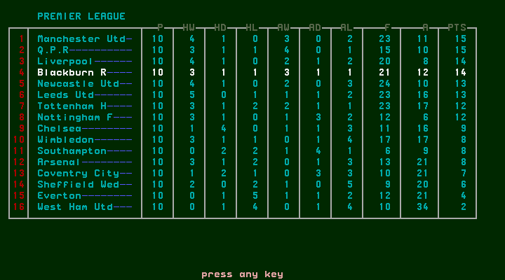
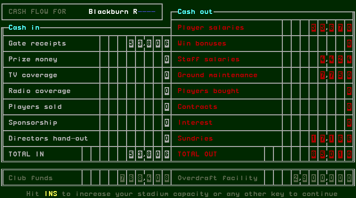
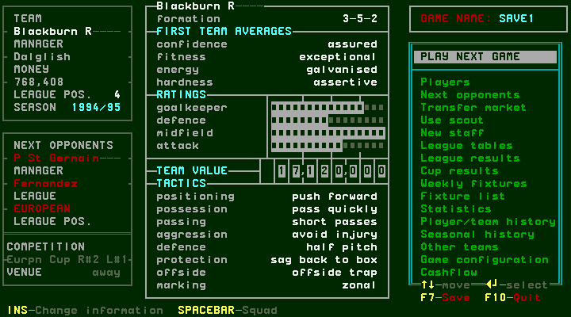

[designed] Continue from this exact save into the next European tie and winter,
then season finish/rollover in bounded tasks. Remaining cases include this
team's tied aggregate/penalty resolution, job acceptance, retiring-player expiry,
stadium completion, promotion/relegation and populated seasonal history. Neither
a draw nor an early-season table establishes those outcomes. The completed
manual phase and native gap audit still precede the UI technology decision.
