# Existing contracts, dismissal and youth trials

[confirmed] Original One-Nil 96 supplied SAVE1, T51/session-r0001, producer
`2ef23f5` (full source and release identities in [session.json](../../runs/T51/session-r0001/session.json)).
Ordered capture records and rendered images are append-only. These procedures
use an isolated scratch squad and do not establish expiry or employment formulas.

## W040 — Existing-player renewal, editing and cancellation

[confirmed] Main-menu Space opens Players; Insert opens details; Space opens
options. Starting at Reposition, five separate Down inputs select New contract;
Enter opens PLAYER CONTRACT for T Flowers, initially contracted,145 games
remaining, wage2850, value1,425,000. Categories are Length1/2/3/4 years,
Wage2850, Allow internationals yes/no, Signing on fee0 and OFFER CONTRACT.
Enter advances category; Escape goes back. Right changed the length highlight
from1 to2; Enter selected wage; Up changed2850 to2950. Escape returned to
length; another Escape closed the editor back to player options. The details
still showed145 games and wage2850: those edits were not an accepted renewal.

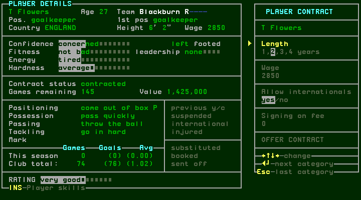
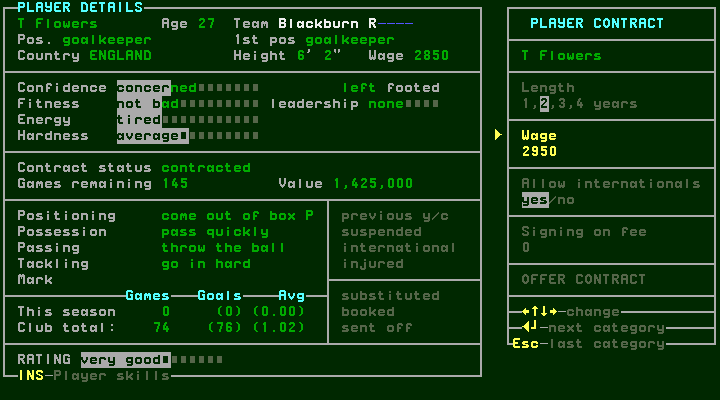
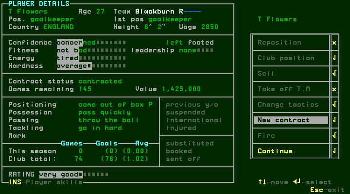

[confirmed] Reopen New contract with Enter. This reset length to1 and wage2850.
Enter→wage, Enter→internationals; Right/Left exercised the yes/no selection.
Enter→signing fee; Up changed0 to10, Down restored0. Enter→OFFER CONTRACT;
Enter reported “REJECTED: not enough money offered : hit any key”. Space
dismissed the message but left the contract screen; Escape returned to options.
There was no accepted renewal here. Higher offers and their acceptance thresholds
remain untested; a purchase agreement is documented separately in transfers.md.

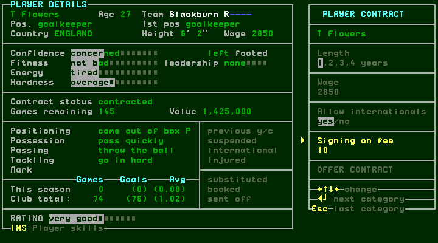
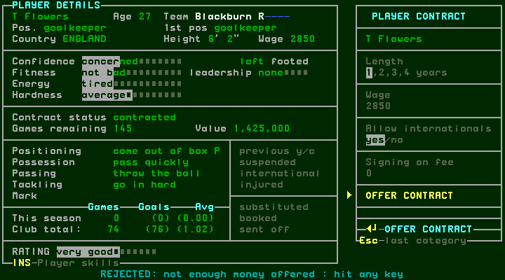

## W041 — Fire confirmation, compensation and cancellation

[confirmed] Select Fire in player options (the captured Right from New contract
moved to Fire; the menu advertises Up/Down). Enter asks “Get rid of Flowers?
(Y/N)”. N cancels and closes options to the squad. An exploratory Enter then
started PUT HERE, not another Fire confirmation; Escape cancelled that move,
Space reopened options with Fire remembered. These steps do not prove dismissal.

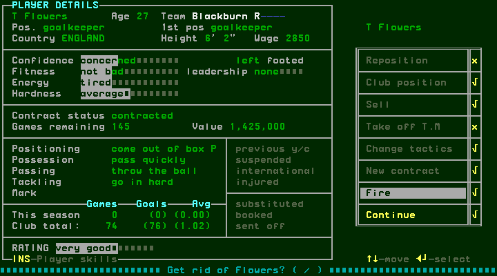
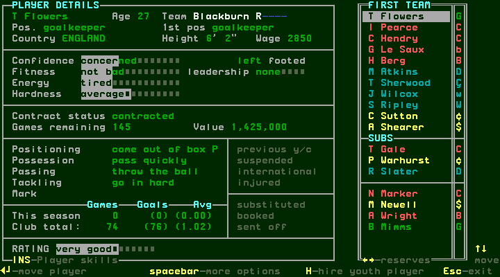

[confirmed] Enter on Fire and Y opened a second prompt: “It will cost you
413250. Ok? (Y/N)”. N cancelled that cost and returned to the squad with Flowers
still present. Space reopened Fire options; Enter→first prompt, Y→cost prompt,
Y accepted. The resulting squad view has a blank first slot and blank details;
Flowers is absent. This confirms the visible removal after both approvals.

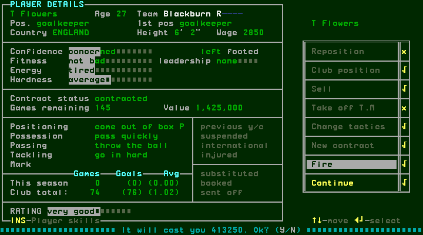

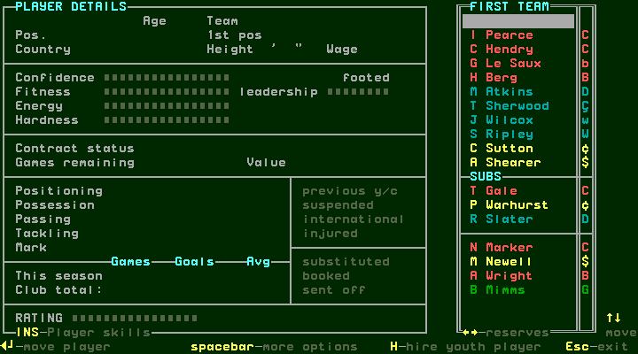

[confirmed] Later main-menu MONEY remained452,000; the capture establishes the
quoted cost and removal, not an immediate displayed debit or its accounting
formula. Other contract lengths, expiring/free players and insufficient-funds
cases have not been exercised.

## W042 — Hire a youth player on trial

[confirmed] H on the squad opens WHICH POSITION?, with fourteen roles from
goalkeeper through striker. Escape cancels without choosing. H reopens;
Enter on goalkeeper produced N Gurney, age17, England,6'0", wage40, goalkeeper,
with contract status on trial and0 games remaining while SELECT TRIAL PERIOD
was open. The first position field is populated; the displayed first-position
field is blank. Do not invent a hidden permanent role or value for it.

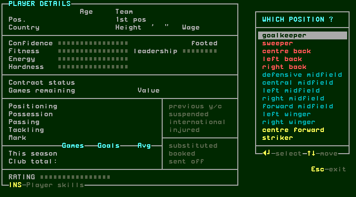
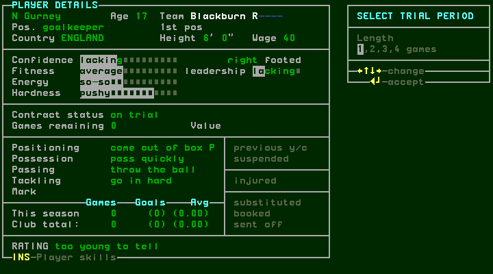

[confirmed] Trial choices are1/2/3/4 games; the footer advertises arrows change,
Enter accept. Right changed the selection to2; Enter put Gurney in RESERVES,
on trial with2 games remaining. The rating says “too young to tell”; value is
blank. No purchase-contract negotiation occurred in this youth route. Escape
returned to management, Insert opened club information, and F7 saved that state.
The club information shows squad size18 after one dismissal and this recruitment;
the displayed main funds are452,000. The removed first-team keeper was not
automatically replaced in his slot by the new reserve trialist.

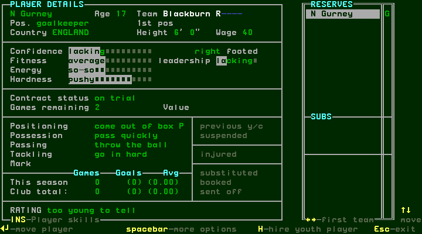
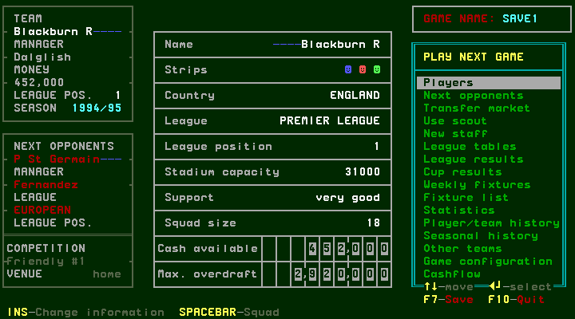

## Branch coverage

| Route | Observed | Remaining |
| --- | --- | --- |
| Renewal | Length/wage/international/signing controls, back/cancel, refusal | Accepted renewal, expiry and counteroffer limits |
| Fire | N at first and cost confirmations; Y/Y removes player | Other costs, zero-contract and financial refusals |
| Youth | Position cancel/reopen, goalkeeper, two-game reserve trial | Other positions, full squad, trial expiry/conversion |
| Accounting | Quoted compensation and unchanged main funds before week | Actual posting/timing in cash flow |

[designed] #140 and the season backlog remain open for these conditional and
expiry cases; this chapter does not claim a completed contract lifecycle.
