# Statistics, histories and other teams

[confirmed] Original One-Nil 96 supplied SAVE1, T53/session-r0001; source/release
identities and ordered screenshot receipts are in its [session record](../../runs/T53/session-r0001/session.json).
No fixture was played in this task. Historical values below belong to the
supplied game, not to outcomes generated by this exploration.

## W043 — Statistics availability

[confirmed] From PLAY NEXT GAME, eleven separate Down inputs select Statistics.
Enter reports “Not available until after league match #4 : hit any key”. Space
dismisses it and returns to the main menu. This captures a prerequisite and
empty state; the populated statistics interface remains a seasonal follow-up.

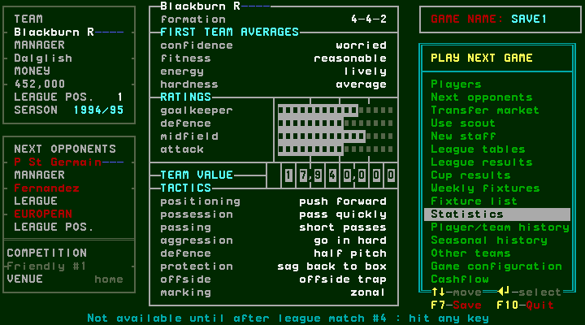

## W044 — Player transfer history and team history

[confirmed] Down from Statistics selects Player/team history; Enter opens
PLAYER TRANSFER HISTORY. The visible rows are empty in this supplied save.
The footer advertises Up/Down-more, Enter-team histories and Escape-exit. Down
left an empty page; Enter opened the team histories browser for Blackburn.

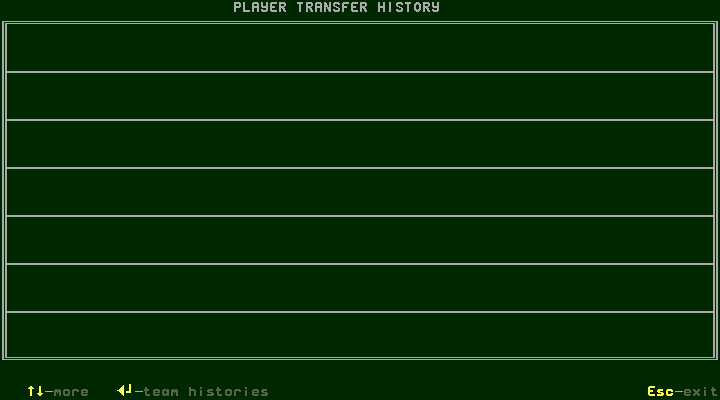
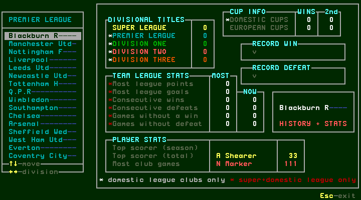

[confirmed] The left side selects a team/division. The history panel includes:

| Group | Visible fields |
| --- | --- |
| Divisional titles | Super League, Premier League, Division One, Two, Three |
| Cup information | Domestic/European cups, wins and second places |
| Records | Record win/defeat and opponent |
| Team league statistics | Most points/goals; consecutive wins/defeats; games without win/defeat, MOST and NOW columns |
| Player statistics | Top scorer season/total; most club games |

[confirmed] Blackburn's visible league/cup counters are zero, record-opponent
fields are blank, top scorer total is A Shearer33 and most club games N Marker111.
Footnotes qualify domestic/super-league fields. Down changes the selected club;
Right changes division; Escape returns directly to management, with Player/team
history still selected. No season of results was generated to populate the
blank fields in this task.

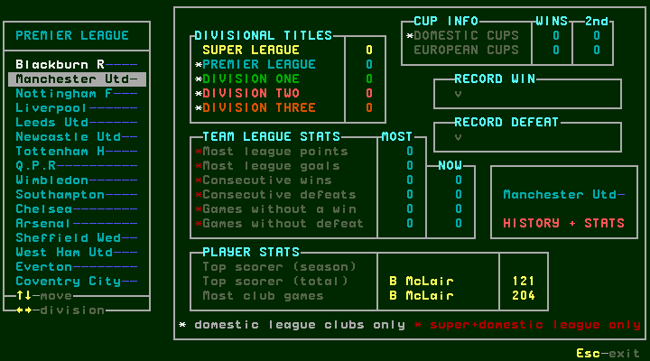
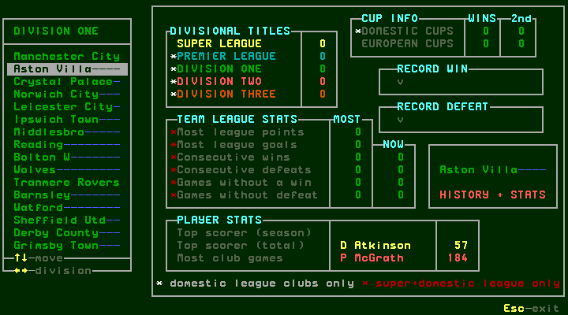

## W045 — Seasonal history availability

[confirmed] Down from Player/team history selects Seasonal history. Enter
reports “No history available until a full season is completed : hit any key”.
Space dismisses the message. A full season and rollover are required before
the populated view can be documented; this task does not substitute a mockup.

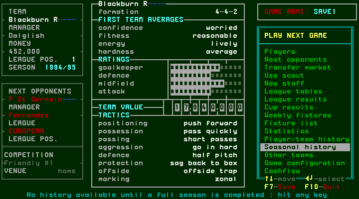

## W046 — Other-team information and squad details

[confirmed] Down from Seasonal history selects Other teams; Enter opens a club
browser with division/team list on the left, information panel in the centre
and that team's FIRST TEAM/SUBS on the right. Initially Blackburn is shown.
Down changed to Manchester Utd; Right changed division to Division One and the
selected displayed club to Aston Villa. Insert showed its club information;
another Insert showed staff. Space opened that club's player skills list;
Insert switched to details, Down selected another player, Escape returned to
the other-team browser, Escape returned to Blackburn's management menu.

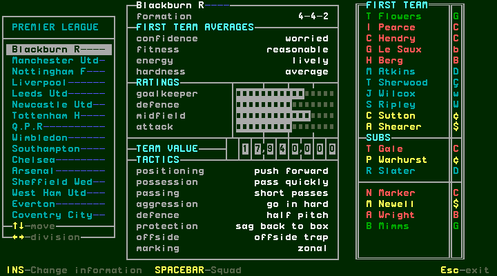
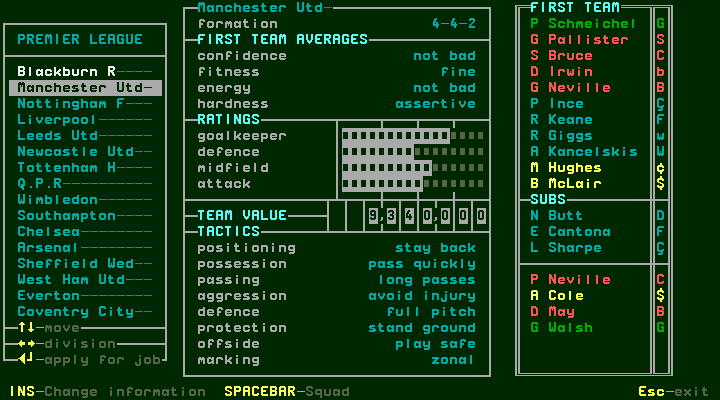
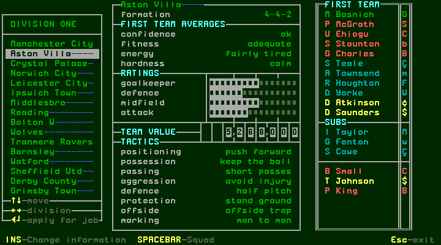
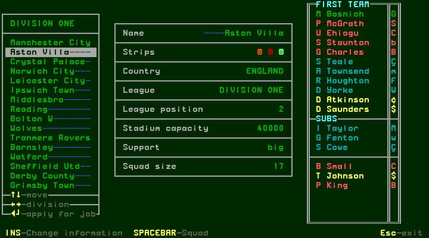
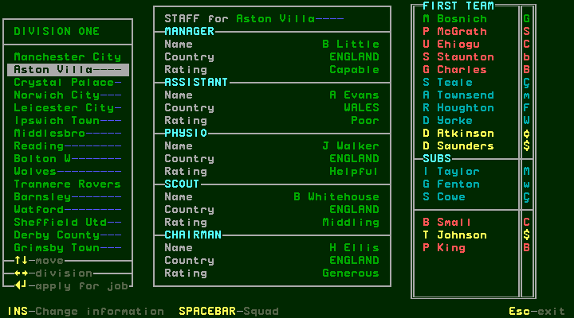

[confirmed] Club information includes name, strips, country, league, league
position, stadium capacity, support and squad size; staff information includes
manager, assistant, physio, scout and chairman names/countries/ratings. The
initial team panel shows formation, average confidence/fitness/energy/hardness,
rating bars, team value and eight team instruction fields. These are displayed
values, not proven formulas. Rendered screenshots preserve kit glyphs and bar
lengths that the decoded text cannot represent faithfully.

[confirmed] Aston Villa's selected keeper M Bosnich shows age22, Australia,
5'11", wage830,80 games remaining and value415,000. Down selects P McGrath,
age35, Eire, sweeper, wage830. The same details fields documented in squad.md
are visible for other teams. This squad's footer advertises Enter-buy player;
it was not activated here. There is no move-player or own-player options flow
in these captures. Transfer bids are documented separately in transfers.md.

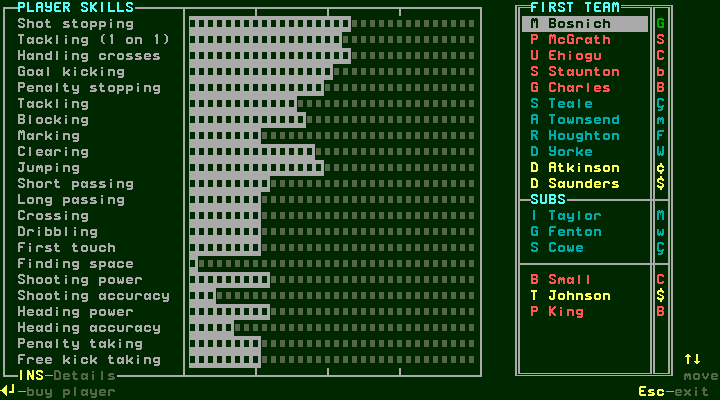
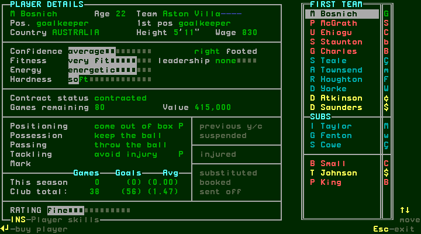
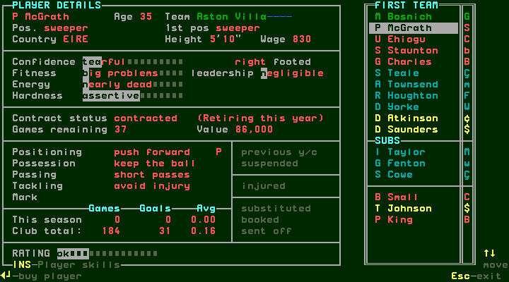
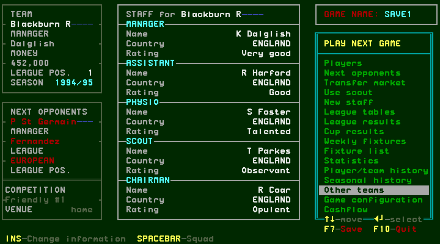

## Branch coverage

| Route | Observed | Remaining |
| --- | --- | --- |
| Statistics | Pre-league-four refusal and dismissal | Populated pages after prerequisite |
| Transfer history | Empty page, scroll, Enter team history | Populated transfers and paging |
| Team history | Two clubs/divisions, field inventory and exit | Records generated by season play |
| Seasonal history | Full-season prerequisite and dismissal | Completed-season view/rollover |
| Other teams | Club/division, information panels, two players, exits | Buy-player shortcut, all leagues and paging limits |

[designed] These seasonal prerequisites stay in #142 and the final coverage
audit; an unavailable early-season screen is not marked complete coverage.
