# Later season: tribunal departure, friendlies and a cup win

[confirmed] This chapter continues the original One-Nil96 from league sixteen
through league twenty-four in [T60/session-r0001](../../runs/T60/session-r0001/session.json).
Producer commit is `576448a92dcd7af283cbd48b55a107d8814c70fc`; adjacent step
records contain exact keys, decoded text and original screenshot hashes. Clock
and seed are uncontrolled, so the scores describe this run rather than fixed
outcomes. No original font, palette or resource buffer is used as a product asset.

[confirmed] The [input receipt](../../runs/T60/save-input-r0001.json) identifies
T59's league-sixteen save. The fresh-process restart at step1 records matching
save/restored hashes and different process IDs. Y loads management at step2,
whose text digest matches T59's final saved main menu. Only actual game saves
were copied before the new process mounted its verified release; no savestate
was restored as game persistence.

## W073 — Expired player leaves at a tribunal-set fee

[confirmed] Enter from the blank-opponent Euro cups week advances through other
teams' European results, group table and cup draws to accounts (steps3–9).
Space after accounts opens a departure screen: Leeds PAY765000 FOR N Marker,
FEE SET BY TRIBUNAL, and Marker is LEAVING the club (step10). There is no Y/N
acceptance question on this screen. Insert changes skills to details while the
departure remains visible (step11). Marker still displays Blackburn, listed,
zero games, wage2850 and value860000 at this point.

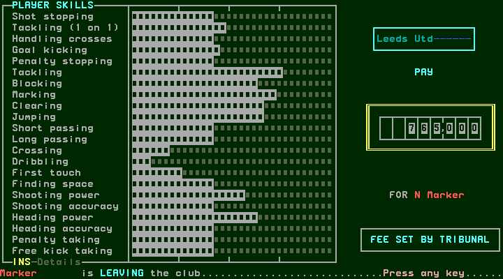
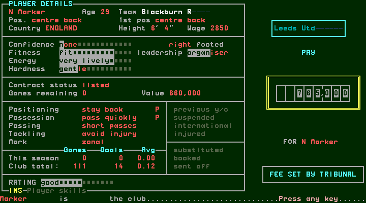

[confirmed] Space continues to transfer news naming Marker, Blackburn→Leeds
(step12). Space returns to management with funds806641 (step13), matching the
accounts shown before departure. Space opens the squad: Marker is absent and
his former lower-squad row is blank (step14). This follows the expiry-editor
cancellation and listed-zero state documented in [midseason](midseason.md).

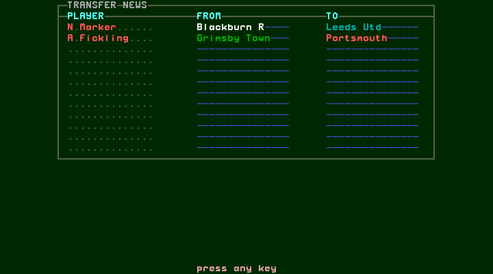
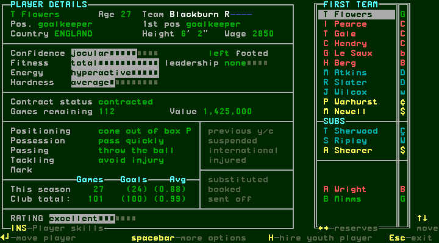

[confirmed] The next accounts, after league17, show Players sold765000 and
funds1549229 (step22). Thus this run shows the departure before its payment is
posted in the following statement. Player salaries are52820 on that statement,
versus55670 on the preceding one; this is an observed ledger difference, not
a general wage-posting formula.

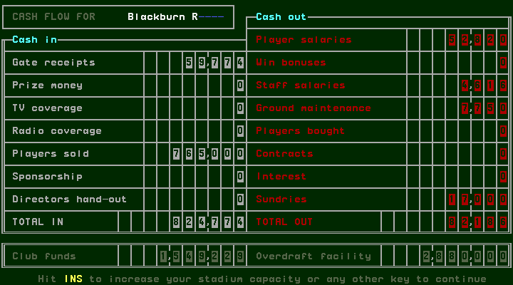

## W074 — Announced friendlies become actual fixtures

[confirmed] The prior Dec18 announcement did not disappear as a cancelled
fixture after Escape. Following league17, management shows Sevilla at home,
competition Friendly (step24). Enter→preparation→Enter first half→Space bench
→Enter second half completes Blackburn1–1Sevilla (step28). Space then shows
other teams' FA Cup results and the next draw (steps29/30), before accounts.
An arranged friendly can therefore share its week with a competition from
which the managed club has been eliminated.

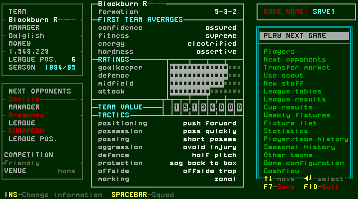
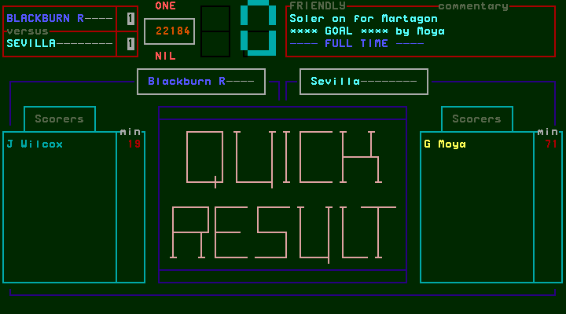

[confirmed] Space from the draw displays a new banner: Jan18, Celtic versus
Blackburn, Friendly arranged (step31). Escape continues to accounts (step32).
Later, after league20, management shows Celtic away, Friendly (step93); actual
play finishes Celtic1–2Blackburn (step97). Space again opens other teams' FA
Cup results and a semi-final draw (steps98/99), then accounts/news/main.
These dated announcements and later fixtures are observed; no scheduling
algorithm or guarantee for every empty week is inferred.

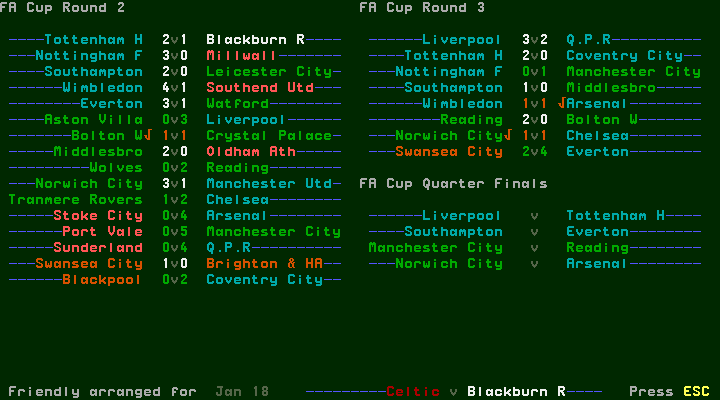
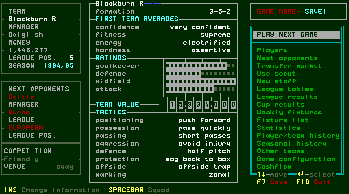
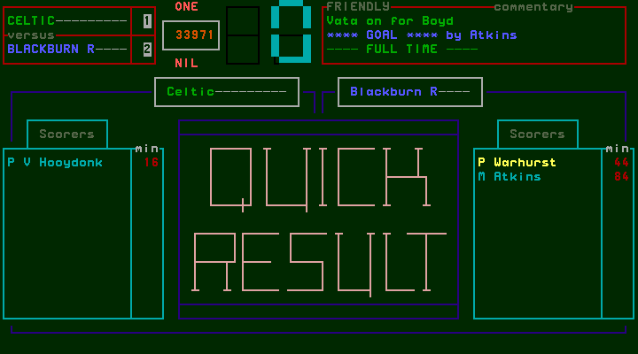

## W075 — Neutral final, injury replacement and winner celebration

[confirmed] After league18, management explicitly shows League Cup Final,
Wimbledon, venue neutral (step44). The incomplete side includes Hendry, whose
details show international and Can't play (step46). Enter on Hendry, navigate
to eligible recovered Sherwood and Enter moves him in (steps47–50). The first
navigation burst stopped at Newell (step48); an additional Down reached the
actual target. Escape→Up returns to PLAY NEXT GAME, with4-4-2 (step51).

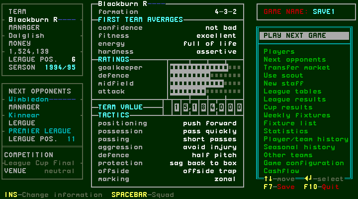
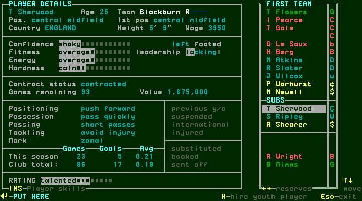

[confirmed] Enter opens preparation; Enter plays to halftime, Space returns
to the bench and Enter resumes (steps52–55). At2–1 the final stops for Berg's
injury (step55). Space→bench, Space→squad; navigate to Berg, inspect the injured
mark, then Enter picks him up. Down twice selects Ripley, whose injury mark is
clear (step61). Enter completes Ripley for Berg; Escape returns to a3-5-2 bench
with one substitution remaining, versus two on injury arrival (steps56/63).
The initial Down burst selected Warhurst at step58; two further Down keys
reached Berg before pickup. Requested repeat counts are not substitutes for
inspecting the actual selected player.

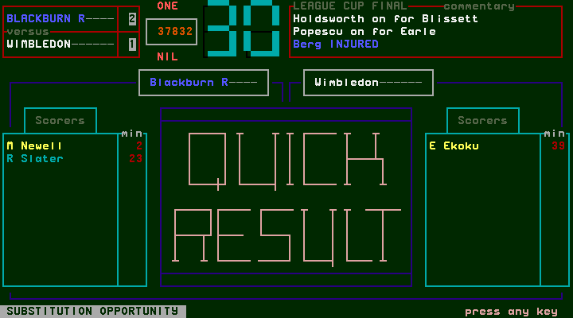
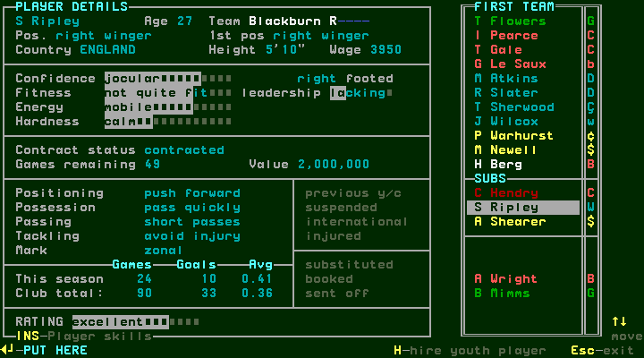
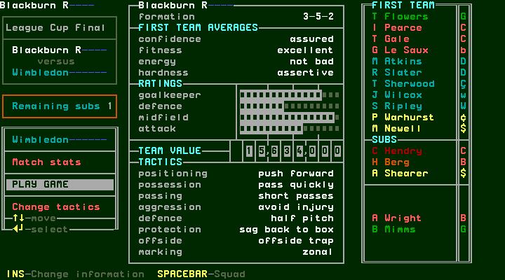

[confirmed] Enter resumes to actual fulltime Blackburn3–1Wimbledon (step64).
Space opens a congratulations screen headed Blackburn and ON WINNING THE
League Cup (step65), rather than going straight to results. Space opens the
completed cup results (step66); Space opens accounts (step67), showing prize
money25000 and funds1561953. Space then shows Manager of the Month over the
accounts (step68); Space returns to management (step69). F7 preserves the
cup-winning checkpoint (step70).

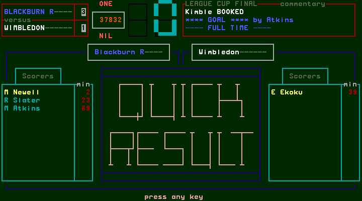
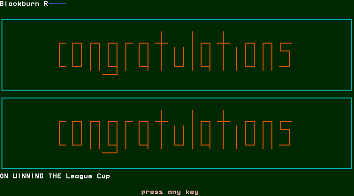
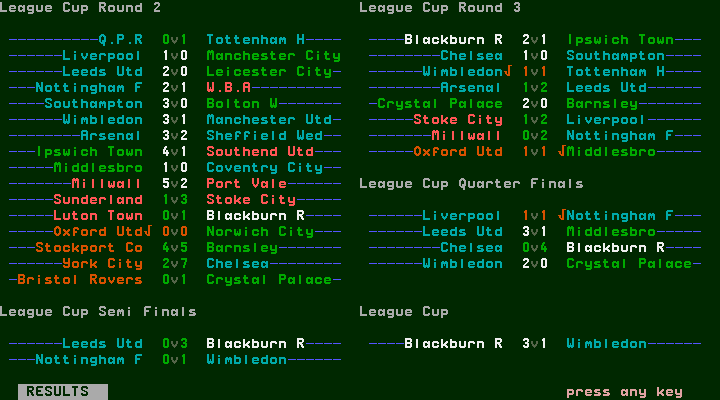
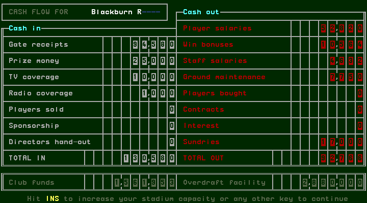

## W076 — Listed expiry and actual eligibility are separate observations

[confirmed] Slater's ten-week warning appears after the Sevilla week (step33).
N continues into news (step34). After league23 accounts the automatic editor
shows him retiring this year, zero games, wage1920 and proposed signing fee96000
(step137). Escape cancels into news (step138). Later details show listed, zero
games, Retiring this year and a talented rating, with no suspended/injured mark
(step146). That screen does not itself identify the missing starter.

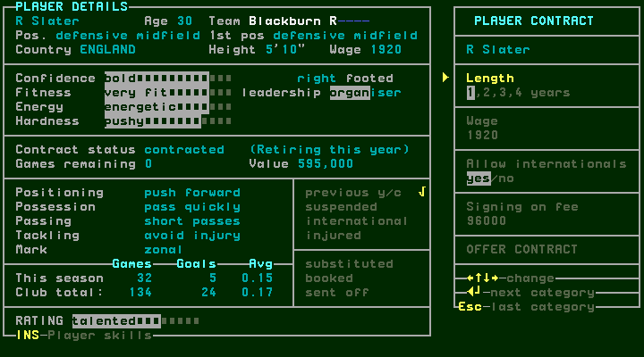
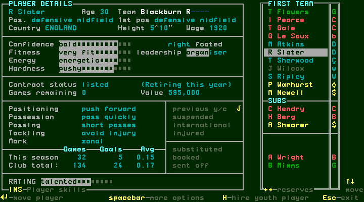

[confirmed] Wilcox instead shows suspended and Can't play (step147). Enter on
Wilcox, navigate to available Berg and Enter swaps them (steps149–151).
Escape→Up returns to management with4-4-2; Enter opens preparation containing
Slater, and PLAY GAME is admitted (steps152–154). The match actually completes
(step156). In this observed state, listed/zero alone did not prevent Slater
from appearing in the admitted first team. His later departure or retirement
remains unvisited; do not generalize from Marker's separate tribunal departure.

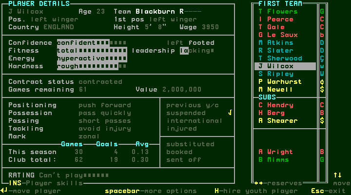
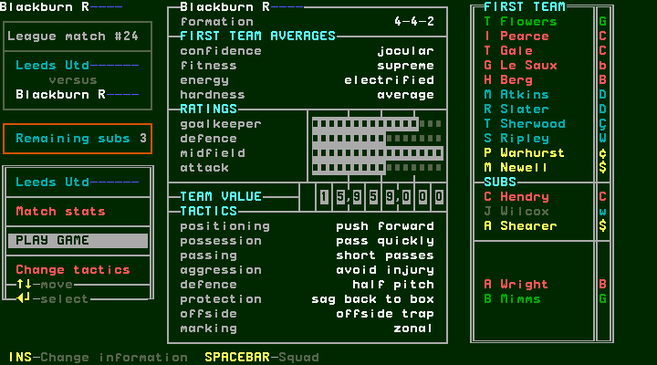

## W077 — Later weekly flow and league progression

[confirmed] The inherited Watch-off/avoid-injury scenario continues, with the
lineup changes above. Actual league outcomes are:

| Fixture | Actual result | Fulltime capture |
| --- | --- | --- |
| 17, home Sheffield Wed | Blackburn0–1Sheffield Wed | [19](../../runs/T60/session-r0001/step-0019.png) |
| 18, away Southampton | Southampton1–0Blackburn | [39](../../runs/T60/session-r0001/step-0039.png) |
| 19, home Coventry | Blackburn4–3Coventry | [74](../../runs/T60/session-r0001/step-0074.png) |
| 20, away Liverpool | Liverpool1–4Blackburn | [89](../../runs/T60/session-r0001/step-0089.png) |
| 21, home Q.P.R | Blackburn2–2Q.P.R | [106](../../runs/T60/session-r0001/step-0106.png) |
| 22, away Manchester Utd | Manchester Utd1–3Blackburn | [124](../../runs/T60/session-r0001/step-0124.png) |
| 23, home West Ham | Blackburn4–3West Ham | [133](../../runs/T60/session-r0001/step-0133.png) |
| 24, away Leeds | Leeds1–3Blackburn | [156](../../runs/T60/session-r0001/step-0156.png) |

[confirmed] Blank-opponent Euro cups weeks advance directly through other
teams' results and group tables (steps79–85 and110–120). A later blank-opponent
FA Cup SF week similarly advances through results, draw, accounts and news
without this club's preparation (steps139–144). The competition label and blank
opponent fields therefore matter when describing PLAY NEXT GAME. Other teams'
unplayed final pairings are scheduling, not completed outcomes.

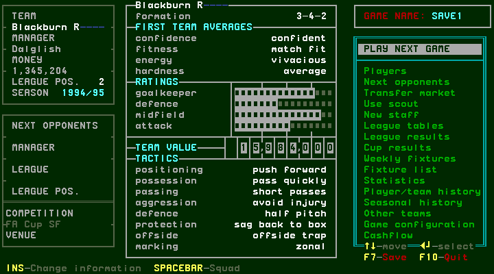

## W078 — Save the league-twenty-four endpoint

[confirmed] Fulltime Space opens league results; Space shows the table, Space
accounts, Space news and Space management (steps156–161). Blackburn's table row
shows P24,F52,A30,PTS32, second (step158). Accounts show in79902,out93139,
funds1266733 (step159). The next main menu is a blank-opponent Euro cups week,
4-4-2, still in1994/95. F7 saves at step162; the original session ends cleanly.
All163screens authenticate.

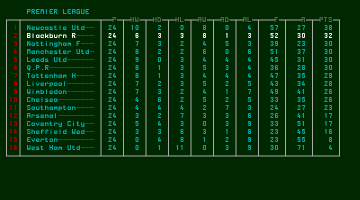
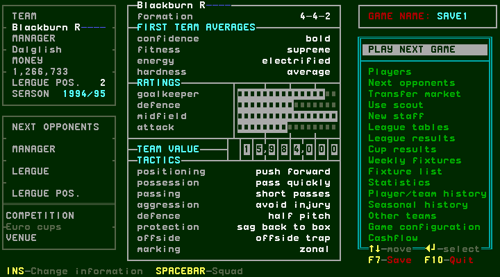

[confirmed] The [private archive receipt](../../runs/T60/private-backup-pending-r0001.json)
identifies the cup-winning and final league-twenty-four saves. Final save SHA256 is
`83ca2bc3761302dbdb86dc9833102d7bc9edf35b53a7e67424bbc22b1ef9ee07`.
Upload and public receipt publication require their separately recorded owner
approval; a pending receipt does not establish either operation completed.

[designed] Continue from this exact save through the remaining league fixtures,
European observer weeks and season finish/rollover. Required remaining
observations include eventual retiring-player outcomes, final competition/league
summaries, promotion/relegation and populated seasonal history. Stadium-completion
and unreached conditional branches remain separate coverage gaps. The complete
workflow/native audit and owner UI decision still follow the manual phase.
