# From preseason to league play

[confirmed] These are original One-Nil 96 observations from supplied SAVE1,
T54/session-r0001; full producer/release identities are in its
[session record](../../runs/T54/session-r0001/session.json). Host clock/seed are
uncontrolled. Scores describe this run, not deterministic expected results.
Watch match was disabled through configuration before the first fixture.

## W051 — Successive weeks and the first league match

[confirmed] PLAY NEXT GAME→Enter opens preparation, Enter starts the quick
first half; the halftime screen stops for a key. Space returns to the bench;
Enter plays the second half. For the four friendlies, fulltime Space opened
cash flow, Space transfer news, Space management. The opposition/venue and
competition changed on the next main menu; these were actual played fixtures.

| Fixture | Observed score | Fulltime capture |
| --- | --- | --- |
| Home P St Germain, Friendly1 | Blackburn0–2P St Germain | [step12](../../runs/T54/session-r0001/step-0012.png) |
| Away Sevilla, Friendly2 | Sevilla1–2Blackburn | [step19](../../runs/T54/session-r0001/step-0019.png) |
| Away Celtic, Friendly3 | Celtic2–2Blackburn | [step26](../../runs/T54/session-r0001/step-0026.png) |
| Home Zaglebie Lubin, Friendly4 | Blackburn2–0Zaglebie | [step33](../../runs/T54/session-r0001/step-0033.png) |

[confirmed] After Friendly4, management showed Nottingham F at home, League
match #1, with funds382027. Enter preparation→Enter first half→Space bench→Enter
second half produced1–1: Bohinen67 and Ripley68, attendance30989.

[confirmed] The post-league route adds two screens before cash flow. Space from
fulltime opens LEAGUE RESULTS MATCH NO #1; Space shows the league table; Space
opens cash flow. Blackburn's table row shows P1, HD1, goals1–1, PTS1. Clubs that
won their first match display PTS2. These observed values must not be replaced
with a modern three-point assumption. Tie-break rules are not established here.

## W052 — Expiring contract interrupts weekly processing

[confirmed] Space after this week's cash flow opened M Newell's PLAYER CONTRACT
rather than transfer news. He had0 games remaining, existing wage3950, while
the offer editor proposed1 year, wage3800, internationals yes and signing fee190000.
Exploratory Space and F7 left the editor unchanged: they were not management
return or successful-save evidence. The final save after completing the dialog
is recorded separately from the game file copied during this interruption.

[confirmed] Enter advances through wage, internationals, signing fee and OFFER
CONTRACT; Enter submits the defaults. The original reported CONTRACT ACCEPTED.
Space showed agreement ended; Space advanced to transfer news; Space returned
to management; F7 on that verified main menu saved. This is an accepted renewal
at an expiry interruption, unlike the refused proactive Flowers offer in
contracts.md. It does not establish universal wage or signing-fee thresholds.

## W053 — Incoming offer and completed sale during the week

[confirmed] League match2 away at Sheffield Wed ended1–3 to Blackburn. After
its results/table/cash screens, Space opened an incoming Honved Kispest offer
for C Sutton:715000, displayed value765000, listed,202 games remaining.
The prompt asks “Do you agree to sell Sutton (Y/N)?”. Y accepted; transfer news
then showed C Sutton Blackburn→Honved Kispest. Space returned to management;
Sutton's first-team slot was vacant. Displayed money was still179859 at that
point. The following week's cash flow showed Players sold715000 and funds864795.
This observes a completed sale and subsequent posting, not just a transfer listing.

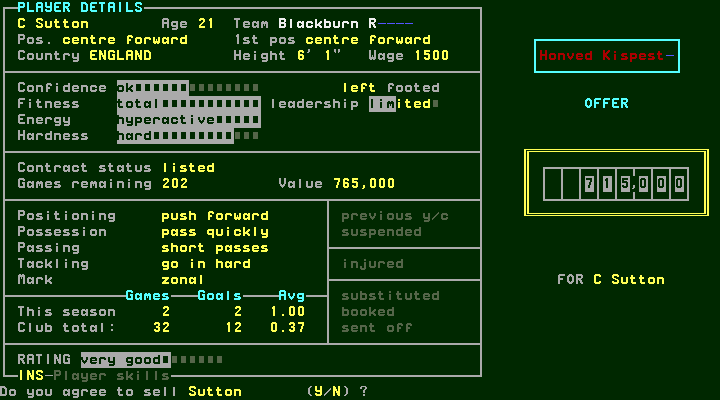
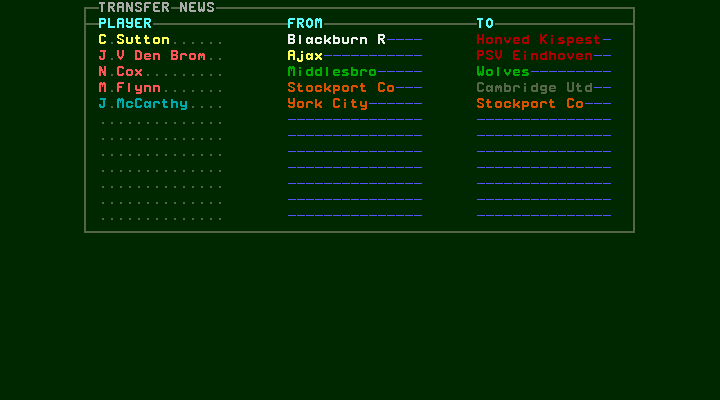
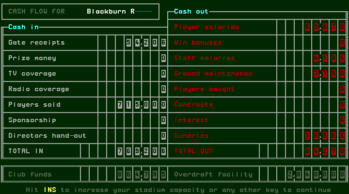

## W054 — International duty, suspension and an incomplete lineup

[confirmed] Attempting league match3 against Southampton was refused with
“Blackburn R has insufficient players : hit any key”. The preparation panel
showed a vacant slot and a3-3-1 formation. Space dismissed the message; Space
opened Players. C Hendry's details showed international checked and “Can't play”;
J Wilcox's showed suspended checked and “Can't play”. Neither screen showed
injured checked. These indicators explain the observed unavailable selections;
the run does not establish call-up or disciplinary thresholds.

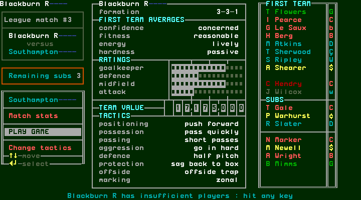
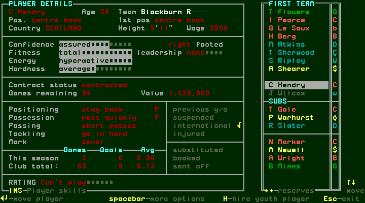
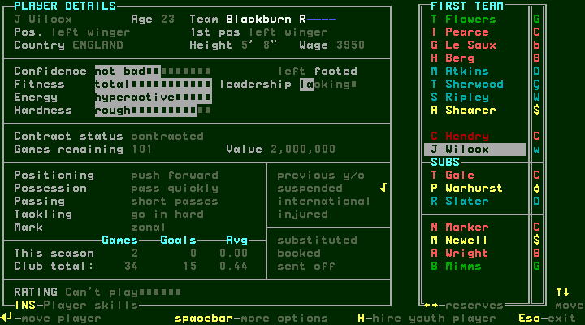

[confirmed] In Players, Enter picks up the selected player; arrows select a
replacement and Enter places/swaps. Warhurst replaced Wilcox; Gale replaced
Hendry. The original reordered the first team by displayed roles after these
changes, so subsequent row indices changed. Newell was then selected from the
lower squad rows and put in the actual remaining blank first-team slot.
His details now showed wage3800 and57 games remaining, confirming changed
contract state after W052 and another match. Escape returned to preparation
with a complete4-3-3; Enter admitted the fixture. Do not reuse the earlier
exploratory “empty-forward-slot” label: that capture actually selected Warhurst;
the final blank target was separately captured before placement.

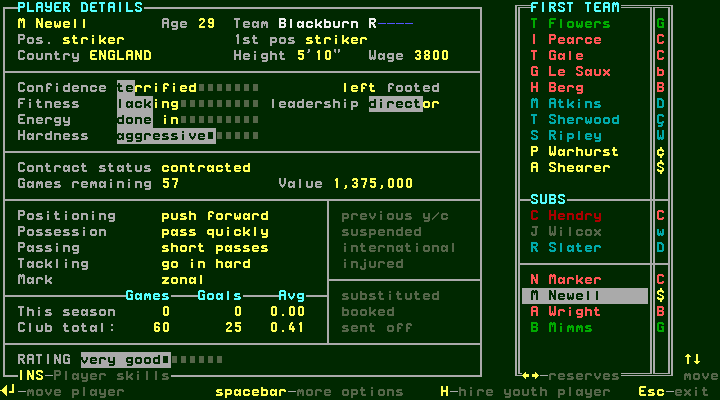
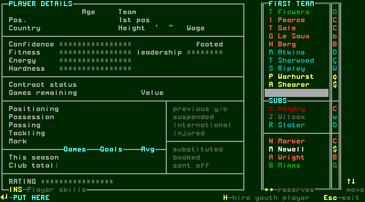
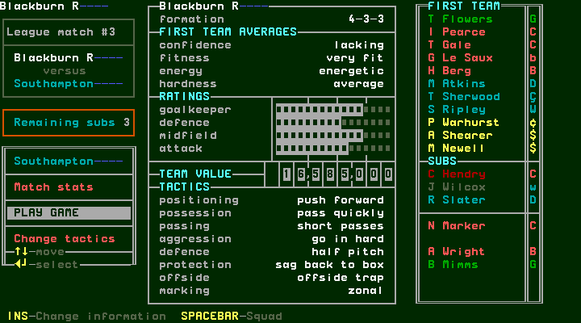

## W055 — Cup injury interruption, replacement and next-round draw

[confirmed] After league match3, the next fixture was League Cup Round1 at home
to Portsmouth. The quick first half stopped at SUBSTITUTION OPPORTUNITY with
“Shearer INJURED”, score2–0. Space opened the bench; an initial Enter resumed
but reached the opportunity again before halftime. Space→bench, Space→Players
opened direct MAKE SUBSTITUTION. From Flowers, ten Down inputs selected Shearer;
his fitness read injured and the injured indicator was checked.

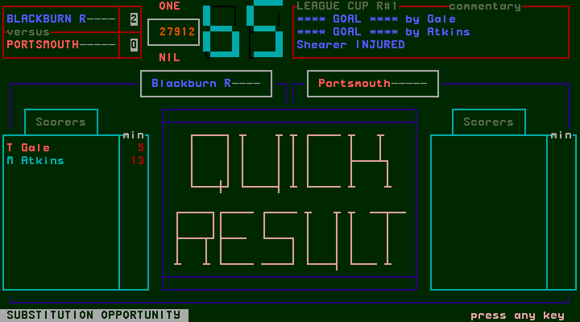
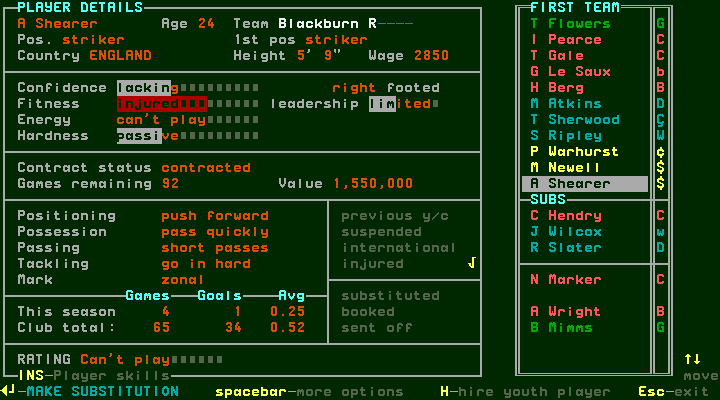

[confirmed] Enter entered PUT HERE; three Down inputs selected R Slater; Enter
made the replacement. Escape returned to a4-4-2 bench with Remaining subs2,
down from3. Enter resumed to the actual halftime2–0. Space→bench, Enter played
the second half to fulltime3–0. Thus the earlier capture labelled “cup-one-full”
was an injury interruption, not fulltime; the true fulltime is step107.

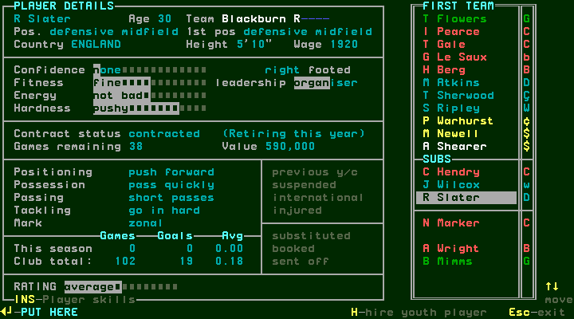
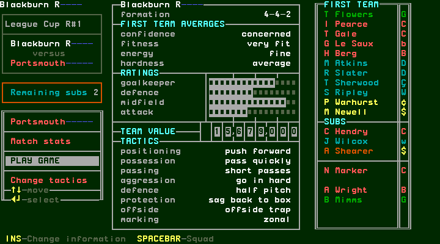
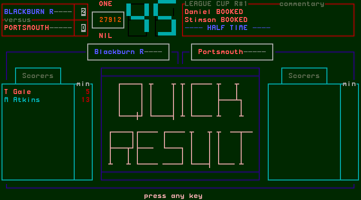
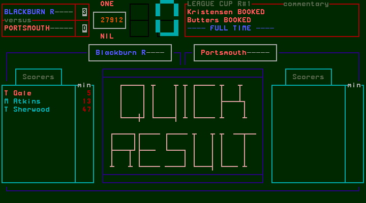

[confirmed] Space from fulltime showed League Cup Round1 RESULTS including the
3–0 score; Space showed CUP DRAW for Round2, Luton Town versus Blackburn.
This is observed progression for this win. A checkmark appears beside another
tied pairing in the results; its tie-resolution meaning is not established by
Blackburn's non-tied match. Extra time, penalties and losing-round flows remain
separate conditional coverage.

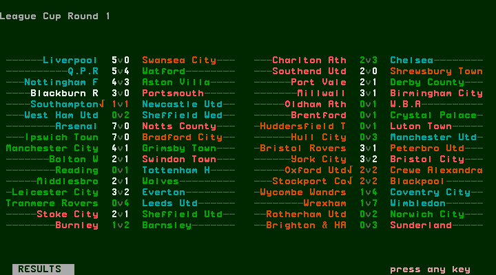
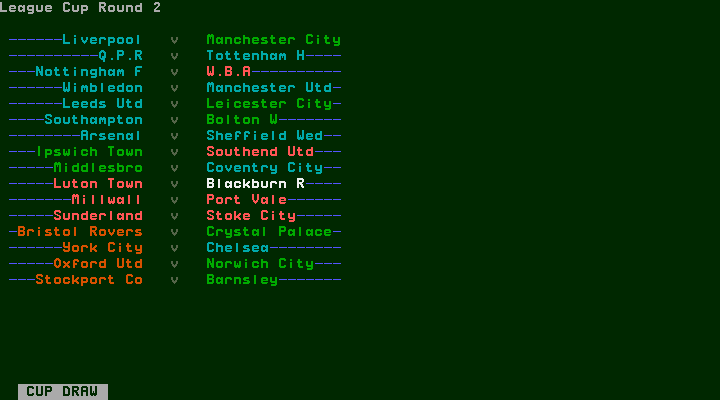
