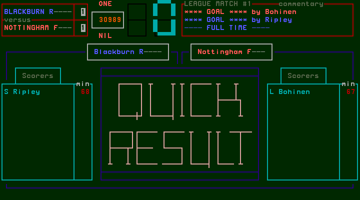
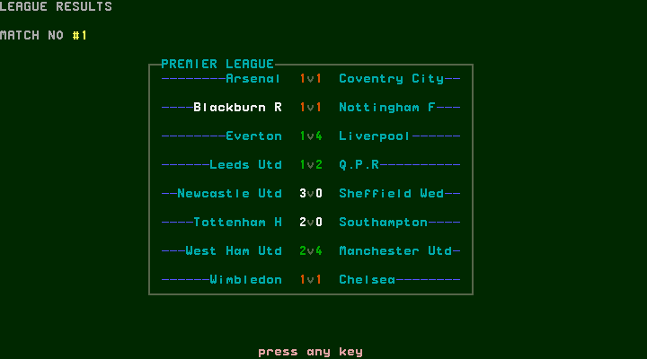
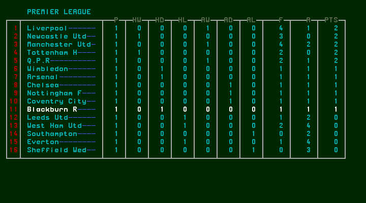
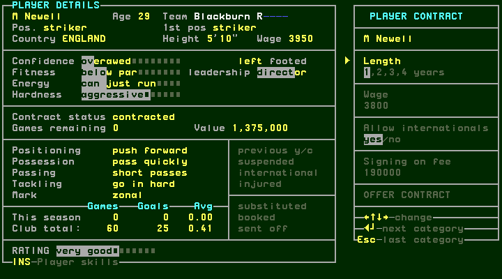
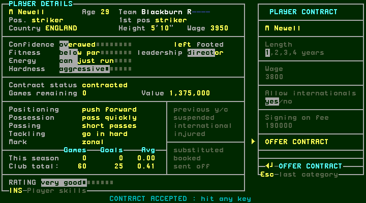
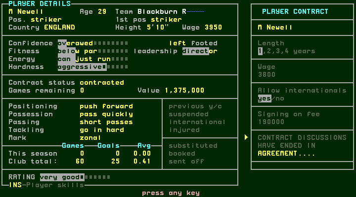
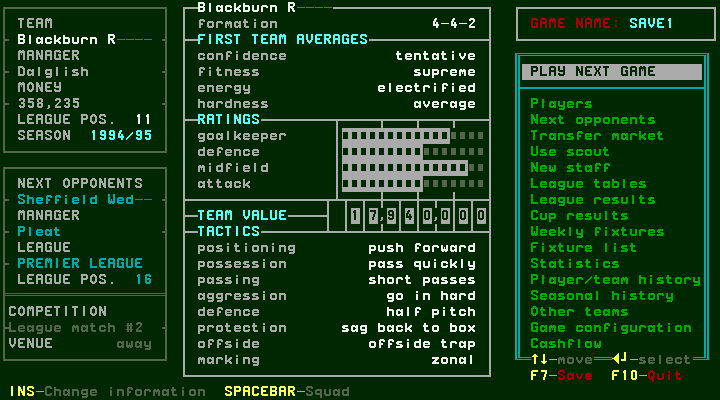

# From preseason to league play

[confirmed] These are original One-Nil 96 observations from supplied SAVE1,
T54/session-r0001; full producer/release identities are in its
[session record](../../runs/T54/session-r0001/session.json). Host clock/seed are
uncontrolled. Scores describe this run, not deterministic expected results.
Watch match was disabled through configuration before the first fixture.

## W051 — Successive weeks and the first league match

[confirmed] PLAY NEXT GAME→Enter opens preparation, Enter starts the quick
first half; the halftime screen stops for a key. Space returns to the bench;
Enter plays the second half. For the four friendlies, fulltime Space opened
cash flow, Space transfer news, Space management. The opposition/venue and
competition changed on the next main menu; these were actual played fixtures.

| Fixture | Observed score | Fulltime capture |
| --- | --- | --- |
| Home P St Germain, Friendly1 | Blackburn0–2P St Germain | [step12](../../runs/T54/session-r0001/step-0012.png) |
| Away Sevilla, Friendly2 | Sevilla1–2Blackburn | [step19](../../runs/T54/session-r0001/step-0019.png) |
| Away Celtic, Friendly3 | Celtic2–2Blackburn | [step26](../../runs/T54/session-r0001/step-0026.png) |
| Home Zaglebie Lubin, Friendly4 | Blackburn2–0Zaglebie | [step33](../../runs/T54/session-r0001/step-0033.png) |

[confirmed] After Friendly4, management showed Nottingham F at home, League
match #1, with funds382027. Enter preparation→Enter first half→Space bench→Enter
second half produced1–1: Bohinen67 and Ripley68, attendance30989.

[confirmed] The post-league route adds two screens before cash flow. Space from
fulltime opens LEAGUE RESULTS MATCH NO #1; Space shows the league table; Space
opens cash flow. Blackburn's table row shows P1, HD1, goals1–1, PTS1. Clubs that
won their first match display PTS2. These observed values must not be replaced
with a modern three-point assumption. Tie-break rules are not established here.

## W052 — Expiring contract interrupts weekly processing

[confirmed] Space after this week's cash flow opened M Newell's PLAYER CONTRACT
rather than transfer news. He had0 games remaining, existing wage3950, while
the offer editor proposed1 year, wage3800, internationals yes and signing fee190000.
Exploratory Space and F7 left the editor unchanged: they were not management
return or successful-save evidence. The final save after completing the dialog
is recorded separately from the game file copied during this interruption.

[confirmed] Enter advances through wage, internationals, signing fee and OFFER
CONTRACT; Enter submits the defaults. The original reported CONTRACT ACCEPTED.
Space showed agreement ended; Space advanced to transfer news; Space returned
to management; F7 on that verified main menu saved. This is an accepted renewal
at an expiry interruption, unlike the refused proactive Flowers offer in
contracts.md. It does not establish universal wage or signing-fee thresholds.

