# Preparing a match

[confirmed] The main procedure uses original One-Nil 96 supplied SAVE1:
Blackburn R, 1994/95, the home Friendly #1 against P St Germain.
[T47/session-r0001](../../runs/T47/session-r0001/session.json) identifies its
committed producer/release and contains the exact keys and rendered screenshots.
The captures establish this fixture's workflow; league/cup-specific substitution
limits and later match events are separate coverage.

## W018: inspect the opponent and configuration

[confirmed] From the loaded main menu, Down twice then Enter opens **Next
opponents** (S026). The club browser starts on P St Germain in EUROPEAN, with
formation, team averages, ratings, value, tactics and the named squad. It shows
Up/Down to move, Left/Right for division, Insert for information, Space for squad
and Escape to exit. Escape returns to the main menu. Only entry and exit were
exercised in this viewer; its other shortcuts are not established by their hints.

[confirmed] Select **Game configuration** and Enter to open S027. The visible
entries are Watch match, Sacking, Auto save game, Friendlies, Auto player select
and Continue. The supplied save initially shows ticks beside all six entries.
Enter on Watch match changes its tick to x; another Enter restores the tick.
Escape returns to the main menu. This procedure restores Watch match before
starting the fixture. Evidence: session-r0001 steps 1–9.

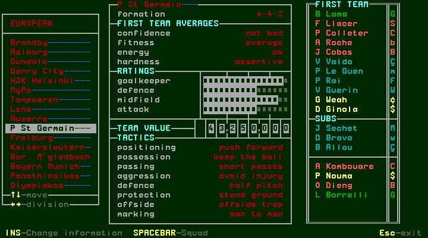
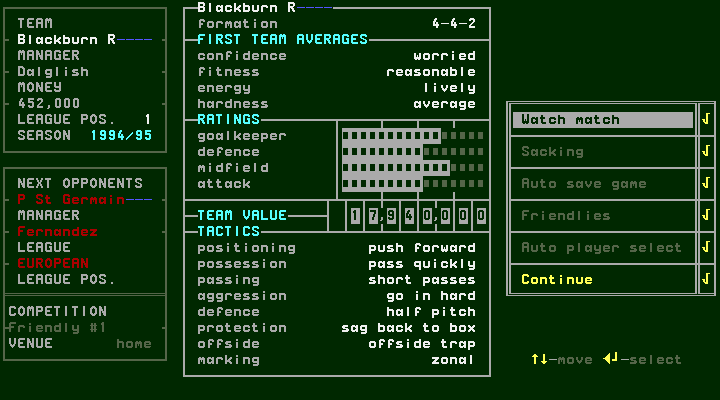

## W019: enter match preparation

[confirmed] Highlight **PLAY NEXT GAME**, then Enter. In this supplied-save
scenario it opens S028 match preparation directly, showing Friendly #1,
Blackburn R versus P St Germain and **Remaining subs 9**. The main left menu has
P St Germain, Match stats, PLAY GAME and Change tactics; PLAY GAME is initially
highlighted. The centre shows formation, averages, ratings, value and team
instructions; the right shows the first team/substitutes/lower squad. Insert
and Space hints remain visible at the bottom.

[confirmed] Evidence: steps 10–11. “Remaining subs 9” is observed for this
friendly; it must not be applied as a universal competition rule. This route
also does not prove that every future PLAY NEXT GAME skips weekly dialogs.

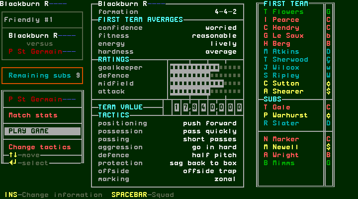

## W020: edit team instructions

[confirmed] Down from PLAY GAME highlights **Change tactics**; Enter opens S029.
Up/Down selects one of the eight instruction rows, Enter changes its value and
Escape returns to the pre-match menu. Up from Positioning wraps to Marking.
The editor retained its changed settings when exited; Escape is an exit here,
not a rollback button. These are the displayed choices exercised in this run:

| Team instruction | Observed choices | Example change capture |
| --- | --- | --- |
| positioning | push forward / stay back | [14](../../runs/T47/session-r0001/step-0014.png) |
| possession | pass quickly / keep the ball | [23](../../runs/T47/session-r0001/step-0023.png) |
| passing | short passes / long passes | [26](../../runs/T47/session-r0001/step-0026.png) |
| aggression | go in hard / avoid injury | [29](../../runs/T47/session-r0001/step-0029.png) |
| defence | half pitch / full pitch | [32](../../runs/T47/session-r0001/step-0032.png) |
| protection | sag back to box / stand ground | [37](../../runs/T47/session-r0001/step-0037.png) |
| offside | offside trap / play safe | [41](../../runs/T47/session-r0001/step-0041.png) |
| marking | zonal / man to man | [18](../../runs/T47/session-r0001/step-0018.png) |

[confirmed] Evidence: steps 12–43. Enter was repeated to revisit prior values
for each row. The final example keeps stand ground for Protection; the other
instruction values are back at their starting settings. These observations do
not establish the engine's tactical formulas or every player's override rules.
See [individual instructions](selection.md) for the separate player editor.

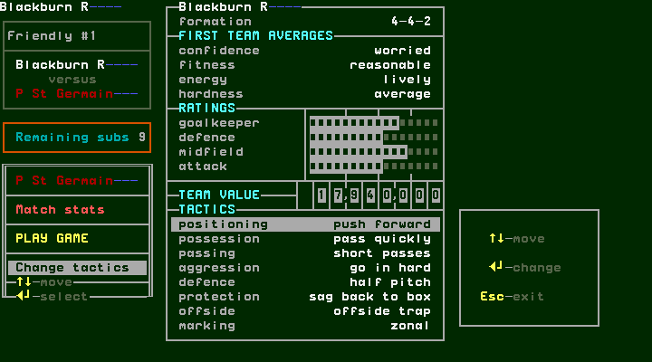
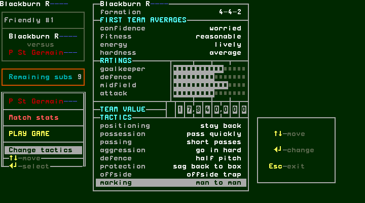
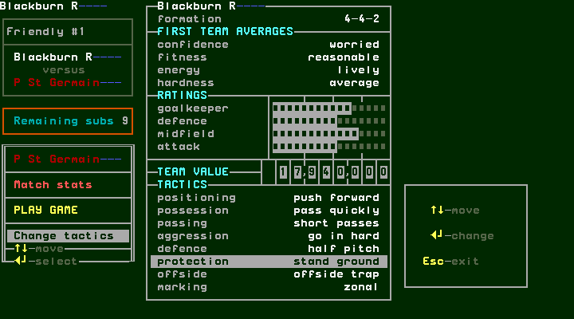

## W021: change the displayed formation through player positions

[confirmed] Space from pre-match opens Players. Select I Pearce, Space options,
then Reposition until his current Pos. is centre forward. His 1st pos remains
centre back. In this run ten Enter presses from centre back reached centre
forward. Escape from options and Escape from Players returns to S028, whose
formation now reads **3-4-3**, previously **4-4-2**.

[confirmed] Reopen Players/that player's options, highlight **Club position**
and Enter to restore centre back. Exit both views: the pre-match formation is
**4-4-2** again. Evidence: steps 46–58. The team instruction editor selects eight
instruction rows; Formation is displayed above them. This procedure establishes
the position-based formation change observed here, not every possible formation.

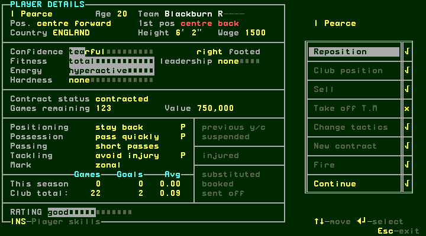

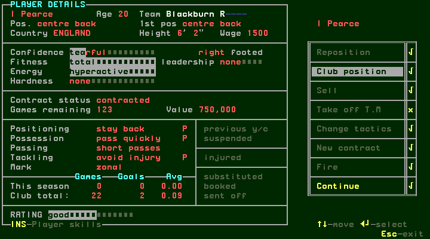
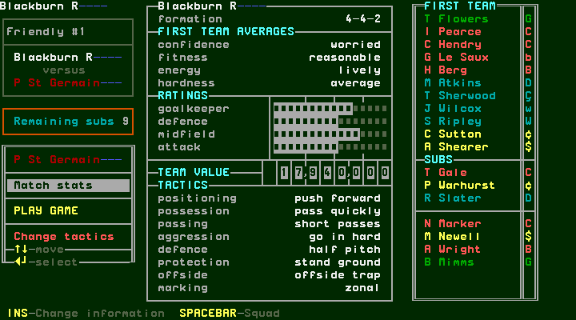

## W022: view pre-match statistics and start the watched fixture

[confirmed] Select **Match stats**, then Enter. S030 shows the score at 0–0,
attendance 25,841 in this run, an empty commentary panel, scorers/minute columns,
and both teams' Corners, Free kicks, Penalties, Shots, On target, Saves, Fouls,
Bookings and Red cards, initially zero. Possession and Territory bars are below.
The footer says **press any key**; Space returns to match preparation.

[confirmed] Highlight **PLAY GAME**, then Enter. With Watch match ticked, S031
shows the actual pitch, players and ball. The opening commentary is “Sutton
wins the toss” and “Sutton to take kick off”. The footer advertises Up/Down for
display, Left/Right for speed (23 here), R for result, Space for commentary,
F9 for sound, and Escape/Enter for bench. These controls are visible here;
exercising them and following halftime/fulltime belongs to the watched-match
procedure. This capture session ended after the kickoff illustration.

[confirmed] Evidence: statistics steps 44–46; watched start 59–60.

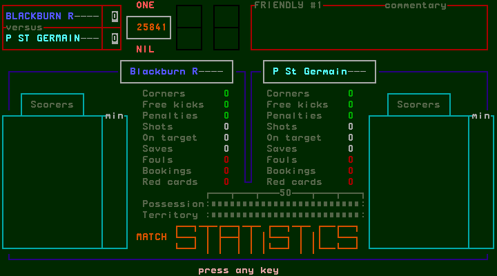
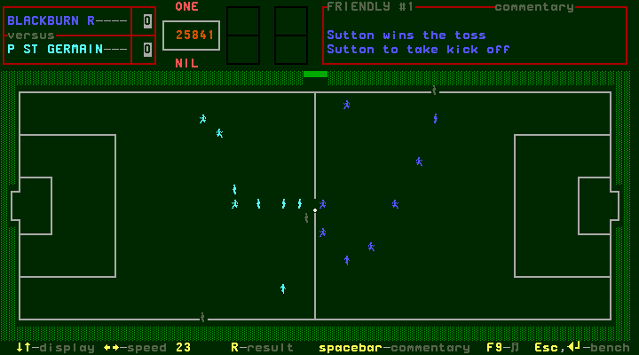

## Scope and remaining matchday branches

[confirmed] Watched controls/speeds, bench/substitutions, halftime, fulltime,
commentary history, quick results and weekly results remain pending their own
captures. The separate invalid-selection scenario below must be read with its
actual configuration and lineup; an attempted route that opened another menu
is retained as exploration, not evidence of admission behavior.

## W023: an incomplete lineup is refused at PLAY GAME

[confirmed] In a fresh supplied-save session, open Game configuration and move
the highlight to **Auto player select**. Enter changes its tick to x; Escape
returns to the main menu. Space opens Players. With T Flowers selected, Enter
starts a move, Right changes the destination list to RESERVES, and Enter puts
him into its initially empty first row. Left returns to FIRST TEAM: the other
starters have shifted up, leaving the final first-team row empty. Escape returns
to the main menu with Players highlighted; Up selects PLAY NEXT GAME.

[confirmed] Enter still opens match preparation with the incomplete lineup.
Pressing Enter on **PLAY GAME** then displays S034:
**“Blackburn R has insufficient players : hit any key”**. Space dismisses the
message and returns to match preparation; no match begins. This establishes the
refusal with ten visible starters and automatic selection disabled. It does not
establish the separate missing-goalkeeper-only warning, injury/suspension checks
or the automatic-selection-enabled repair behavior.

[confirmed] Evidence: [T47/session-r0003](../../runs/T47/session-r0003/session.json),
steps 0–20. Step 9 verifies the x on Auto player select; 12–15 show the reserve
move; 18 is incomplete preparation, 19 refusal and 20 dismissal. This scenario
was not saved and did not modify the verified release.

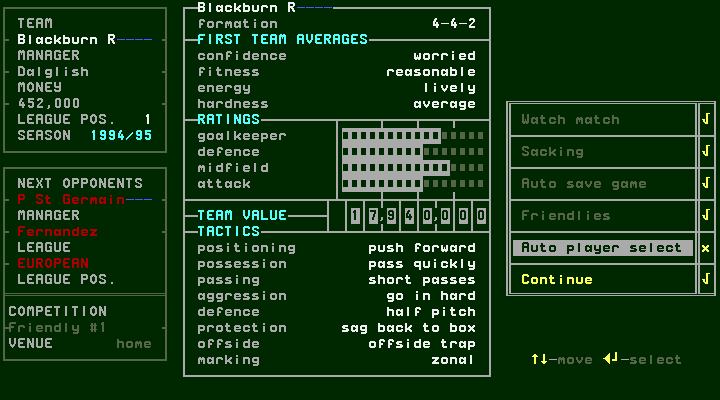
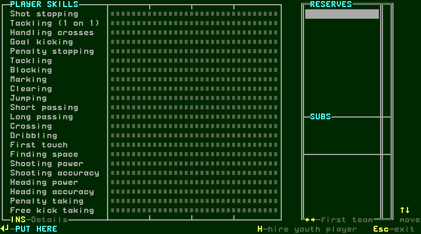
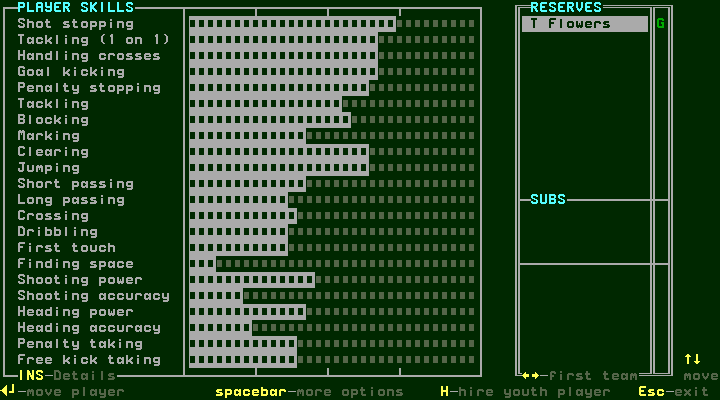
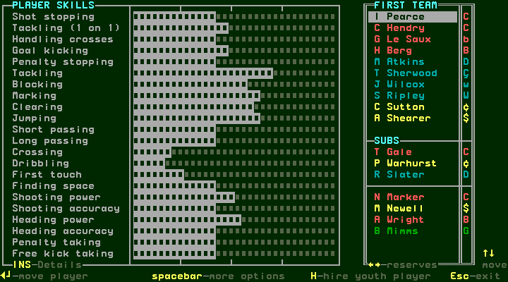

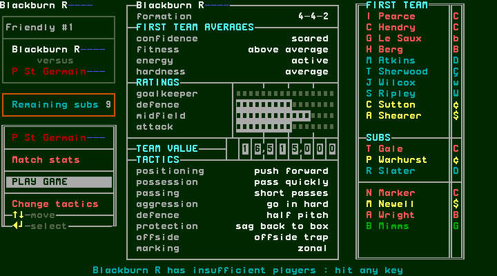
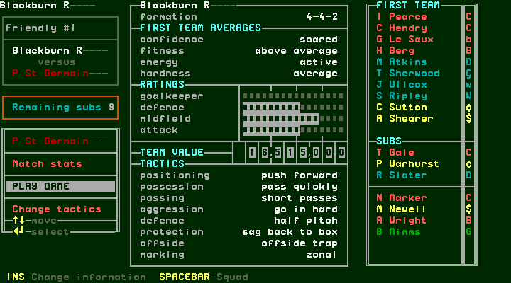

[confirmed] The preceding session-r0002 is retained as aborted exploration.
Some rapidly repeated harness keys did not reach their intended highlights;
returning from Players also selected Players on the main menu, so assuming an
old configuration-menu selection led to Transfer market. Its screen labels are
exploratory intent, not verified classifications. It supplies no invalid-lineup
admission claim. The procedure above follows the actual captured highlights.
