# Midseason: elimination, contracts and cup progression

[confirmed] This chapter follows the original One-Nil 96 from the league-ten
save through league sixteen. Evidence is the completed
[T59 session](../../runs/T59/session-r0001/session.json), producer `b2ecf63`;
its metadata records the full commit and release identities. Adjacent step JSON
files record exact commands, text and screenshot hashes. Scores describe this
uncontrolled-clock run, not deterministic results or native simulation.

## W065 — Resume the saved season and progress through league sixteen

[confirmed] The [save input](../../runs/T59/save-input-r0001.json) is T56's
league-ten SAVE1, SHA256
`c43fd8ffc31a17e5fc460541cbb6ef5448689830a4b0cc8b1933c5f423edddb0`.
At startup the save was copied into the scratch game directory; restart then
copied only game saves into a verified release before mounting a fresh process.
[Step1](../../runs/T59/session-r0001/step-0001.json) records different old/new
process IDs and matching save/restored hashes. Y loaded management at step2,
whose decoded-text digest exactly matches T56's saved endpoint. No savestate
was used to restore game persistence.

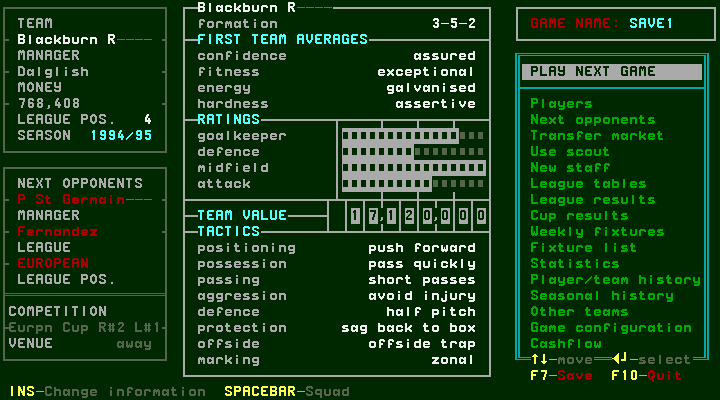

[confirmed] Watch match remained off and aggression remained avoid injury.
PLAY NEXT GAME→Enter opened preparation for an actual managed fixture; Enter
on PLAY GAME played to halftime, Space returned to the bench, and Enter resumed.
Injury and extra-time interruptions below add states to that ordinary path.

| League fixture | Actual score | Fulltime capture |
| --- | --- | --- |
| 11, home Arsenal | Blackburn 1–1 Arsenal | [16](../../runs/T59/session-r0001/step-0016.png) |
| 12, away Tottenham | Tottenham 0–3 Blackburn | [53](../../runs/T59/session-r0001/step-0053.png) |
| 13, home Newcastle | Blackburn 3–1 Newcastle | [87](../../runs/T59/session-r0001/step-0087.png) |
| 14, home Chelsea | Blackburn 1–2 Chelsea | [108](../../runs/T59/session-r0001/step-0108.png) |
| 15, away Wimbledon | Wimbledon 0–3 Blackburn | [140](../../runs/T59/session-r0001/step-0140.png) |
| 16, away Nottingham F | Nottingham F 1–0 Blackburn | [170](../../runs/T59/session-r0001/step-0170.png) |

[confirmed] After league eleven, Space from accounts went directly to management
(steps19→20). After league sixteen, accounts went through transfer news before
management (steps173→174→175). Therefore a transfer-news screen is not established
as an unconditional step after every accounts screen.

## W066 — European elimination and the following group stage

[confirmed] European Round2 Leg1 away to P St Germain finished 2–2 (step6).
Its results showed first-leg 2v2 with the second leg blank (step7). After league
eleven, the return at home finished Blackburn 1–2 P St Germain (step24).
Results displayed P St Germain 4v3 Blackburn, with first leg 2v2 and second
leg 1v2 (step25). This is an observed completed aggregate defeat.

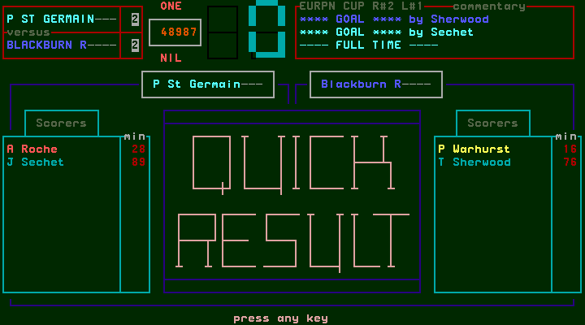
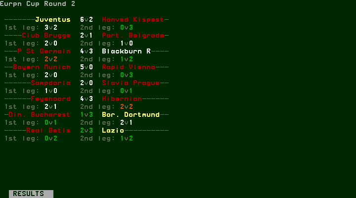

[confirmed] The subsequent draw combines completed Round2 ties with unplayed
future fixtures (step28). After league thirteen, management showed competition
Euro cups but blank opponent, manager, league and venue fields (step92).
Enter went directly to other teams' European results (step93), without this
club's preparation or match. Space displayed the EUROPEAN CUP GROUP STAGE
table (step94), with two groups and the explicit rule that the Group A winner
plays the Group B winner in the final. The observed table has P St Germain in
Group A; Blackburn is absent.

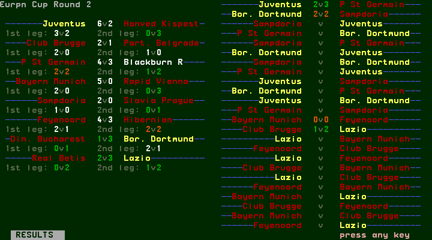
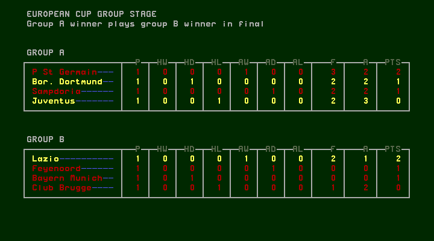

[confirmed] Space continued to Cup Winners results, UEFA results and accounts
(steps95–97). Their quarter-final headings do not establish a European Cup
quarter-final format: the European Cup's own group-stage screen is the evidence
for that competition. Later group completion and the final remain unvisited.

## W067 — Injury replacement, recovery and international absence

[confirmed] League twelve stopped at a substitution opportunity with Wilcox
injured (step45). Space opened the bench; Space opened the squad. It initially
showed skills, so Insert changed to details. After selecting Wilcox, his injured
mark and Can't play rating were visible (step48). Enter picked him up; Down
selected eligible Gale (step50); Enter completed the substitution. Escape
returned to a 4-4-2 bench with two substitutions remaining (step52), then Enter
resumed to fulltime. Avoid injury was active; it did not prevent this injury.

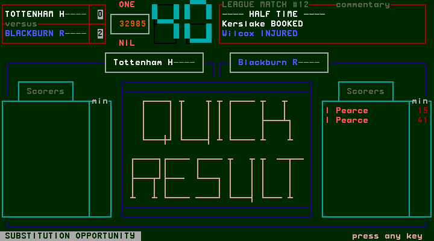
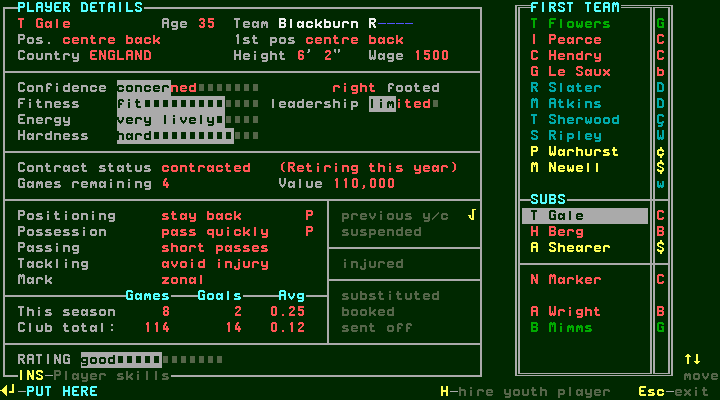
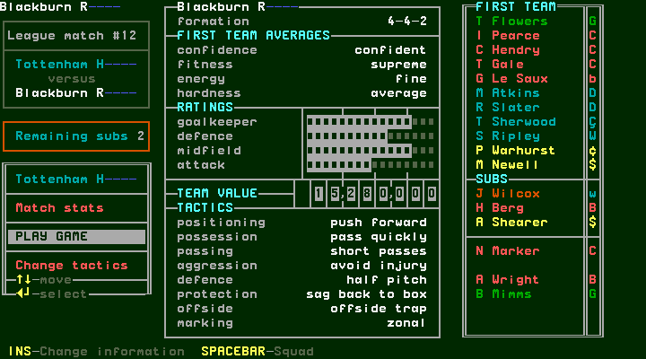

[confirmed] After that week Wilcox's injury mark was clear and his rating was
excellent (step59). Hendry instead showed international and Can't play (step61).
Enter on Hendry, navigation to Wilcox, then Enter moved the recovered player
into the side (steps64–66). Management showed a complete 3-5-2 before the cup
quarter-final (step68). These observations do not establish a universal injury
duration or international calendar.

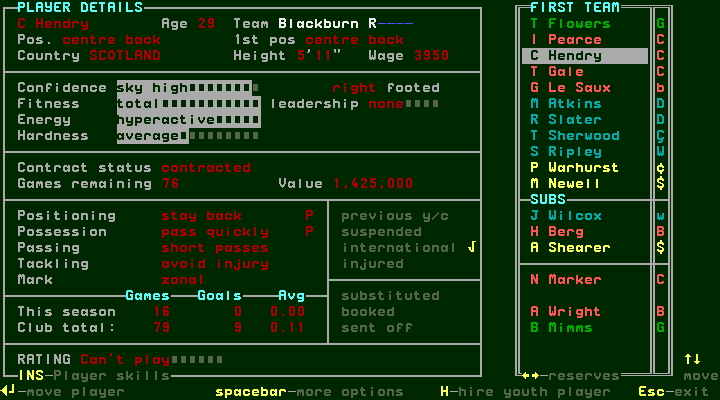
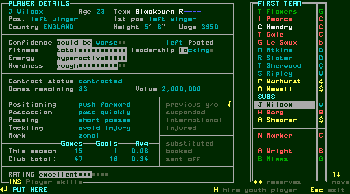

## W068 — Expiry cancellation leaves a listed squad member

[confirmed] After the League Cup quarter-final accounts, Marker automatically
entered PLAYER CONTRACT with zero games remaining. His old wage was 2,850;
the editor offered one year, wage 2,350 and signing fee 117,500 (step76).
Escape from the first category cancelled into transfer news (step77).
After returning to management, Space opened the squad and selecting Marker
showed status listed, zero games, wage 2,850 and continued squad membership
(step81). No agreed renewal, release or completed transfer was observed.

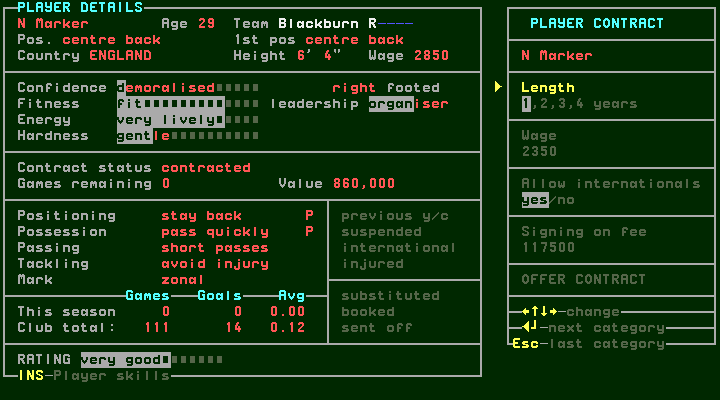
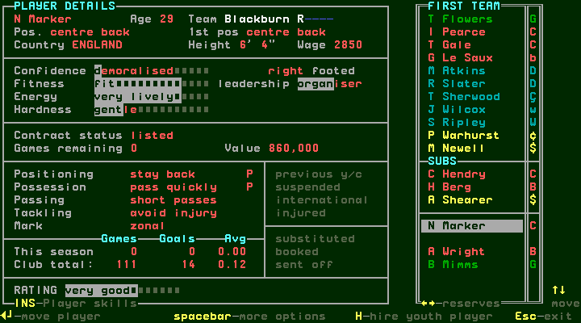

[derived] In this observed expiry route, proceeding without an agreement
results in a listed player who remains in the squad. Do not describe Escape
as an immediate release or a contract extension.

## W069 — Renew a player still marked as retiring

[confirmed] During the later European week, Gale's automatic editor showed zero
games remaining and Retiring this year (step98). Defaults were one year, wage
1,500 and signing fee 75,000. Enter advances categories; the exploratory burst
at step99 stopped at Signing on fee, and step100 reached OFFER CONTRACT.
Only the next Enter actually submitted it, displaying CONTRACT ACCEPTED
(step101). Space showed agreement (step102); another Space returned to news
(step103), and Space reached management (step104).

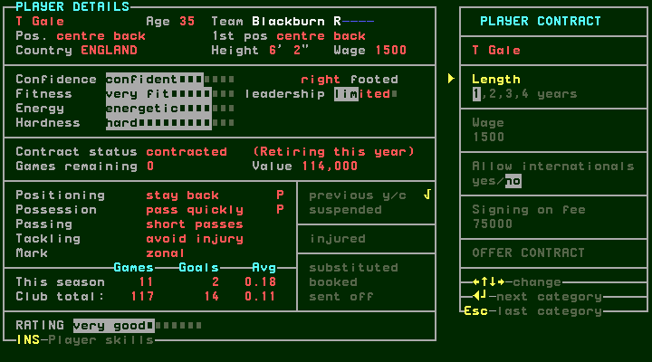
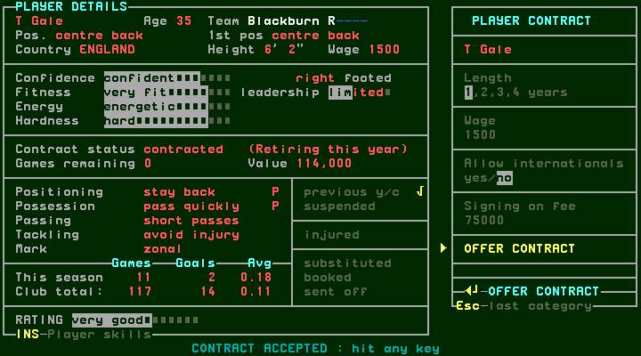

[confirmed] The following accounts showed Contracts 75,000 (step111). Later
details showed Gale contracted, wage 1,500 and 57 games remaining, while still
displaying Retiring this year (step114). Thus acceptance and an updated contract
are observed; whether he ultimately retires at season end is not established.

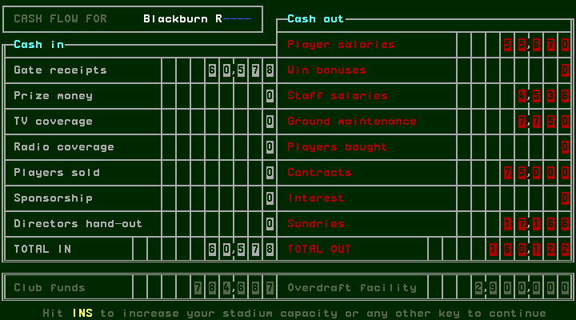
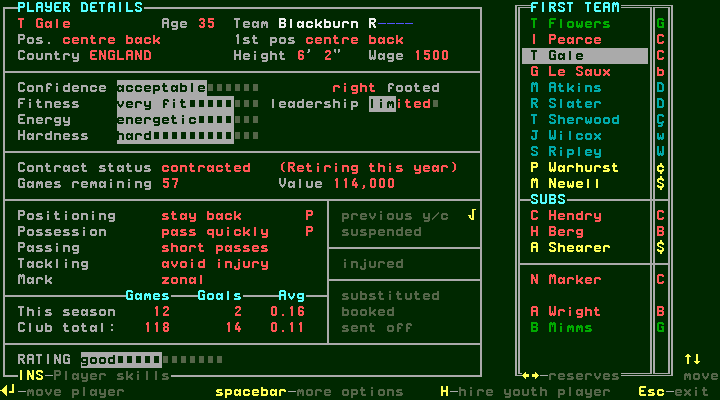

## W070 — Domestic cups, extra time and neutral semi-final

[confirmed] FA Cup Round1 finished Blackburn 5–0 Charlton (step37), then Space
opened results and a Round2 draw against Tottenham (steps38/39). League Cup
quarter-final away to Chelsea finished Chelsea 0–4 Blackburn (step72), followed
by results and the semi-final pairing against Leeds (steps73/74).

[confirmed] FA Cup Round2 stopped for Sherwood's injury (step117). Space→bench,
Space→squad, select Sherwood→Enter, Down to eligible Hendry→Enter completed
the replacement; Escape returned to a 4-4-2 bench with two subs remaining
(steps118–124). Enter resumed to halftime (step125), Space returned to the bench,
and further Enter commands passed additional bench intervals (steps127/128).
Fulltime was Tottenham 2–1 Blackburn, Klinsmann's winning goal at106 minutes
(step129). Space opened results and the next draw without Blackburn (130/131).

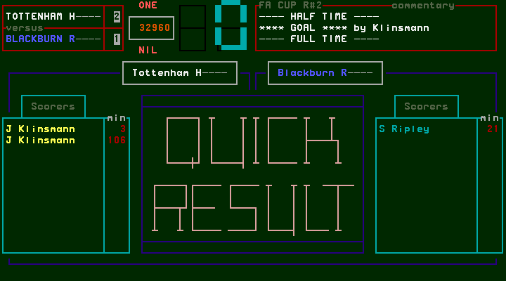

[confirmed] Later management explicitly showed League Cup SF, venue neutral
(step145). After the injury procedure in W071, fulltime was Blackburn 3–0 Leeds
(step161). Space opened results, then a draw listing Blackburn versus Wimbledon
(steps162/163). The captured semi-final is a completed neutral fixture, without
two leg fields. The listed final was not played in this task.

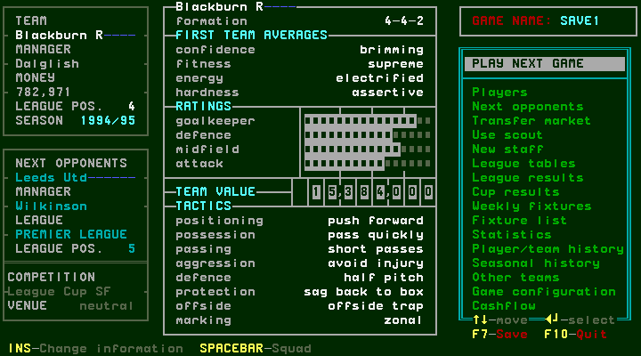
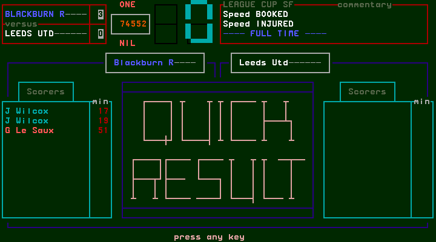
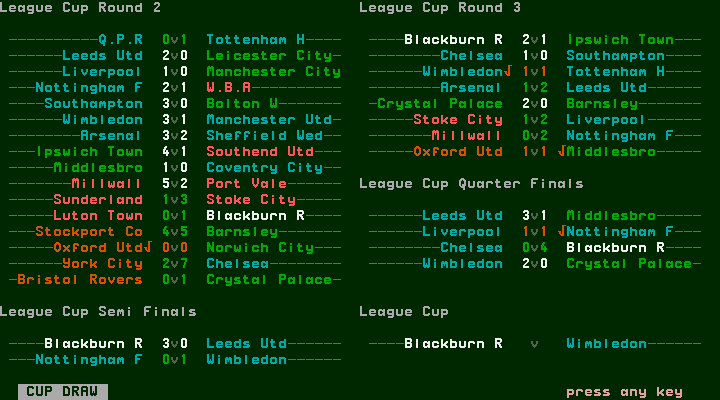

## W071 — Inspect actual selection and cancel before committing a move

[confirmed] The semi-final stopped for Ripley's injury (step147). Space opened
the bench, then Space the squad. A repeated Down burst actually selected Newell
(step150), despite its exploratory intent label naming Ripley. Enter picked up
Newell, and Down selected injured Ripley as the target (step152). Escape cancelled
that pending move, leaving Ripley selected and restoring MAKE SUBSTITUTION
(step153). No replacement had been completed by those steps.

[confirmed] Enter now picked up Ripley. Down reached Sherwood, who was still
injured and unable to play (step155), so another Down selected eligible Berg
(step156). Enter completed Berg for Ripley; Escape returned to the bench
(step158). Its remaining count was one, versus two on arrival at step148.
The side changed to 5-3-2. Actual screen state takes precedence over exploratory
labels and requested repeat counts, which can outpace the original's input loop.

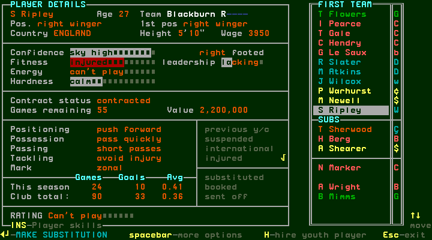
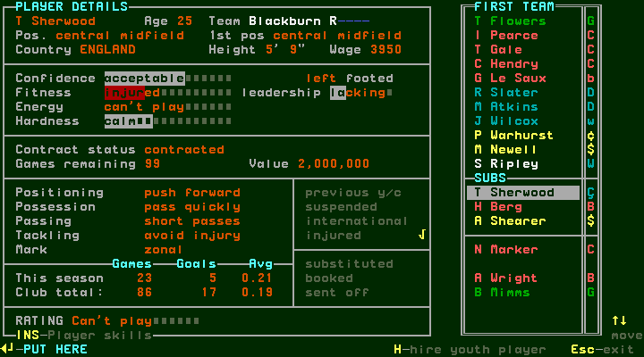
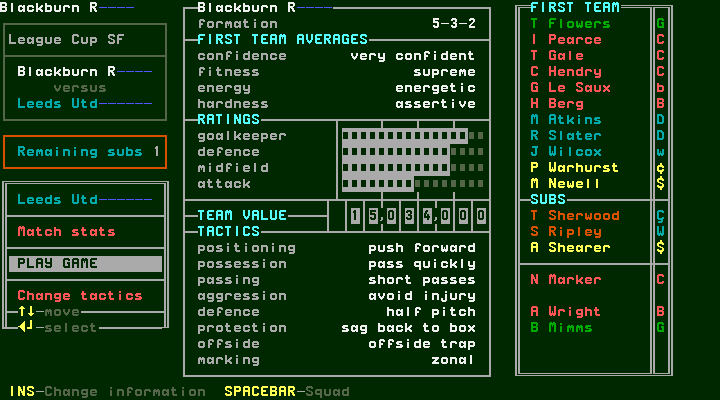

## W072 — Weekly announcements and saved continuation

[confirmed] After FA elimination/draw, a banner announced a friendly arranged
for Dec18, Blackburn versus Sevilla (step132). Escape continued to accounts
(step133); it is not evidence that the friendly was cancelled. A later approach
from York City appeared over transfer news (step135); Escape returned to
management. After league fifteen, an explicit join-York Y/N question appeared
over accounts (step144); N returned to Blackburn management (step145).

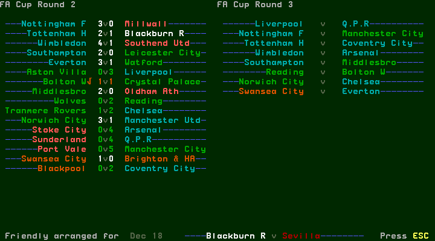
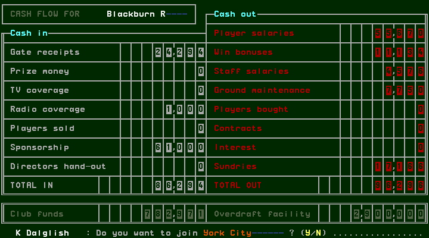

[confirmed] Following the semi-final accounts, Manager of the Month listed
the league winners, including Dalglish/Blackburn for the Premier League
(step165). Space dismissed to management (step166). No award payment is inferred
from the modal; the preceding accounts independently show prize money 25,000.

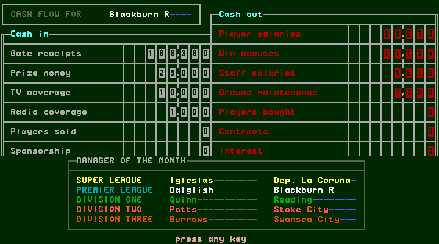

[confirmed] League sixteen finished Nottingham F 1–0 Blackburn. Fulltime Space
opened results, Space the table, Space accounts, Space news and Space management
(steps170–175). The table shows Blackburn P16, F32, A17, PTS21, fourth. Accounts
show in50,912, out85,226 and funds874,701. Management shows 5-3-2 and a blank
opponent Euro cups week. F7 saved at step176, then the original session ended
cleanly; all177screens authenticate.

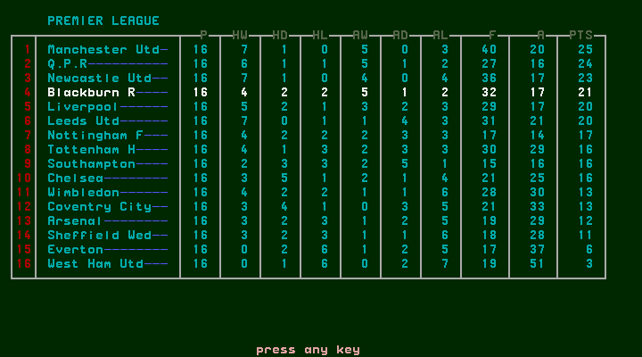
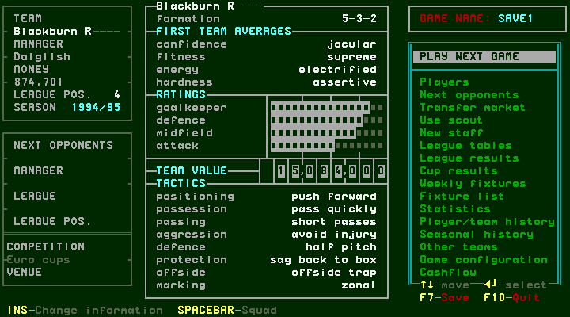

[confirmed] The [private-save receipt](../../runs/T59/private-backup-pending-r0001.json)
identifies final SHA256
`5983cd6197e80bacecd99ae1f22827da13e7d0fb86866b4b3bf1dfbf91217859`.
The earlier quarter-final checkpoint is preserved separately; private archive
upload status is recorded independently from its pending receipt.

[designed] Continue from that exact game save through the scheduled friendly,
League Cup final and later league fixtures, then season finish/rollover. Remaining
cases include this team's penalties/tied aggregate, the retiring player's final
outcome, completed stadium works, promotion/relegation and populated seasonal
history. The complete workflow/native gap audit and UI decision remain later
deliverables; this task does not claim a completed season or full-game UI.
