# Quick results, fixtures and competition views

[confirmed] These procedures use the original One-Nil 96 supplied SAVE1 in two
independent fresh processes. T49/session-r0002 starts from producer
`f9de1a4` and disables Watch match. Session-r0003 starts from `9489985` and
uses R on the watched pitch. Full identities, release hashes, ordered inputs,
rendered PNG digests and process endings are in [T49](../../runs/T49/).
Neither run controls the host clock/seed. Different scores are observations,
not evidence that the two modes use equivalent outcome rules.

## W031 — Disable Watch match and complete a fixture

[confirmed] From the supplied main menu with PLAY NEXT GAME highlighted:
Up selects Cashflow, Up selects Game configuration, Enter opens configuration.
Watch match is selected initially; Enter changes its check mark to x. Escape
returns to the main menu with Game configuration selected. Down selects
Cashflow, Down wraps to PLAY NEXT GAME, Enter opens preparation, Enter starts.

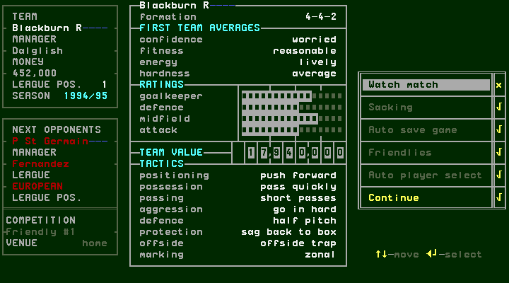

[confirmed] The quick-result screen stops at HALF TIME, here Blackburn0–2
P St Germain (Bravo27, Cobos45), rather than finishing the whole fixture in one
step. Space returns to the bench, with PLAY GAME selected and Remaining subs7.
Enter runs the second half to FULL TIME, still0–2. No substitution was made.

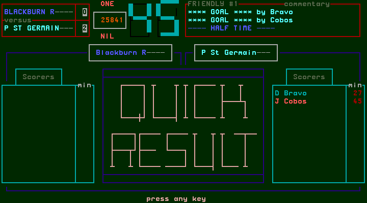
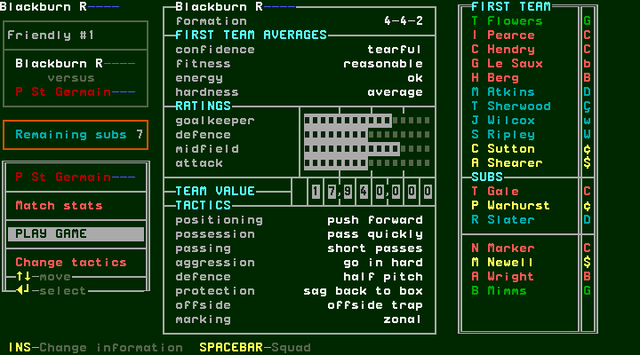
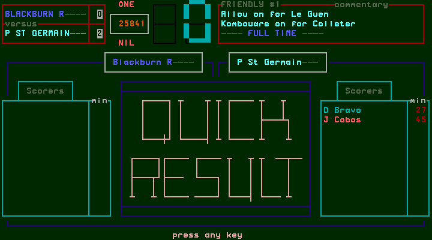

[confirmed] Space from this fulltime screen goes directly to cash flow; Space
opens transfer news; Space returns to management. The next opponent is Sevilla,
away, Friendly #2, with displayed money421,491. A further Space opens Players;
it is not another result confirmation. Exploratory record IDs mentioning
“final-stats”, “cash” and “management” are intent labels: the actual screens
at steps13–16 are cash flow, transfer news, main menu and Players respectively.

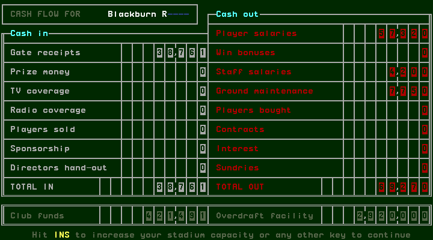
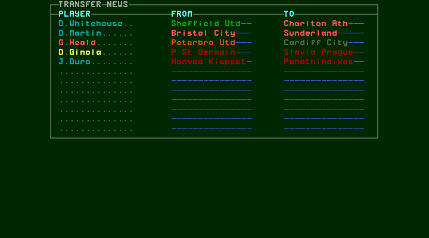

## W032 — Switch the watched pitch to R-result

[confirmed] In a separate fresh supplied-save session, leave Watch match on.
Enter from PLAY NEXT GAME opens preparation; Enter begins the watched pitch.
Press R, as advertised by its footer. The next captured screen is QUICK RESULT
at halftime,1–1 (Guerin1, Ripley35). Space opens the bench, Enter continues;
the second half also uses quick result without another R. Fulltime is2–2
(Ripley35/Sutton76, Guerin1/Dieng82; see the captured scorer list for authority).
Space→cash flow, Space→transfer news, Space→main menu completes the route.
No confirmation/cancel dialog was offered for R in this run.

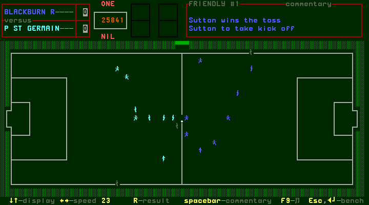
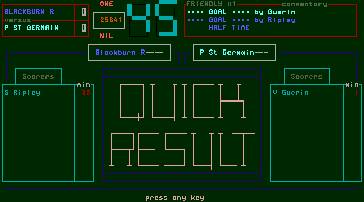
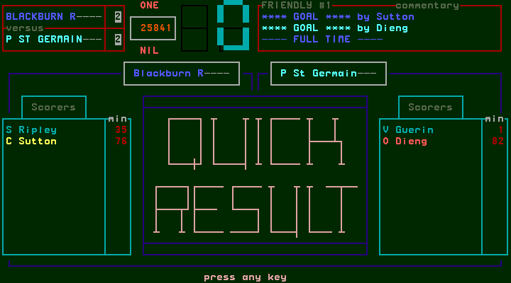
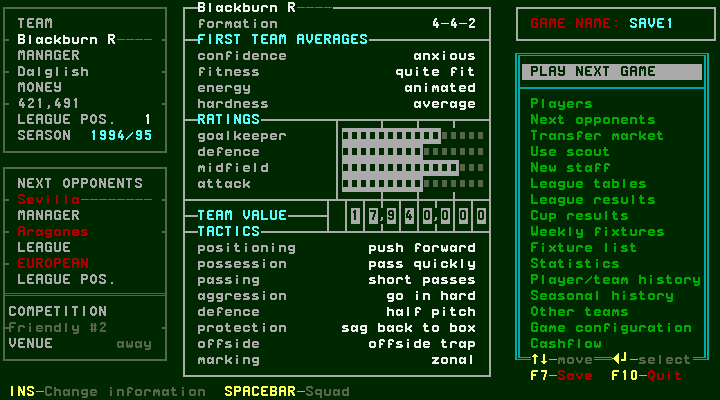

## W033 — League tables and results after a friendly

[confirmed] Select League tables in the main menu and Enter. The first view is
PREMIER LEAGUE, with places/team, P, HW/HD/HL, AW/AD/AL, F/A and PTS. All
shown entries have zero played and points after this friendly. Down changes to
DIVISION ONE; Up returns to PREMIER LEAGUE; Escape exits. Enter/Down next,
Del/Up last and F5 print-out are advertised; only Down/Up/Escape were exercised.

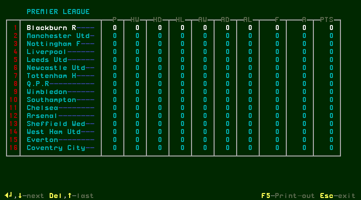
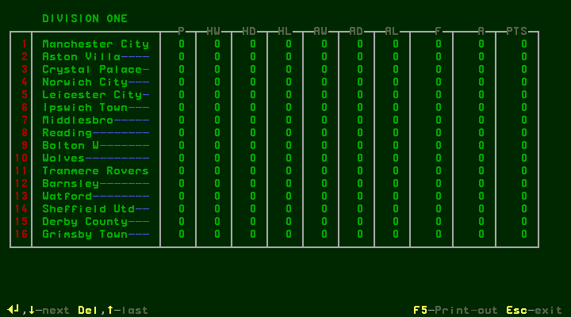

[confirmed] Down from the returned League tables entry selects League results.
Enter reports “No league results to see : hit any key”. Space dismisses it.
This is a captured empty state, not a populated league-results walkthrough.

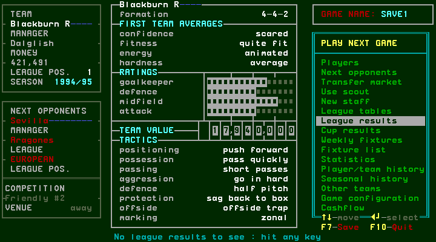

## W034 — Cup views and weekly fixtures

[confirmed] Down from League results selects Cup results; Enter shows League
Cup Round1 pairings. These have v and no scores: they are fixtures despite the
menu title. Down changes to FA Cup Round1; Up returns; Escape exits. The footer
also lists L.C, F.A, UEFA, C.W.C, E.C and F5 print. Those labels do not establish
unexercised direct shortcuts or completed-round progression.

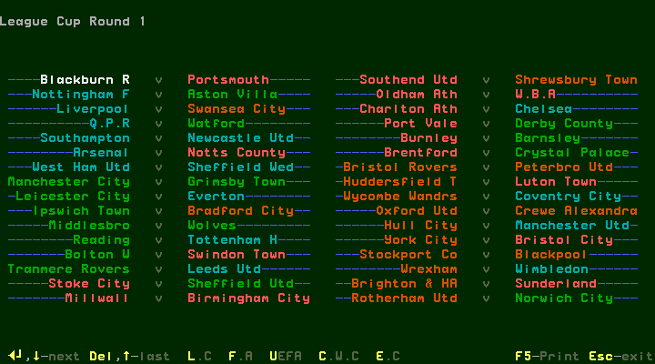
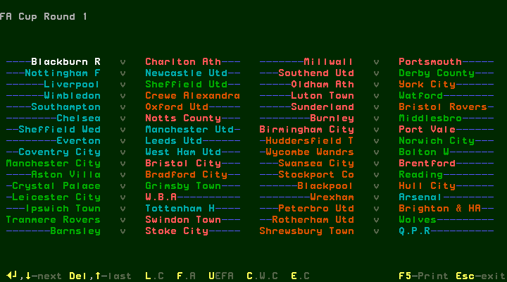

[confirmed] Down from Cup results selects Weekly fixtures; Enter opens
FIXTURES FOR GAME #2. Columns include row number, team pairing and competition,
here Friendly #2. Sixteen Down inputs scroll to later pairings; Up moves back.
Escape returns to the menu. Enter is advertised as watch; it was not activated
on another team's fixture in this task.

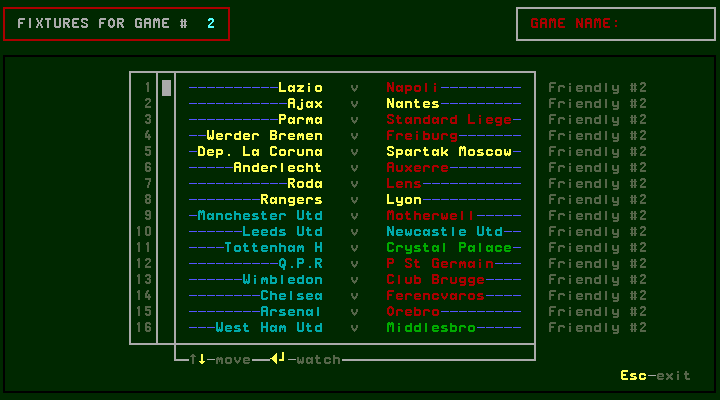
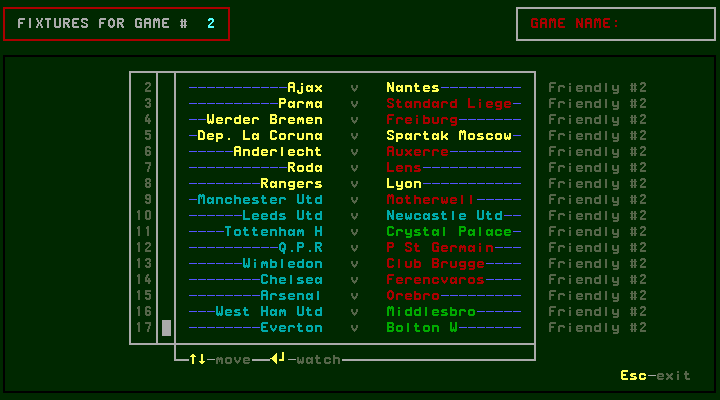

## W035 — Team fixture list

[confirmed] Down from Weekly fixtures selects Fixture list; Enter shows the
selected club's schedule. Blackburn's completed home friendly has attendance
25,841 and0–2, while a tick marks Sevilla away next. Rows show dates, opponent,
home/away, competition/round/leg and score when available. Scheduled blank
opponents are visible in later cup rounds; they do not prove qualification.
PgDn shows later dates, PgUp restores the opening page; Down changes club to
Manchester Utd, Right changes to Division One/Manchester City. Escape exits.
Enter-watch and F5/printing are not exercised here.

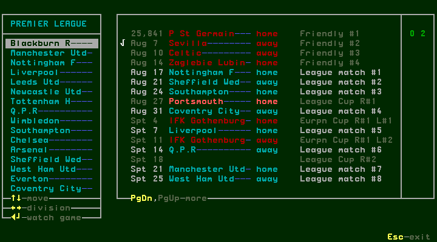
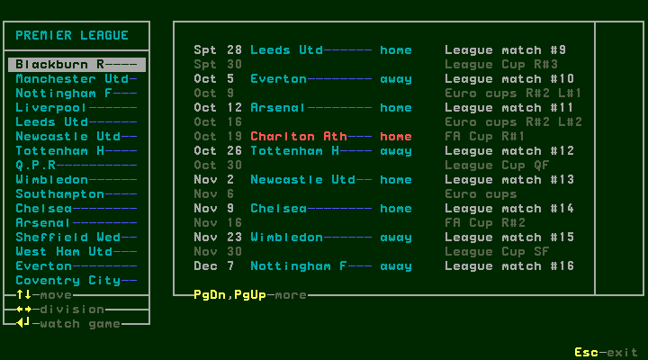
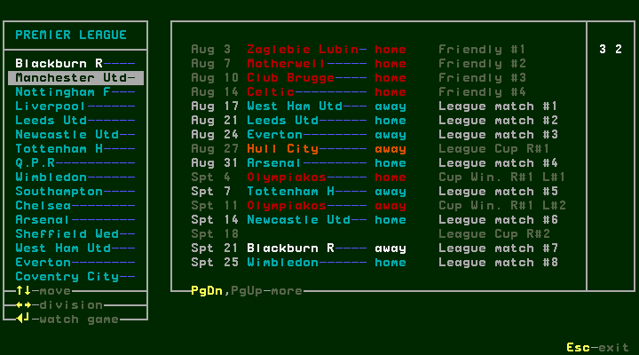
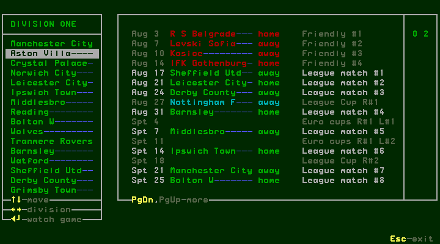

## Branch coverage

| Branch | Observed | Remaining |
| --- | --- | --- |
| Watch off | Halftime, bench, fulltime, cash/news/main | Conditional interruptions and substitutions |
| Pitch R-result | Switch to quick, both halves and main return | Other timing and cancellation possibilities |
| Friendly completion | Fixture score and next opponent; league zero played | League scoring/points require league play |
| League tables/results | Division navigation, empty results dismissal | Populated results, ties, promotion/relegation |
| Cup views | Initial League/FA pairings and exits | Played rounds, legs, extra time, qualification |
| Weekly fixtures | Scroll/back/exit | Watching another club |
| Fixture list | Page, club, division and exit | Full seasonal progression and rollover |

[designed] These remaining competition/season branches stay in #142; this
chapter does not close that backlog or the whole manual milestone.
