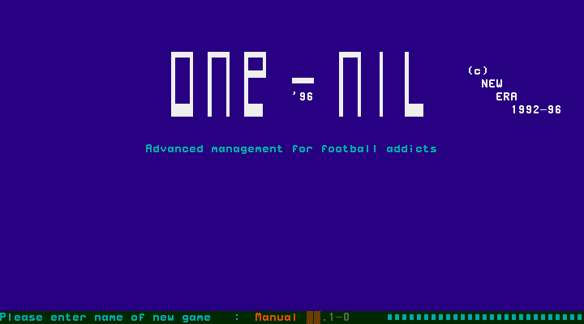
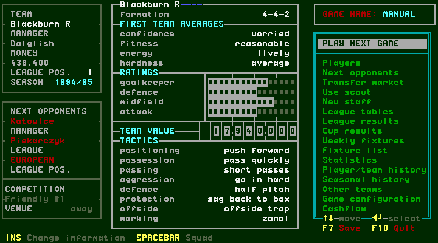
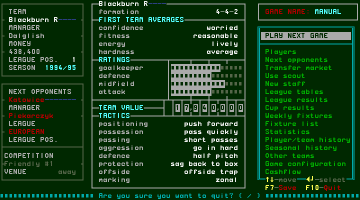
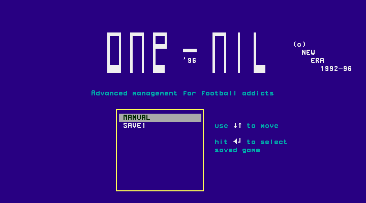
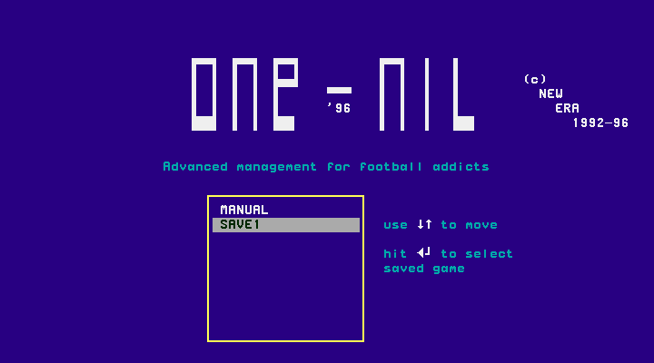

# Saving, quitting and loading

[confirmed] This chapter records One-Nil 96's original game UI. The new-game
procedure is in [setup](setup.md). The save/reload scenario uses the filename
`manual`, entered after clearing the default filename with Home and eight Delete
presses, followed by the letters m, a, n, u, a, l. The game displays this as
**GAME NAME: MANUAL**. It uses England 1994/95, one manager, Blackburn R, the
unchanged manager name K Dalglish and nationality England.

## W005: save and cancel quitting

[confirmed] At the main menu press **F7**, the displayed Save control. After the
one-second observation delay this run again showed the main menu; no persistent
confirmation dialog was present. This observation alone is not the save check:
the fresh-process reload below checks which game state can actually be loaded.

[confirmed] Press **F10** to open S011, “Are you sure you want to quit? (Y/N)”.
Press **N** to cancel and return to the same main menu. This cancellation was
exercised, not inferred from the wording. The Y confirmation branch has not yet
been exercised in this persistence scenario.

## Harness intervention and limits

[designed] A controlled fresh emulator process preserves only `.1-0` game saves,
not emulator savestates. Its receipt records the old/new process IDs, termination
of the old process group and matching hashes of the source/destination save
files. Saves are copied after the verified release is placed in scratch but
before the new DOS process mounts that directory. This filesystem intervention
is part of the research harness, not a step a player performs in the original UI.
Original release files remain unchanged.

[confirmed] Earlier exploratory session-r0002 copied saves after startup and then
Y loaded the supplied SAVE1, not MANUAL. It is retained as aborted evidence; it
does not prove persistence of the newly created game. The corrected scenario
must show MANUAL and the same visible state after reload before acceptance.

## W006: choose and reload the saved game

[confirmed] In the corrected scenario, press **Y** at the fresh startup question.
With MANUAL and SAVE1 present, S012 lists both saved games, initially highlighting
MANUAL. **Down** selects SAVE1. **Escape** leaves the list visible with SAVE1
still highlighted. Press **Up**, then **Enter**, to load MANUAL.

[confirmed] The resulting main menu's entire decoded text equals the text
captured after F7: MANUAL, Blackburn R, manager Dalglish, 1994/95, money 438,400,
next opponent Katowice / Piekarczyk and an away Friendly #1. Those values belong
to this scenario. The restart receipt preserves MANUAL.1-0's SHA-256
`bbef99e04ec376fecb2ccb563f14d19842d3da62afca61d607bec21fb66fdf27`
unchanged across the two processes. Matching this screen establishes the visible
persistence exercised here; it does not prove every internal field or progression
through a match persisted.

[confirmed] Evidence: [session-r0003](../../runs/T43/session-r0003/session.json),
producer `2272f9e`; steps 1–2 filename editing, 8 new main menu, 9 F7, 10–11
quit/cancel, 12 restart receipt, 13–15 save selection/Escape and 16 reloaded
menu. `end.json` records a completed capture and termination of its processes.

## Remaining branches

No-save and unreadable-save errors, overwrite prompts if any, the affirmative
quit branch, saving changed tactics/lineups and progression after a match remain
separate coverage items. F7 here overwrites the named game's save without a
persistent dialog; this does not establish every filename collision rule during
new-game creation.
