# Season finish, retirement and next-season persistence

[confirmed] T61 continues the original One-Nil96 after league24. Exact keys,
decoded displays and PNG digests are in the adjacent step records. Producers:
[session1](../../runs/T61/session-r0001/session.json),
`361b6890b93ee526f21a77b1c79bef8b44074b50`;
[session2](../../runs/T61/session-r0002/session.json),
`c6fbb0999ca83b507e6dd3971cc67a3b95d2d368`;
[session3](../../runs/T61/session-r0003/session.json),
`8f6e63be8c798041efcfb3f3bfe3e743cdf1822b`;
[session4](../../runs/T61/session-r0004/session.json),
`ecbf0be37540e1504fe09bcf632f5ef4ea29f9d1`;
[session5](../../runs/T61/session-r0005/session.json),
`28999b86b38d64ab71543eeeedafb109543c575c`.
Sessions4/5 completed and pass the canonical session validator. Earlier
attempts remain immutable failure evidence; their observed displays are
identified separately below. Scores are this run's outcomes, not predictions.

## W079 — Finish fixtures and handle unavailable players

[confirmed: session1 observed prefix, incomplete session] The initial restart
copies the verified league24 game save before mounting a fresh process; Y
reproduces T60's saved management text. League25 admission refuses an ineligible
player (steps10–12). Space opens the squad; Berg's details show international
and Can't play (step14). Enter picks him up; navigate to eligible Wilcox and
Enter swaps them (steps15–17). Escape returns to preparation. Newell's injury
then stops the match; Space opens the bench, Space the squad. Select Newell,
Enter, navigate to healthy Shearer, Enter, Escape and resume (steps19–29).

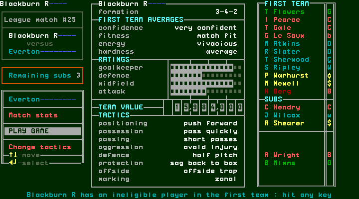
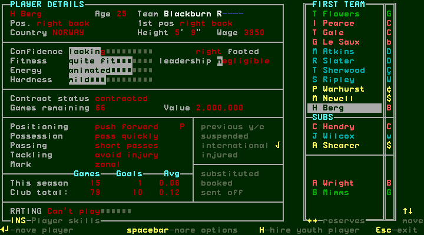
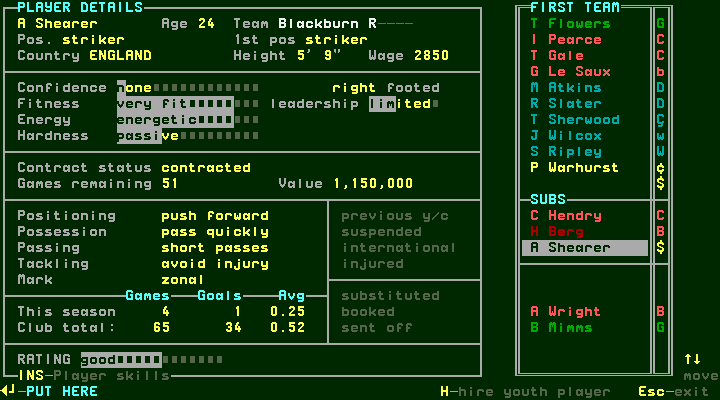

[confirmed: session1 observed prefix, incomplete session] A blank-opponent
FA Cup Final management week opens Liverpool's preparation against Southampton
(steps43/44). Enter runs its first half; Space continues directly to fulltime,
Liverpool2–1Southampton (steps45/46). This is an observer final, not a Blackburn
fixture. Later, Slater's departure announces Sheffield Wednesday paying590000,
fee set by tribunal (step74). Space shows transfer news and subsequent squad
inspection finds his first-team slot empty (steps75–78). Hendry is moved into
that slot before F7 preserves the pre-league28 checkpoint (steps79–84).

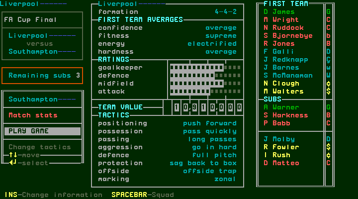
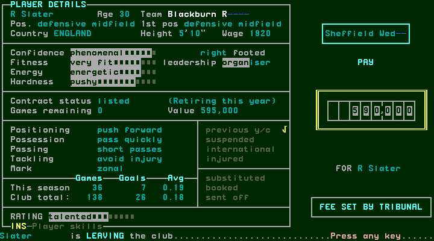

[confirmed: session2 observed prefix, incomplete session] Recovery from that
F7 checkpoint reproduces its management display (step2). League28 ends with
Newcastle3–2Blackburn; the table matches the earlier attempt (step8). Before
league29, Hendry and Berg are international; eligible Wright and recovered
Newell replace them (steps14–25). Preparation shows4-3-3 and admits the side
(steps26/27). Chelsea finishes3–3Blackburn (step31 results).

[confirmed: session2 observed prefix, incomplete session] League30 stops for
Sherwood's injury at5–2 (step39). Space opens a bench with two substitutions
remaining. Enter without a replacement resumes, but further substitution
opportunities recur (steps40–51); the remaining count stays two in the bench
captures. The final recorded results show Blackburn5–3Wimbledon (step52).
There is no captured fulltime-banner frame for this match; the results and
table establish its completed outcome. The final table is Newcastle45 points,
Blackburn41, Manchester United40; Blackburn played30, scored68 and conceded41
(step53). F7 at step57 preserves the final-league continuation used below.

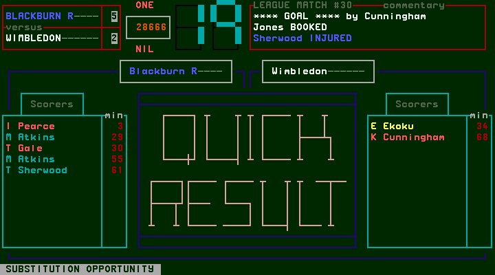
[confirmed: completed session5] A separate fresh-process restoration of the
post-league30 save reproduces the saved management text (steps1/2). Navigate
Down seven to League results, Enter: MATCH NO#30 shows the same5–3 result
(steps3/4). Escape, Up to League tables, Enter reproduces the same final table
(steps5–7). Escape exits and the session ends cleanly (step8). These completed
captures establish the final results independently of the interrupted playthrough.

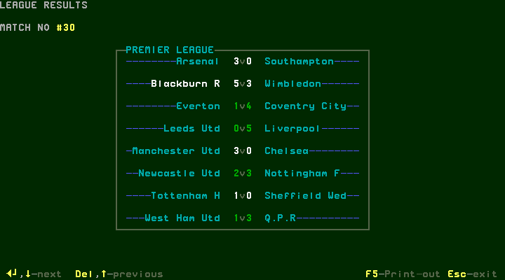
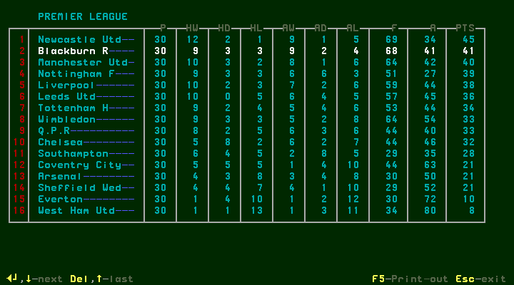

## W080 — European final and the actual End of season entry

[confirmed: completed session4] The supplied-route recovery copies only the
post-league30 game save before a fresh process mounts it (steps1/2). The loaded
management text matches session2's step57. Enter on the blank Euro cups week
opens Lazio's preparation against PSG (step3). Enter runs the first half;
Space after halftime continues the observer final. A2–2 FULL TIME display
without the press-any-key footer is still processing extra time (step5).
Waiting produces Lazio2–3PSG, Colleter scoring at101, with the footer (step6).
Space opens European results, then Space continues accounts/news to management
explicitly labelled End of season (steps7–11).

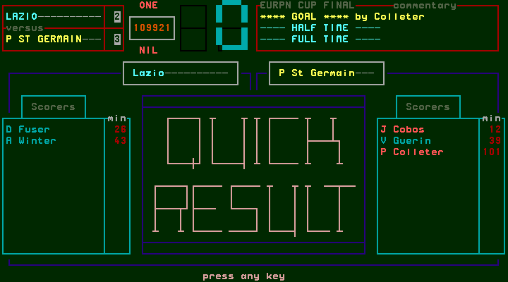
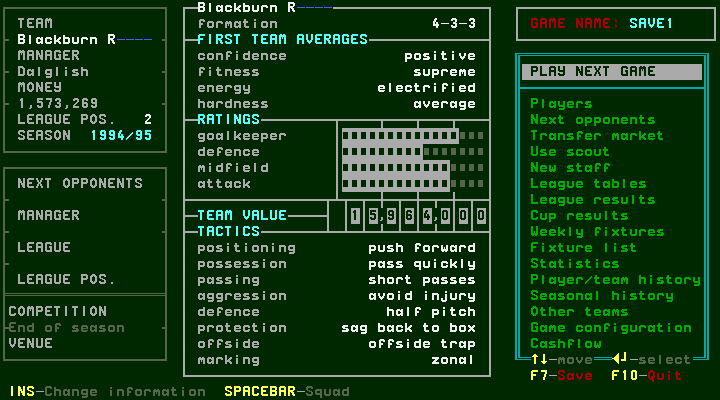

## W081 — Save seasonal information, promotion and retirement

[confirmed: completed session4] Enter on End of season opens accounts showing
prize money50000 and funds1559955 (step12). Space opens transfer news; Space
then adds the Y/N question, “Do you want to save the full seasonal information?”
(steps13/14). Y accepts it (step15). The N/cancel branch was not exercised.
The game writes a separate SAVE1.95 alongside the normal SAVE1.1-0; both are
preserved privately in the next-season backup. No save bytes are repository
assets.

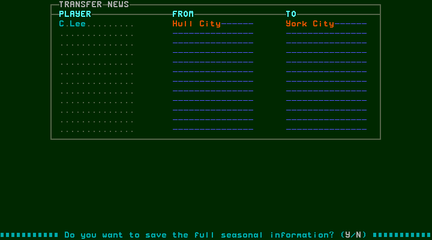
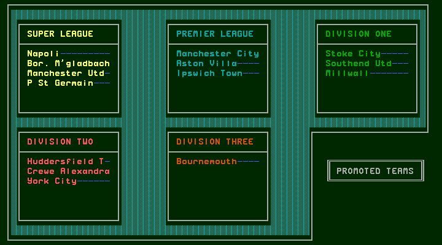
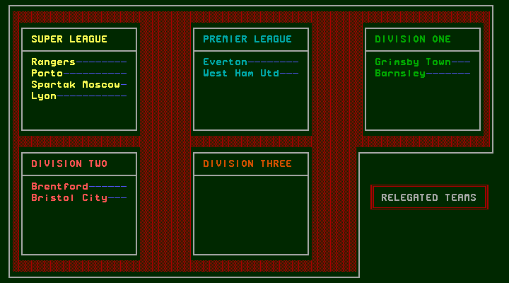

[confirmed: completed session4] Space advances promoted teams→relegated
teams→Gale's retirement screen (steps15–17). The promoted summary names
Manchester United under Super League and Manchester City, Aston Villa and
Ipswich under Premier League. The relegated summary names Everton and West
Ham under Premier League. These displayed lists do not establish the general
promotion selection algorithm.

[confirmed: completed session4] Gale is36 and explicitly HAS RETIRED while
still displaying contracted,27 games remaining and wage1500 (step17). His
previous accepted renewal therefore did not prevent this observed retirement.
Space acknowledges it and returns to management showing1995/96, funds1559955,
Friendly#1 at home against Partizan Belgrade (step18). No retirement cancellation
or contract refund is offered on the captured retirement screen.

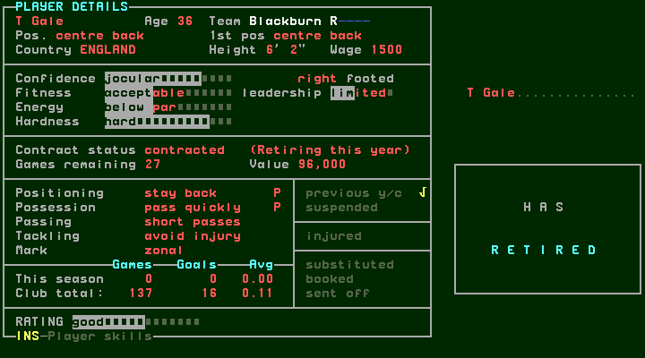

## W082 — Inspect populated history and the new-season state

[confirmed: completed session4] F7 saves; Space opens the squad (steps19/20).
Gale is absent, the last first-team slot is empty, Flowers is28 and his This
season counters are zero. Escape returns to management. Navigate with Up/Down,
inspect the highlight and Enter on Seasonal history (steps21–24). Repeated-key
bursts can land at another item: step22 highlights Other teams; Up selects
Seasonal history before Enter. The screen shows YEAR1994/95, Blackburn second
in the Premier League, League Cup WINNERS, and Round2 as its FA/European best.
Escape returns to management (step25).

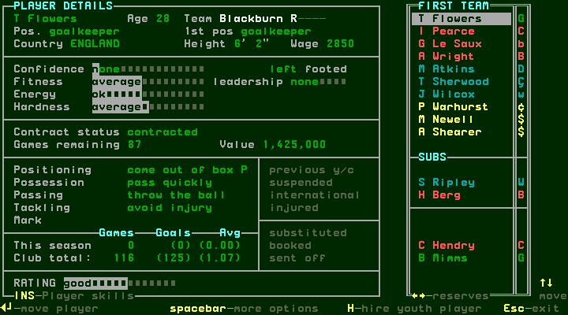
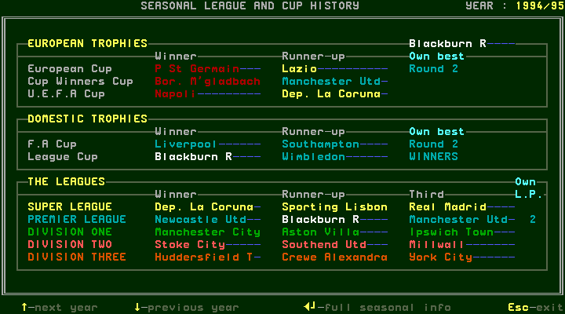

[confirmed: completed session4] Up three selects Fixture list; Enter opens
the new schedule (steps26/27). It starts Aug3 Partizan at home, Aug7 Wimbledon
away, Aug10 Rangers at home and Aug14 Sevilla at home. League1 is Aug17 away
at Aston Villa; UEFA Round1 lists Napoli away/home on September4/11. Escape
returns; Up four selects League tables, Enter opens it (steps28–30). The new
Premier League includes City, Villa, Ipswich and Sheffield Wednesday; every
displayed club has zero played/goals/points. Blackburn remains second in the
initial ordering. The fixtures and table confirm a new schedule and reset
counters, rather than merely a changed year label.

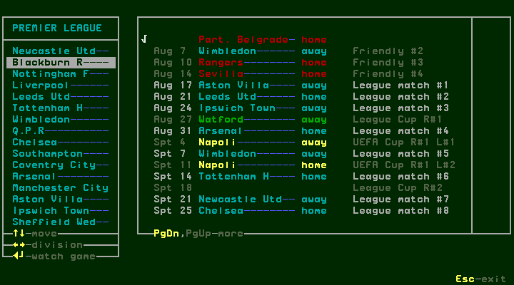
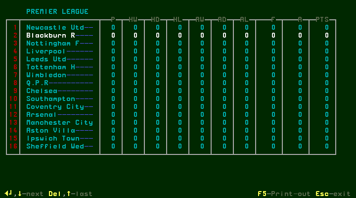

[confirmed: failure evidence] In session2, Enter on populated Seasonal history's
full seasonal info command (step79→command80) caused DOSBox-X to exit with-6
during the observational savestate read; its end record is aborted. That deeper
view was not successfully captured. This is an emulator/capture failure, not
proof that the original game itself rejects the command. Session3 reproduced
rollover but was stopped after identifying that --persistence rejects an initial
startup restore lacking an earlier in-session F7. Neither failed session is
reported as passing the canonical validator, and none of its records was edited.

## W083 — Verify next-season persistence with a fresh process

[confirmed: completed session4] Escape exits the table. Navigation wraps from
League tables to Cashflow; Down then selects PLAY NEXT GAME (steps31–33).
F7 saves the inspected next-season management state (step34). The restart
receipt (step35) records different process IDs, the old processes exited, and
identical saved/restored SAVE1.1-0 hashes. Only game saves are copied after
verified release setup and before the new mount; emulator RAM is not restored.
Y loads management (step36). Its full decoded text and digest exactly match
step34, including1995/96, funds, formation, tactics and next opponent. The
session ends completed with all owned processes exited.

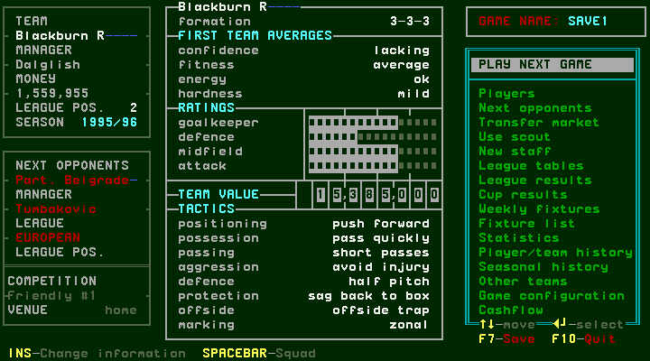

[derived] This proves the captured management display persists through the
normal game save. The separate SAVE1.95 is not carried by the driver's .1-0-only
restart; persistence of its deeper full-season view remains unverified. Other
promotion/relegation situations, managed penalties, retirement choices, N at
the seasonal-information prompt and full-season-info browsing remain explicit
coverage gaps. Publication/backup approvals and checks are separate acceptance
gates; this chapter does not claim T61 merged or the manual milestone complete.
