# Changing the lineup, position and player instructions

[confirmed] This chapter uses original One-Nil 96 supplied SAVE1. Evidence is
[T46/session-r0001](../../runs/T46/session-r0001/session.json), whose committed
producer and release hashes identify the run. Start with Y, then Space on the
main menu to enter Players. [Squad browsing](squad.md) explains the display modes.

## W014: cancel a move, then exchange goalkeepers

[confirmed] T Flowers is initially selected in the first slot. Press **Enter**:
the footer changes from “move player” to **PUT HERE** (S022). **Escape** cancels;
the original order remains. Press Enter again, then Down seventeen times to
highlight B Mimms in the lower part of FIRST TEAM, and Enter to confirm.
The two players exchange rows: B Mimms occupies the first slot; T Flowers is
now below the substitutes. The left skills panel continues to show the player
being carried while choosing a destination, so the right-hand highlight is the
destination indicator.

[confirmed] Evidence: steps 2–7; Up seventeen times then Insert inspects B Mimms
in the first slot at steps 8–9. This tests swapping two occupied rows, not moving
into an empty reserve row or every illegal lineup.

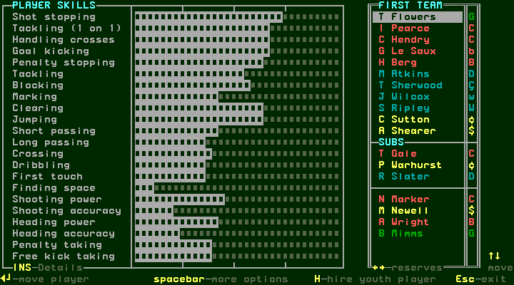
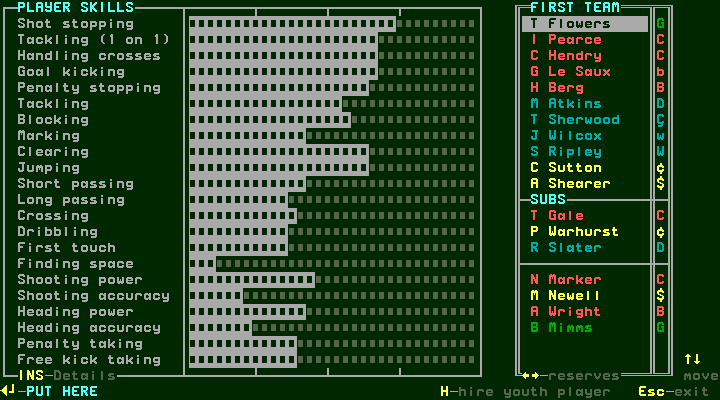

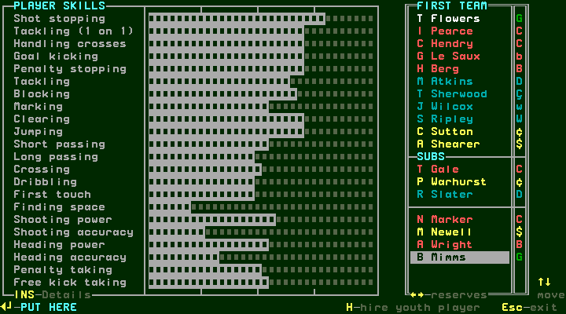
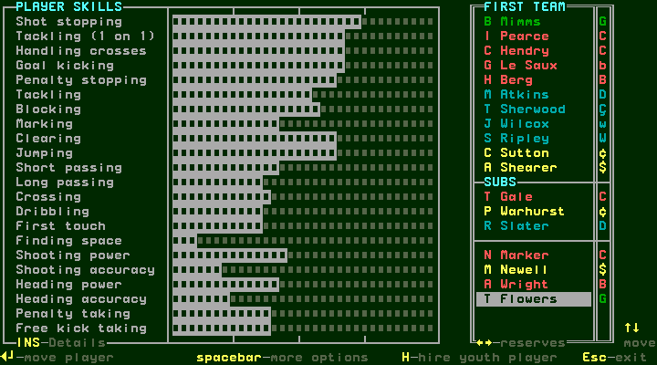

## W015: change individual goalkeeper instructions

[confirmed] With B Mimms selected, Space opens his options. **Reposition** has
an x; pressing Enter on it leaves the menu unchanged in this run. Club position
has a tick, but activating it with his existing goalkeeper position produces no
visible position change. To open **Change tactics**, move to that highlighted
entry and press Enter. In this exact run it was Down three times from Club
position, then Enter. The instruction editor (S025) advertises Up/Down to move,
Enter to change and Escape to exit.

[confirmed] With Positioning highlighted, successive Enter presses produced:

| Step | Displayed Positioning |
| --- | --- |
| 15: editor entered | come out of box P |
| 16 | come out of box (no P) |
| 17 | stay in box P |
| 18 | come out of box P |
| 19 | come out of box (no P) |
| 20: final choice | stay in box P |

[confirmed] Thus this exercised editor has a three-state displayed cycle.
The P marker's engine meaning is not established by this UI observation. The
other displayed instruction rows are Possession, Passing, Tackling and Mark;
this procedure did not cycle their choices. Escape returns to the player options;
a second Escape returns to the player list. Evidence: steps 10–22.

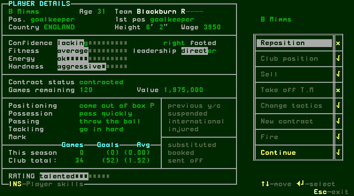
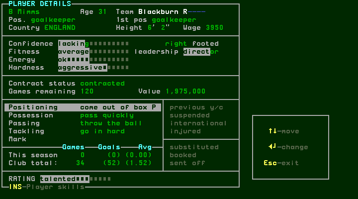

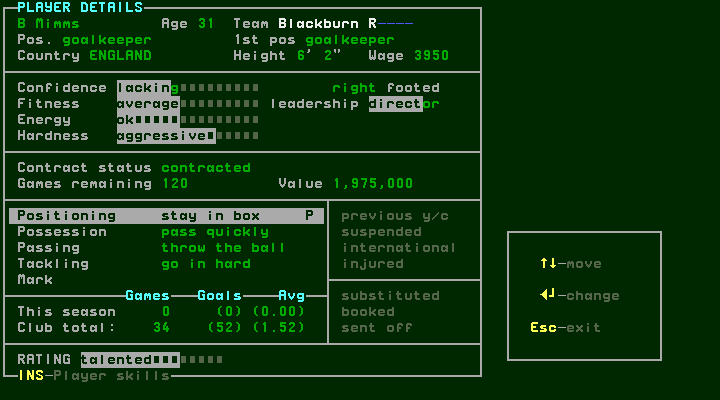

## W016: Reposition cycles current position; Club position restores it

[confirmed] Select I Pearce with Down, open Space options, and highlight
Reposition before pressing Enter. The options menu remembers its previously
highlighted item across the players inspected in this run: reopening it after
Change tactics did not initially select Reposition. Up four times from Change
tactics highlighted Reposition. Each Enter immediately changed **Pos.**;
**1st pos** remained centre back. There is no intervening choice dialog in these
captures.

[confirmed] From centre back, Enter produced left back, then right back, then
defensive midfield (steps 28–30). Down highlights Club position; Enter restores
centre back (31–32). Repeating Reposition then traversed the following displayed
sequence. These are observations for this outfield player, not inferred ability
or suitability ratings.

| Displayed position | Capture |
| --- | --- |
| centre back, before cycle | [step 33](../../runs/T46/session-r0001/step-0033.png) |
| left back | [34](../../runs/T46/session-r0001/step-0034.png) |
| right back | [35](../../runs/T46/session-r0001/step-0035.png) |
| defensive midfield | [36](../../runs/T46/session-r0001/step-0036.png) |
| central midfield | [37](../../runs/T46/session-r0001/step-0037.png) |
| left midfield | [38](../../runs/T46/session-r0001/step-0038.png) |
| right midfield | [39](../../runs/T46/session-r0001/step-0039.png) |
| forward midfield | [40](../../runs/T46/session-r0001/step-0040.png) |
| left winger | [41](../../runs/T46/session-r0001/step-0041.png) |
| right winger | [42](../../runs/T46/session-r0001/step-0042.png) |
| centre forward | [43](../../runs/T46/session-r0001/step-0043.png) |
| striker | [44](../../runs/T46/session-r0001/step-0044.png) |
| goalkeeper | [45](../../runs/T46/session-r0001/step-0045.png) |
| sweeper | [46](../../runs/T46/session-r0001/step-0046.png) |

[confirmed] This is why the unavailable Reposition on B Mimms must not be
summarized as “no player can be repositioned into goalkeeper.” I Pearce entered
that position and could subsequently move on to sweeper. After the reload below,
another Reposition press returned him from sweeper to centre back; that final
restoration was not saved again.

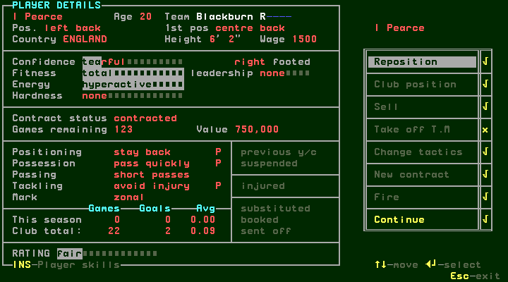
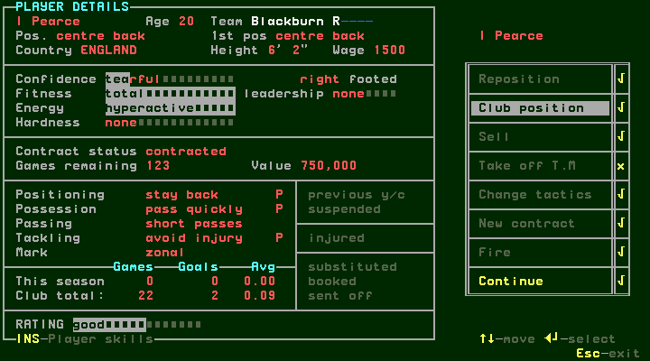
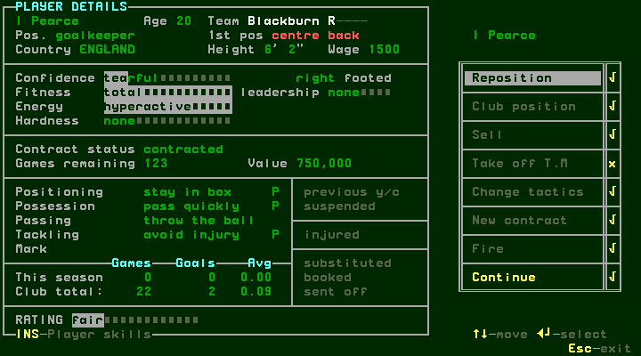

## W017: save and reload the changed selection

[confirmed] Escape from the options and then the player list to the main menu.
Press F7. The controlled fresh-process restart preserves only the game save,
with matching before/after copy hashes, as explained in [saving/loading](saves.md).
Y loads SAVE1 directly because only that save is present. The reloaded main
menu's entire decoded text matches the text captured after F7.

[confirmed] Space then shows B Mimms still first and T Flowers in the lower list.
Insert shows B Mimms's Positioning still **stay in box P**. Down shows I Pearce
still **sweeper**, with **1st pos centre back**. These checks establish the
intentional lineup and instruction changes survived a game-file reload;
no emulator savestate was restored. Evidence: steps 48–54. The save's digest is
`aecb2f9ac707937bd1f10d333ed79143a407747b6e478627d752cd536b9e2385`.

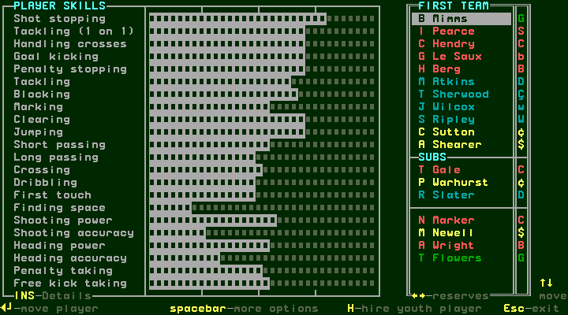
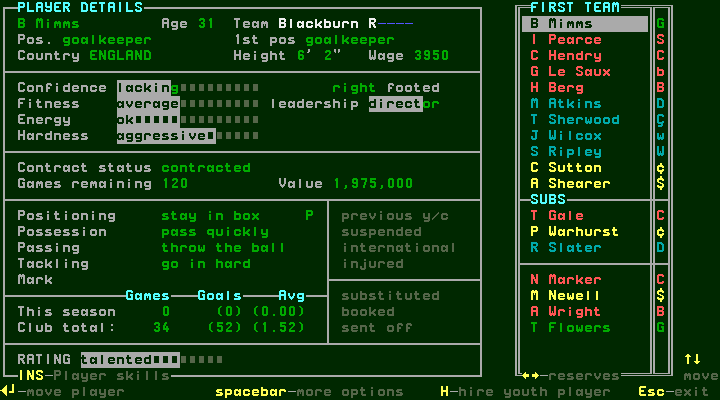
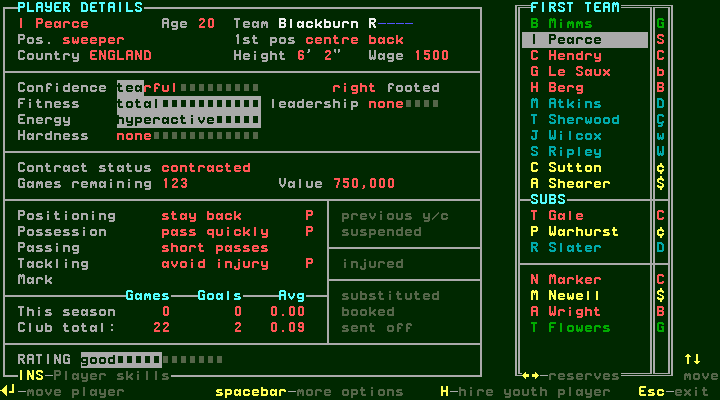

## Remaining selection and tactics coverage

[confirmed] Empty destination/reserve moves, ineligible/injured/suspended-player
refusals, captain/set-piece responsibilities, team formation and team-level
instruction editing, the other individual instruction cycles and effects during
a match remain pending. This chapter establishes UI actions and persistence,
not tactical formulas or how the engine responds to the changed lineup.
