# Starting a new game

[confirmed] These observations are of One-Nil 96, using the verified release in
`records/T01/inventory.json`. Captures were produced by committed scripts; each
session's `session.json` identifies its source and game files. This chapter covers
setup; persistence after saving and restarting is still pending under #137.

## W002: filename, season and number of managers

1. At the startup load question, press **N**. S003 asks “Please enter name of new
   game”; the visible default is `Save1` and the `.1-0` suffix is outside the input.
2. Press **Enter** to accept that default. S004 opens the starting-season selector.
   Its four visible choices are **ENGLAND 1993/94**, **ENGLAND 1994/95**,
   **ITALY 1993/94** and **SCOTLAND 1993/94**. England 1993/94 is initially highlighted.
3. Press **Down**, then **Enter**, to choose England 1994/95.
4. S005 asks for the number of players, **ONE** or **TWO**. ONE is initially
   highlighted. Press **Enter** to choose it and open the club browser.

[confirmed] Exact route and before/action/after evidence:
[session-r0003](../../runs/T42/session-r0003/session.json), steps 0–4,
producer `1bd53c2`. “Players” at this prompt means human managers: the subsequent
club selector says “Select your team, player 1”; the TWO branch is exercised separately in W007 below.

## W003: browse and choose a club

[confirmed] S006 has a club list on the left, team formation/averages/ratings/value
and tactics in the middle, and the named first team, substitutes and remaining
players on the right. Blackburn R is initially selected in this scenario.
Up/Down changes the highlighted club. Right changes from PREMIER LEAGUE to
DIVISION ONE, initially showing Manchester City. Left returns to PREMIER LEAGUE;
Down then highlights Manchester Utd. The team preview updates with the selection.
Press **Enter** on Blackburn R to open S007, the manager-name input.

[confirmed] The navigation experiment is in
[session-r0002 steps 7–9](../../runs/T42/session-r0002/step-0007.json), producer
`5a1422c`; the completed selection route is in session-r0003 steps 4–5.
The bottom of the browser advertises **Ins—Change information** and
**Spacebar—Squad**; these two controls remain untested in this setup slice.

## W004: manager name and nationality

[confirmed] S007 initially contains `K Dalglish` and asks for an initial followed
by a surname. In this run, **Home**, twelve **Delete** presses and **Enter**
cleared the field and advanced without a visible refusal. S008 then asks for
nationality. **ENGLAND** is highlighted in the rendered screenshot, and the
screen advertises Up/Down to move, Enter to select, Escape to exit.
Press **Enter** to accept England. This completes setup and opens S009, the
main menu: Blackburn R, season 1994/95, game name SAVE1 and a blank MANAGER
field. The observed balance is 464,000 and the next friendly is against Aston
Villa; those are this run's values, not a guaranteed seed-independent default.

[confirmed] Evidence: session-r0003 steps 5–8, producer `1bd53c2`.
This establishes that this setup route accepts a blank manager name; it does
not establish every string-editing or filename-validation rule.

## Escape behaves differently between prompts

[confirmed] At S003, **Escape accepts the default filename and advances to S004**;
it does not return to the initial question. At S004, Escape leaves the season
selector visible with England 1993/94 highlighted. See session-r0002 steps 1–3.

[confirmed] At the club browser, Escape caused the original emulator process to
exit with code 0. The harness then failed its next screen read, so this exploratory
session is correctly retained as aborted, not as a completed setup route. The key
and process result are recorded in
[session-r0002/end.json](../../runs/T42/session-r0002/end.json). No after-screen
exists for that exit; do not interpret the aborted harness status as a game crash.

## Coverage remaining

Further invalid filename/name cases and missing/unreadable-save errors remain
pending. Filename editing and fresh-process persistence are documented in
[saving and loading](saves.md); other starting seasons and two managers follow below. The presence of a season choice is not proof that its later
competition rules have been traversed. Squad inspection and matchday have their
own chapters/backlog tasks.

## W007: two human managers and duplicate-club refusal

[confirmed] Choose England 1993/94 and TWO (Right then Enter at S005).
The club browser now asks for player 1. Accept Manchester Utd, default name
A Ferguson and England nationality. The browser returns for player 2.
Pressing Enter on the same Manchester Utd displays S014:
“You can't choose the same team : hit any key”. **Space** dismisses the
message. **Down**, **Enter** chooses Blackburn R. Accept K Dalglish and
England to finish setup.

[confirmed] The first main menu belongs to Manchester Utd and its top action
is **NEXT PLAYER**, not PLAY NEXT GAME. **Enter** hands control to Blackburn R;
its menu has PLAY NEXT GAME and an additional **Previous player** entry.
The latter is visible but has not been exercised here. This procedure does not
advance a two-manager match or prove how their later turns synchronize.

[confirmed] Evidence: T44/session-r0001, producer `a25747a`, steps 0–13;
[session metadata](../../runs/T44/session-r0001/session.json). Screens 4–7 show
player 1 and player 2 setup, 8 refusal, 9 dismissal, 10–11 second name/nationality,
12 first turn and 13 handover.

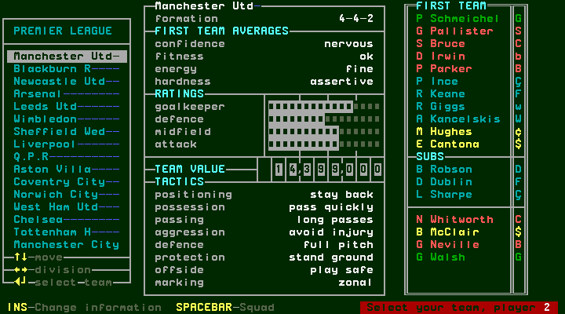
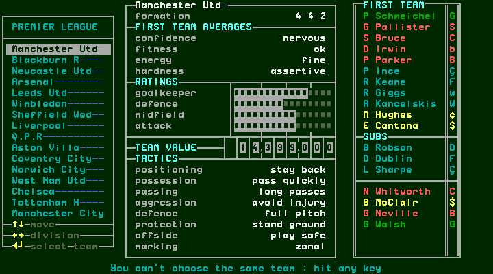
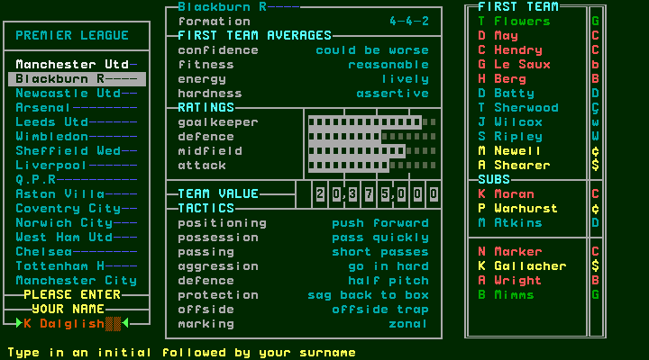
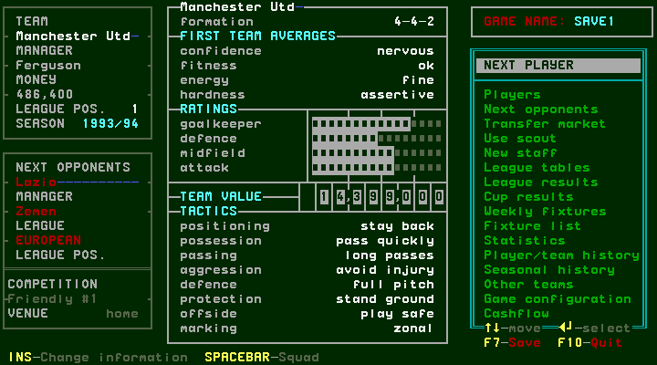
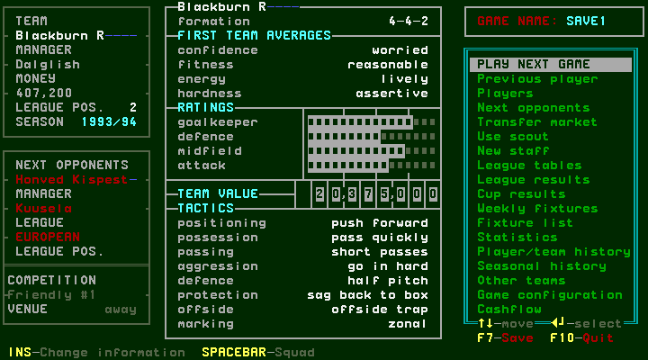

## W008: Italy 1993/94 setup

[confirmed] From N and the default filename, press Down twice then Enter in
the season selector, accept ONE, then accept AC Milan, the default name
F Capello and Italy nationality. The resulting main menu displays AC Milan,
Capello and season 1993/94. This is setup coverage only.
Evidence: [T44/session-r0002](../../runs/T44/session-r0002/session.json),
producer `a25747a`, steps 0–7. Its initial club browser is SERIE A.

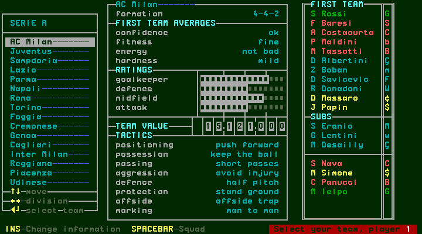
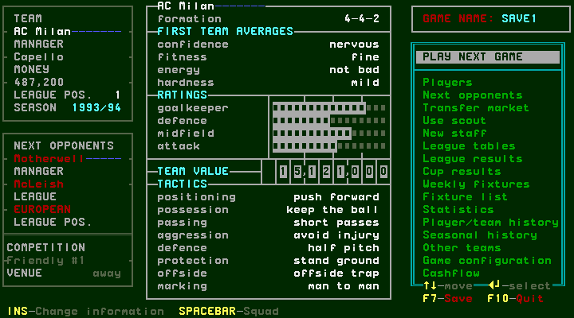

## W009: Scotland 1993/94 setup and another nationality

[confirmed] At S004 press Down three times then Enter, accept ONE, and the club
browser starts on Rangers in PREMIER LEAGUE. **Right** shows DIVISION ONE and
Clydebank; **Left**, **Enter** returns to and chooses Rangers. Accept the default
name W Smith. The nationality selector initially highlights SCOTLAND. **Down**
highlights SPAIN; **Enter** accepts it and opens the Rangers/Smith/1993–94 main
menu. This establishes acceptance of a nationality different from the league;
it does not establish the nationality's later gameplay effects.

[confirmed] Evidence: [T44/session-r0003](../../runs/T44/session-r0003/session.json),
producer `a25747a`, steps 0–9.

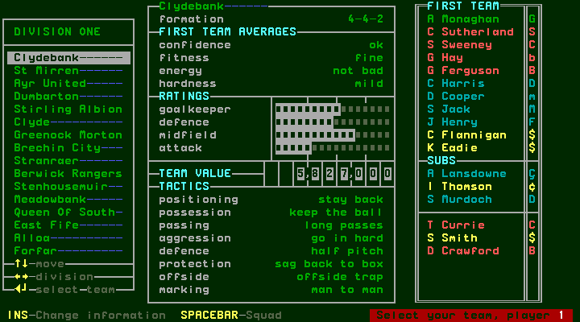
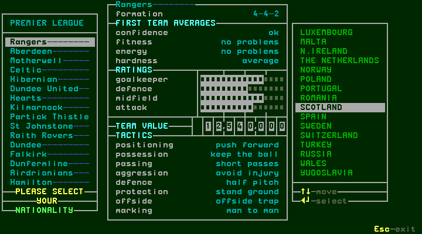
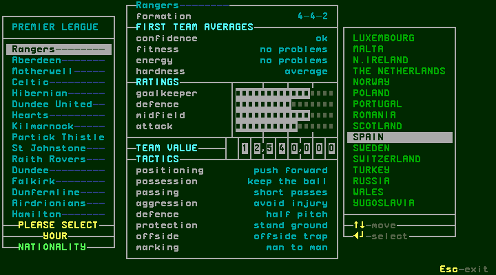
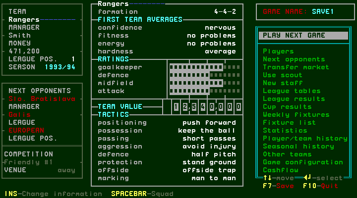

### Nationality choices visible in the original

[confirmed] The England and Scotland selector screenshots together show these
32 choices, in displayed order: Albania, Austria, Belgium, Bulgaria, Cyprus,
Czechoslovakia, Denmark, Eire, England, Finland, France, Germany, Greece, Hungary,
Iceland, Italy, Luxembourg, Malta, N.Ireland, The Netherlands, Norway, Poland,
Portugal, Romania, Scotland, Spain, Sweden, Switzerland, Turkey, Russia, Wales,
Yugoslavia. These are the original game's labels. England, Italy and Spain were
accepted in the procedures here; selecting each of the other countries has not
been tested. Default nationality was England for the England scenarios, Italy
for Italy, and Scotland for Scotland.
