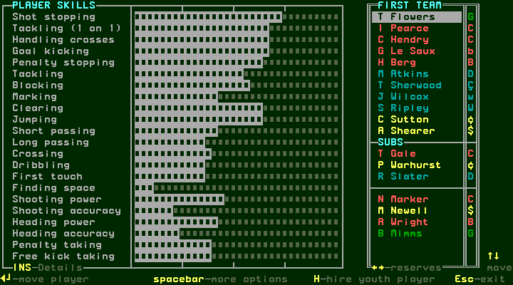
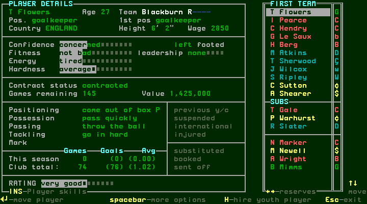
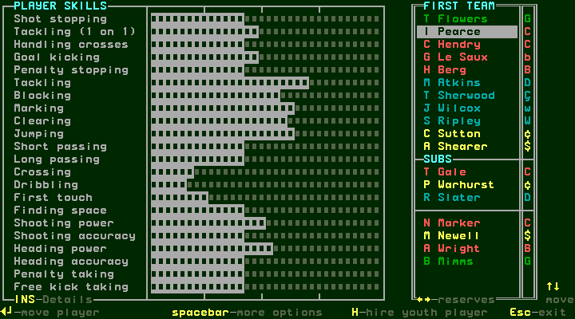
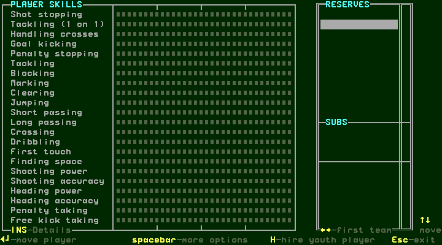
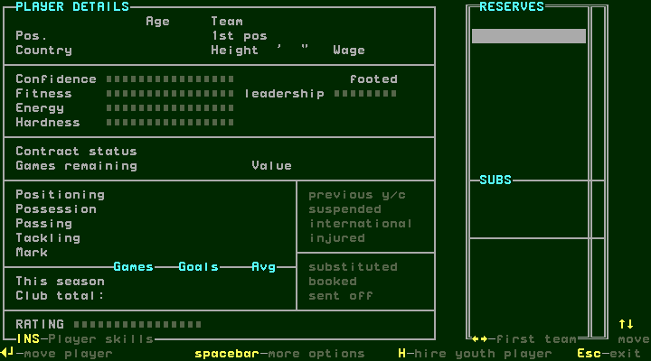
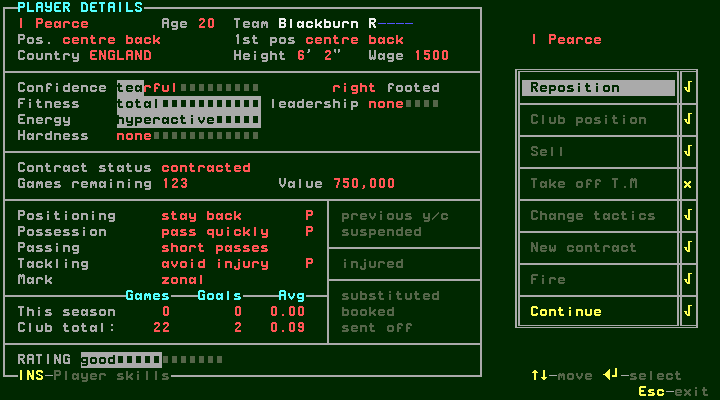
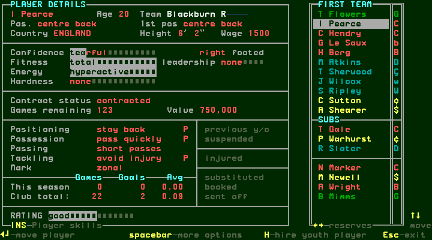
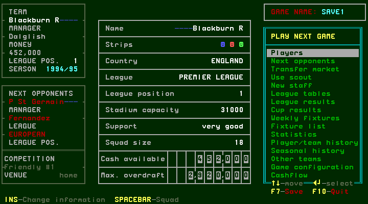
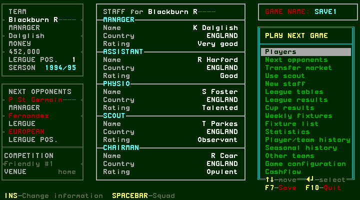
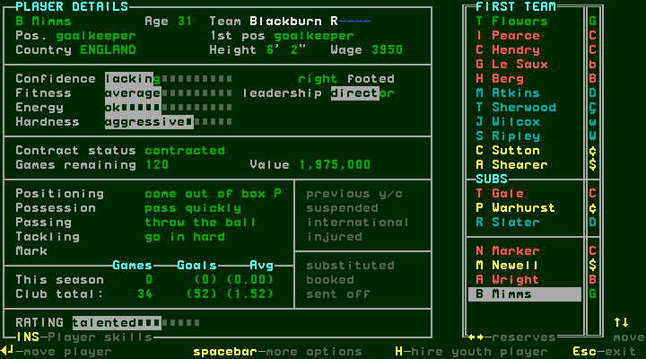

# Browsing the squad and player information

[confirmed] This chapter uses the supplied One-Nil 96 SAVE1, Blackburn R in
1994/95. Every workflow below is captured in
[T45/session-r0001](../../runs/T45/session-r0001/session.json), producer
`e078adf`. Game/release hashes, exact key arrays, screenshots and action chains
are stored alongside that metadata. Values here describe this save, not a new
career or universal player defaults.

## W010: enter Players, compare players and return

1. [confirmed] At startup press **Y**, wait for the supplied main menu, then
   **Down**, **Enter** to choose Players. S015 opens PLAYER SKILLS with T Flowers
   selected. The right list contains FIRST TEAM, SUBS and further named players.
   A narrow right-hand column shows role glyphs.
2. [confirmed] Press **Insert** to change the left panel to PLAYER DETAILS
   (S016), preserving the selected player.
3. [confirmed] Press **Down** to select I Pearce. The details update immediately.
   Press **Insert** again to return to his skill bars.
4. [confirmed] Press **Right** to show RESERVES. In this save that list is empty;
   the skills and details are blank when there is no selected player. Insert
   still switches the panel. Space on this empty list did not open options.
5. [confirmed] Press **Left** to return to FIRST TEAM. I Pearce is selected again
   and his details reappear. Press **Space** to open his options (S017).
6. [confirmed] Press **Escape** to cancel the options menu, then **Escape** again
   to leave Players and return to the main menu. No lineup move, contract or
   transfer was executed in this procedure.

[confirmed] Evidence: steps 0–13. Skills/details are panel modes, not an Enter
navigation: Enter is labelled “move player” and was deliberately left for the
selection-editing procedure that follows this research slice.

## Player field inventory

[confirmed] PLAYER SKILLS displays bars for Shot stopping, Tackling (1 on 1),
Handling crosses, Goal kicking, Penalty stopping, Tackling, Blocking, Marking,
Clearing, Jumping, Short passing, Long passing, Crossing, Dribbling, First touch,
Finding space, Shooting power, Shooting accuracy, Heading power, Heading accuracy,
Penalty taking and Free kick taking. The bars do not display numeric skill values
on these captured screens.

[confirmed] PLAYER DETAILS displays name, Age, Team, Pos., 1st pos, Country,
Height, Wage, Confidence, Fitness, Energy, Hardness, preferred foot and leadership.
It also shows Contract status, Games remaining, Value; individual Positioning,
Possession, Passing, Tackling and Mark instructions; This season and Club total
under Games/Goals/Avg; and a RATING descriptor/bar. Status areas include previous
y/c, suspended, international, injured, substituted, booked and sent off where
rendered. Blank cells are not proof of each condition's later rules.

| Displayed value | T Flowers | I Pearce |
| --- | --- | --- |
| Age | 27 | 20 |
| Pos. / 1st pos | goalkeeper / goalkeeper | centre back / centre back |
| Country | ENGLAND | ENGLAND |
| Height | 6 ft 2 in | 6 ft 2 in |
| Wage | 2850 | 1500 |
| Foot | left | right |
| Contract status | contracted | contracted |
| Games remaining | 145 | 123 |
| Value | 1,425,000 | 750,000 |
| RATING | very good | good |

[confirmed] These values come from steps 4–5. The UI does not state the Wage
period on these screens. The goalkeeper's Goals/Avg values use parentheses;
this chapter preserves that display without assigning a statistical meaning.
The original role font contains glyphs that do not faithfully map to decoded
CP437 characters; use the rendered screenshots and textual Pos./1st pos fields.

## Visible actions and coverage limits

[confirmed] In Players, the footer advertises Up/Down to move, Left/Right for
first team/reserves, Insert to switch skills/details, Enter to move a player,
Space for more options, H to hire a youth player and Escape to exit. The options
menu lists Reposition, Club position, Sell, Take off T.M, Change tactics,
New contract, Fire and Continue. For this contracted I Pearce, Take off T.M
has an x; the other listed entries show ticks. Only opening and cancelling this
menu was exercised here. [Lineup/position changes and individual instructions](selection.md) are covered
separately. Hiring, contracts, selling/firing and conditional availability remain
pending their own workflows.

## W011: the main-menu squad shortcut remembers the view

[confirmed] After returning from Players, **Space** on the main menu opens the
same PLAYER DETAILS view with I Pearce selected. **Escape** returns to the main
menu. Capture S018 names this shortcut arrival; it is the S016 panel reached by
another route, not an additional squad screen. Evidence: steps 13–15.

## W012: cycle main-menu information

[confirmed] On the main menu, **Insert** changes the central information panel.
The first press opens S019 club information: Name, Strips, Country, League,
League position, Stadium capacity, Support, Squad size, Cash available and
Max. overdraft. In this save the capacity is 31,000 and squad size 18. The second
press opens S020 STAFF: manager, assistant, physio, scout and chairman, each
with Name, Country and Rating. The third returns to the original formation,
first-team averages, ratings, value and tactics panel. The menu remains visible.
Evidence: steps 15–18. S021 is this return to the S002 main-menu panel.

[confirmed] These are information views only. No capacity, financial, staff or
board action is established by viewing them; those belong to the administration
chapter. Sorting/filtering controls were not advertised on the captured Players
footer and no such behavior has been established.

## W013: inspect a player outside the starting eleven

[confirmed] From the returned main menu, Space reopens the remembered I Pearce
details. Sixteen Down presses select B Mimms in the lower, unlabelled part of
FIRST TEAM, below the three SUBS entries. His details show goalkeeper, age 31,
Wage 3950, Games remaining 120 and Value 1,975,000. He is not in the separate
RESERVES list, which was empty. Escape returns to the main menu.
Evidence: steps 19–21. Being below the starting eleven/substitutes is a visible
list distinction here; the selection-editing chapter will establish the effects
of moving him into the eleven.

