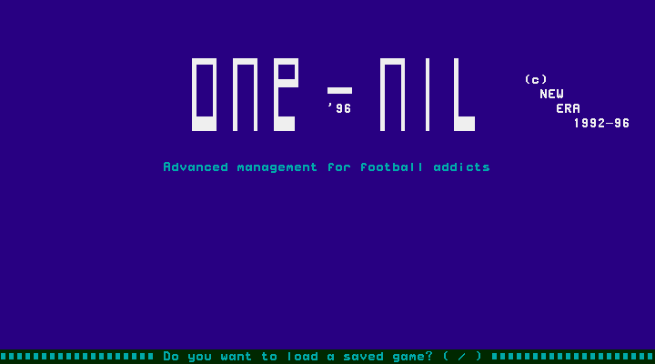
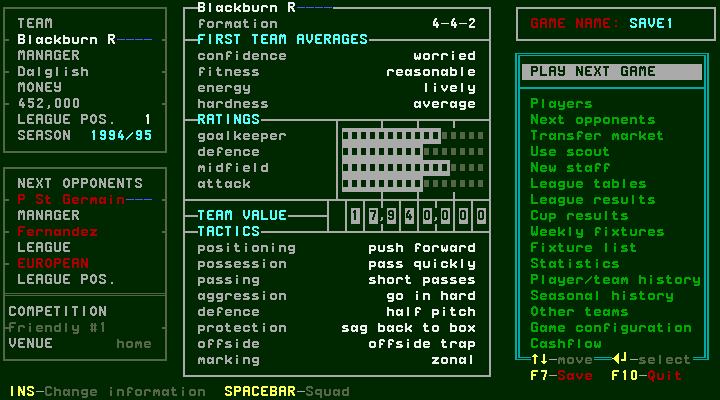

# Starting One-Nil 96 and loading the supplied game

[confirmed: T41-r0002, producer d82b42b] This chapter covers a fresh launch and
one **loaded game**. It does not establish the new-game route or the effect of
any main-menu action. [Capture record](../../runs/T41/T41-r0002/record.json)
contains the exact executable/save identities, screen and PNG hashes, key log,
source commit and runtime version. Host clock and random seed were not fixed.

## W001: load the supplied SAVE1

1. Start `1-0.EXE` from the verified One-Nil 96 folder under DOSBox-X 2024.03.01.
2. At S001, answer **Y** to “Do you want to load a saved game? (Y/N)”. The
   captured driver sends the `y` key once, then waits three seconds before its
   first saved-state read while loading completes.
3. The supplied `SAVE1.1-0` opens directly at S002. In this observed scenario it
   is **Blackburn R**, manager **Dalglish**, season **1994/95**, with **452,000**
   money and league position **1**. The game name is **SAVE1**. These are facts
   about this save, not default values for a new game.
4. The highlighted selection is **PLAY NEXT GAME**. This survey stops here;
   it does not select or advance the fixture.

## S001: startup question



[confirmed: T41-r0002/S001] The screen shows the One-Nil '96 title and load
question. The decoded text page contains `(Y/N)`; the emulator screenshot caught
the prompt letters during their blink interval. The observed action is Y.
Answering N, invalid keys and any subsequent setup dialogs are unvisited here.

## S002: weekly main menu after loading



[confirmed: T41-r0002/S002] The left panel shows club, manager, money, league
position and season. Below it are the next opponent **P St Germain**, manager
**Fernandez**, league **EUROPEAN**, competition **Friendly #1**, venue **home**.
The central panel shows **4-4-2**, first-team averages, rating bars, team value
and eight tactic settings. The right panel is the main menu.

| Visible menu entry | Exploration backlog |
| --- | --- |
| PLAY NEXT GAME | #139 |
| Players | #138 |
| Next opponents | #139 |
| Transfer market | #140 |
| Use scout | #140 |
| New staff | #141 |
| League tables | #142 |
| League results | #142 |
| Cup results | #142 |
| Weekly fixtures | #142 |
| Fixture list | #142 |
| Statistics | #142 |
| Player/team history | #142 |
| Seasonal history | #142 |
| Other teams | #142 |
| Game configuration | #137/#139 |
| Cashflow | #141 |

[confirmed: T41-r0002/S002, displayed hints only] The menu advertises Up/Down
to move and Enter to select. Footer hints advertise **F7 Save**, **F10 Quit**,
**Ins Change information** and **Spacebar Squad**. This run has not exercised
these keys. Their exact dialogs, persistence and cancellation paths remain
unvisited; a displayed hint is not proof of the resulting workflow.

## Coverage boundary and reproduction

The route is fresh executable → Y → supplied-save weekly menu. It captures two
screens, one game key and no management decisions. No savestate is imported as
the route's starting point. Original files are copied to ignored scratch storage
by the existing driver; the release copy is verified, never edited. Temporary
savestates remain ignored. Both emulator/display processes exited after capture.
The earlier T41-r0001 aborted before display startup and is retained as history.

With the calibrated runtime and private game files available:

```sh
python3 runtime/driver/manual.py --run
python3 runtime/driver/manual.py --check runs/T41
```

`--run` allocates a new directory, never overwrites a prior run, and requires
committed capture source. Screenshots come from DOSBox-X's renderer, not a
reconstruction from decoded text. See [environment](../environment.md) for the
driver requirements. This host's dependency restoration is recorded separately
in `runs/T41/runtime-restoration-r0001.json`; the X server's local compiler path
was relocated because system package installation was unnecessary.
