# Transfer market, purchases, sale listing and scouting

[confirmed] Original One-Nil 96, supplied SAVE1, T50/session-r0001, producer
`079f1edf4fcfaac753e09ff2d24aa3c02861d6ae`. The [capture records](../../runs/T50/)
include release/source identities, ordered keys, actual rendered PNG digests
and a completed process ending. This is an isolated scratch game; observations
below do not establish universal acceptance thresholds or accounting formulas.

## W036 — Browse the market and cancel a bid

[confirmed] From PLAY NEXT GAME, three separate Down inputs select Transfer
market; Enter opens the DOMESTIC list. Up/Down choose players, Left/Right change
leagues, Insert switches skills/details, Enter makes a bid, Escape exits.
Right showed a foreign list headed by M Lipcak; Left restored DOMESTIC.
The displayed skills bars must be read from the rendered image: decoded text
records do not preserve their filled lengths.

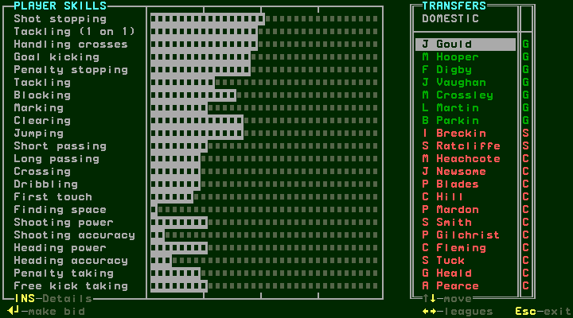
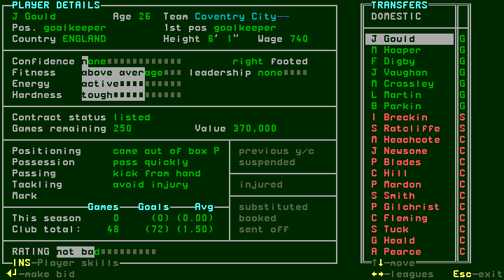
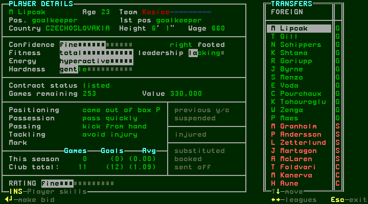

[confirmed] J Gould's details show Coventry City, goalkeeper/first position
keeper, age26, England,6'1", wage740, listed,250 games remaining and
value370,000, plus confidence/fitness/energy/hardness/leadership/foot, individual
instructions, status indicators, season/club games and goals and rating.
Enter opens MAKE YOUR OFFER with370,000 initially. The footer offers Up/Down
in1,000, PgUp/PgDn in10,000, Home/End in100,000, Enter make offer and Escape
give up. Escape returns to the market without buying. A second Enter reopens.

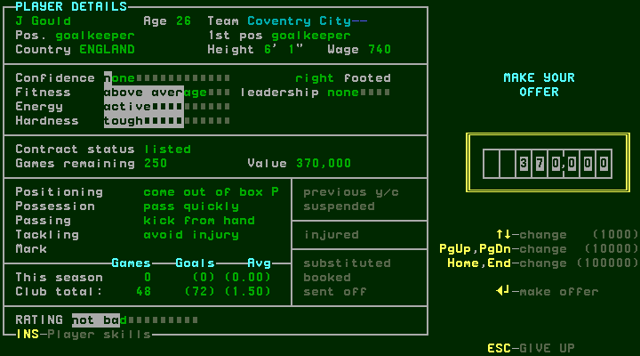

## W037 — Refused fee, accepted purchase contract and resulting squad

[confirmed] Three End inputs changed370,000 to70,000. Enter produced
“BID REFUSED : try again” on the same offer editor. Three Home inputs restored
370,000; Enter advanced to PLAYER CONTRACT. This pair of outcomes applies to
this player/run only; it does not prove a general price threshold.

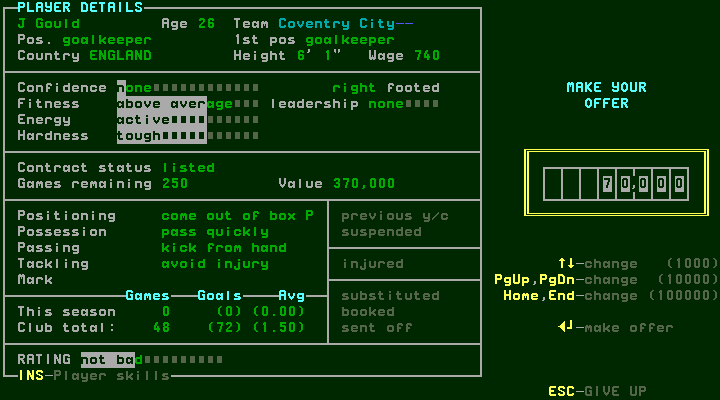
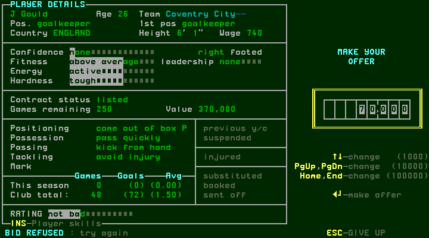
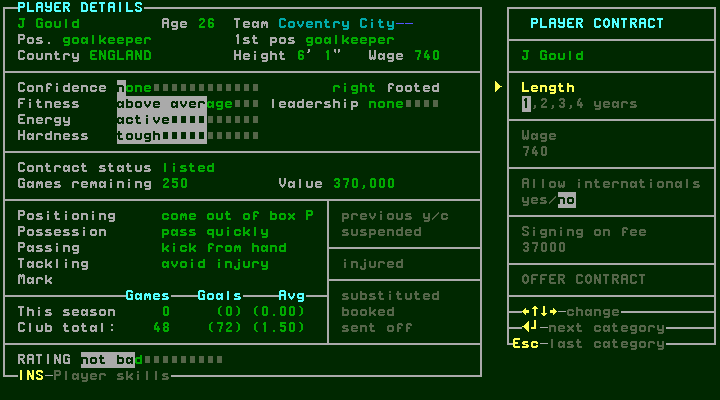

[confirmed] Contract categories are Length (1,2,3,4 years), Wage740, Allow
internationals yes/no, Signing on fee37000, OFFER CONTRACT. The initial length
selection is1. Enter advances category; Escape is advertised as last category;
arrow keys change values. Four Enters moved from length through wage,
internationals and signing fee to OFFER CONTRACT; another Enter reported
CONTRACT ACCEPTED. Space showed CONTRACT DISCUSSIONS HAVE ENDED IN AGREEMENT
and “press any key”; Escape then returned to the market with J Gould absent
from the leading list. These acknowledgements are distinct screens.

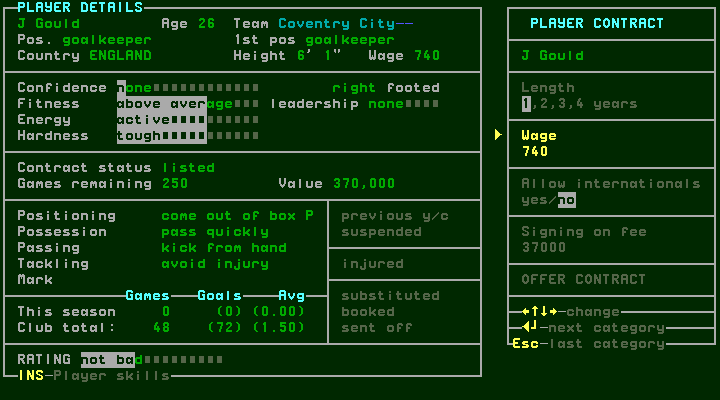
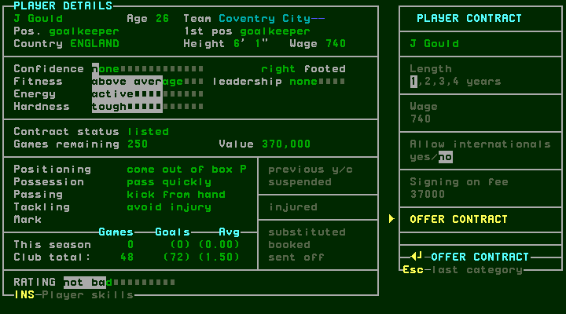
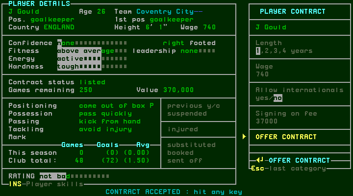
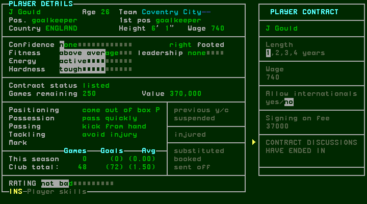

[confirmed] Escape from the market returned to management. Displayed MONEY
was still452,000, the same as before this transaction. F7 on this actual main
menu saved; an earlier F7 while still in the market did not leave that screen
and is not treated as a successful save. Main-menu Space opens Players. Right
showed empty reserves; Left returned to FIRST TEAM. Eighteen Down inputs
selected J Gould below B Mimms in its lower squad rows. His team now reads
Blackburn R, contract status contracted, games remaining58, wage740,
value370,000 and club total0 games/0 goals. This establishes the visible squad
change. Fee/signing deductions and their timing require the accounts/weekly
chapter; unchanged displayed money must not be described as an immediate debit.

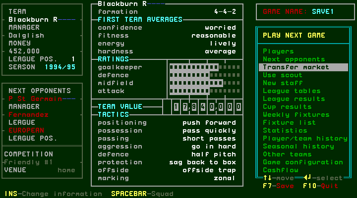
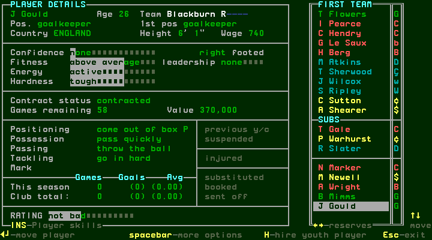

## W038 — Sell confirmation, transfer listing and removal

[confirmed] On J Gould, Space opens player options. Down twice from Reposition
selects Sell; Enter asks “Sell Gould? (Y/N)”. N cancels and leaves him contracted.
Enter asks again; Y reports that Gould has been placed on the transfer market.
The details now say listed; Sell becomes x and Take off T.M becomes checked.
This is listing for sale, not a completed sale to another club.

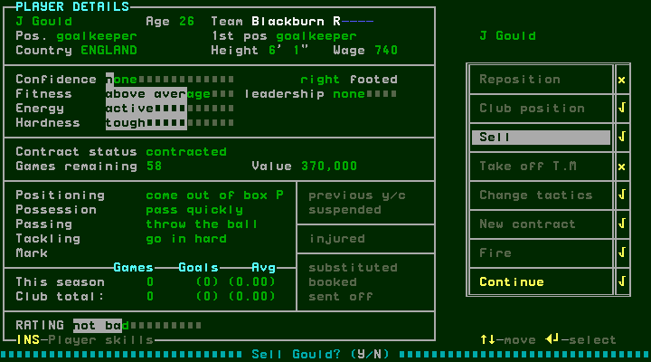
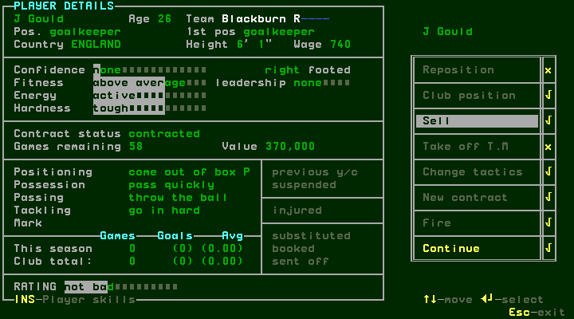
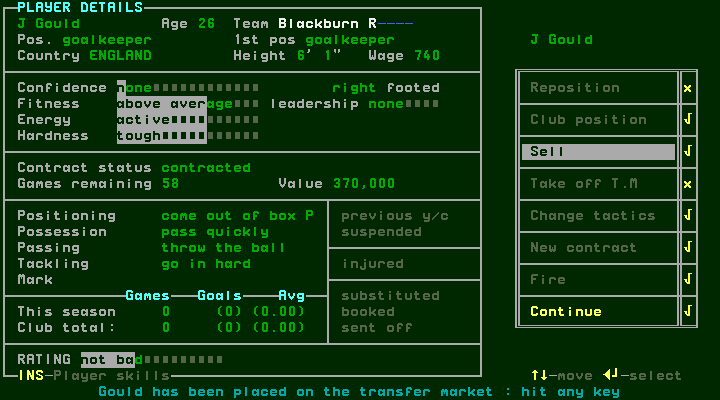

[confirmed] The first Down after the acknowledgement only dismisses it, leaving
Sell highlighted. Enter there has no observed effect because Sell is x. Another
Down selects Take off T.M; Enter restores contracted, Sell checked and Take off
T.M x, with no new confirmation observed. Escape closes options; Escape returns
to management. Do not treat exploratory IDs “unlist-entry/unlist” at steps39–40
as the removal: the actual removal is step42.

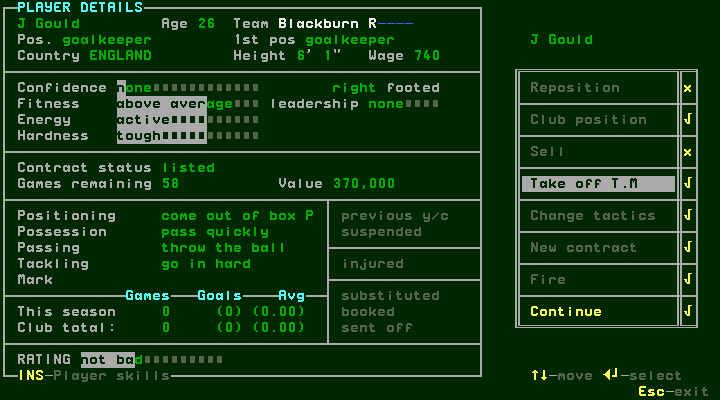
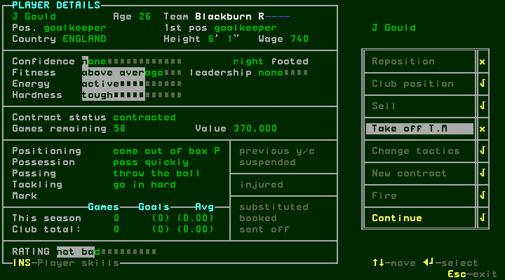

## W039 — Scout criteria, search results and cancellation

[confirmed] From the returned main menu's Players selection, Down selects Next
opponents, Down Transfer market, Down Use scout; Enter opens criteria. Escape
cancels to main; Enter reopens with the same displayed selections. Categories:

| Group | Visible choices |
| --- | --- |
| Price | up to150,000;150,000–300,000;300,000–½million;½–¾million;¾–1million;1–2million;2–4million;over4million |
| Position | goalkeeper, sweeper, centre/left/right back, defensive/central/left/right/forward midfield, left/right winger, centre forward, striker |
| Age |18–20,21–23,24–26,27–29,30–32,over32 |
| Hardness | soft, hard |
| Confidence | unconfident, confident |
| Fitness | unfit, fit |
| Nationality | domestic, foreign |

[confirmed] Initial selections here were¾–1million, striker, ages24–26 and
27–29, with both alternatives checked in the other four groups. DONE is selected
initially. Enter on DONE opens a SCOUT result list headed by T Sheringham;
Down selects D Holdsworth. Enter opens the bid editor; Escape cancels to the
results; Escape returns to criteria; Escape from criteria returns to management.

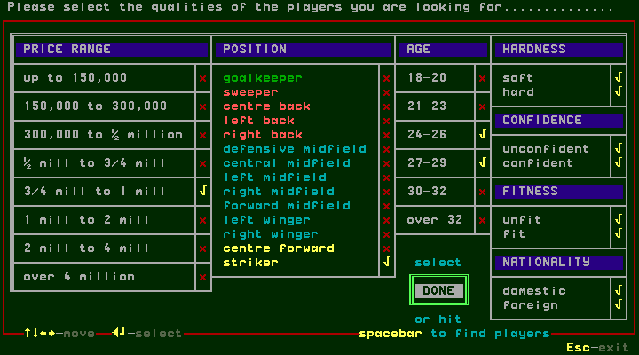
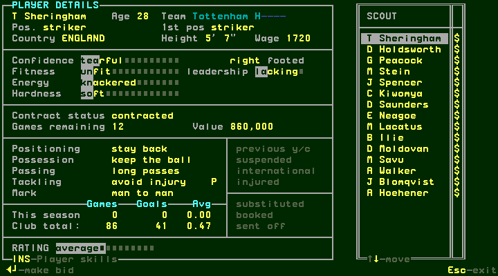
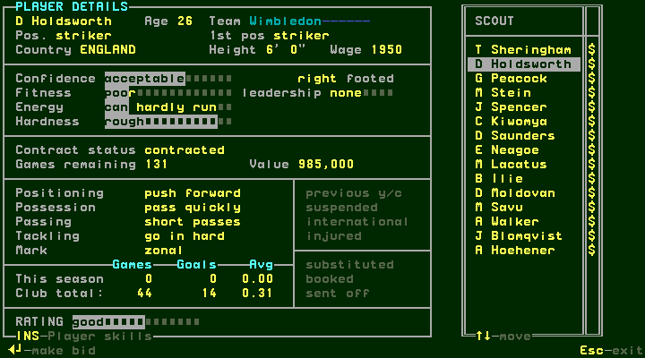
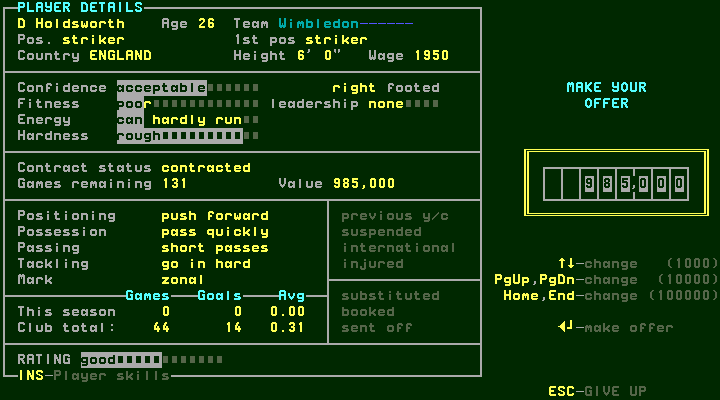

[confirmed] From DONE, Left selected striker. Enter unchecked it; another Enter
restored its check. Right returned to DONE; Enter reran the search. Space was
advertised as find players, but the recorded Space captures at steps51/60
remained on criteria; successful search here is established by Enter on DONE,
not by those Space inputs. Only this one filter's toggle/navigation was tested;
the full combinations and empty-results branch remain unvisited.

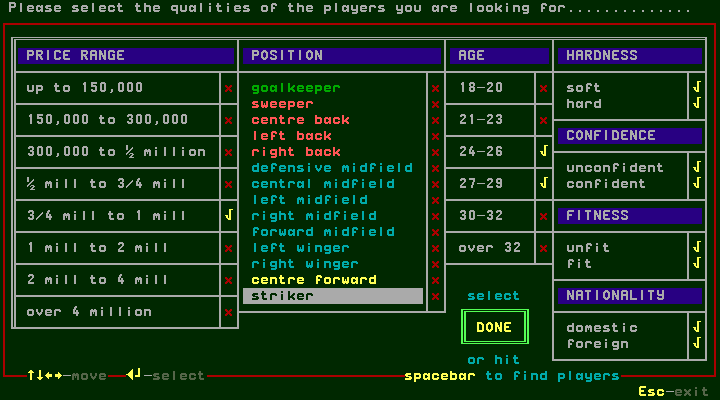

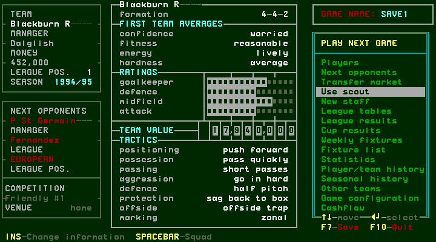

## Branch coverage

| Branch | Observed | Remaining |
| --- | --- | --- |
| Market | Domestic/foreign, skills/details, bid cancel | Every league/list paging boundary |
| Fee negotiation |70,000 refused;370,000 advanced for J Gould | Insufficient funds and other counteroffers |
| Purchase | Contract acceptance, acknowledgements, squad change | Accounting timing; all negotiation variants |
| Selling | N cancel; Y lists; Take off T.M reverses | Actual buyer offer, completed sale and proceeds |
| Scout | Criteria, filter toggle, Enter search, player/bid cancel, exits | Empty results and other criteria combinations |
| Contracts | New purchase agreement | Existing-player renewal, expiry and dismissal separately |

[designed] #140 remains open for the remaining contract and conditional transfer
work; this chapter does not establish a complete transfer economy.
