# Watching a match

[confirmed] This chapter is being assembled from the original One-Nil 96 supplied
SAVE1 friendly, Blackburn R versus P St Germain. Its capture is
[T48/session-r0001](../../runs/T48/session-r0001/session.json), which records
source/release identity and exact inputs. The fixture was watched through halftime and fulltime, including a legal
replacement and the return to the next management week.

## W024: start, open the bench and resume

[confirmed] From the supplied main menu, Enter opens match preparation; Enter
on PLAY GAME starts the watched pitch. Escape opens the live bench (S035), whose
layout resembles preparation: opponent, Match stats, PLAY GAME and Change tactics,
team panel and squad. Space opens Players. Escape from Players returns to the
bench; Enter on PLAY GAME resumes the pitch. Evidence: steps 1–5 and 13–15.

[confirmed] The friendly preparation showed Remaining subs 9; the first live
bench showed 7 before any replacement was made in this capture. This chapter
records that display difference without assigning a universal allowance formula.

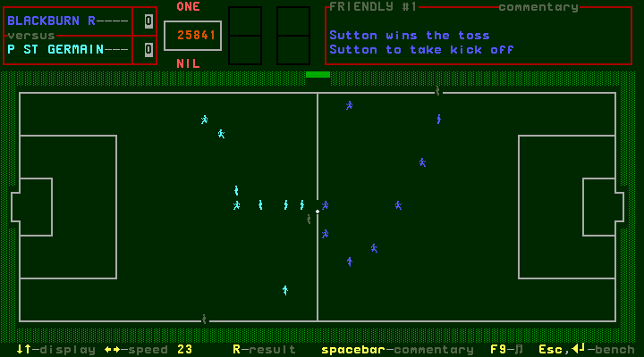
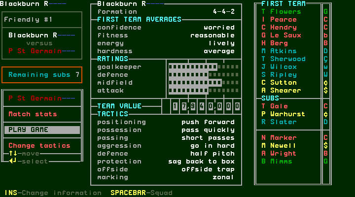

## W025: request and cancel a substitution

[confirmed] During live play, the Players footer says **REQUEST SUBSTITION**
(the original spelling), rather than the pre-match “move player” control. Enter
with I Pearce selected changes it to **CANCEL SUB REQUESTED**. Escape returns
to the bench and leaves the request active: after resuming/reopening the bench,
Players with T Flowers selected still shows CANCEL SUB REQUESTED and the
vertical “substitution requested” indicator. Enter then changes the footer back
to REQUEST SUBSTITION and clears that indicator. No player exchange occurred.
Evidence: request steps 6–7, bench exit 8, later status/cancellation 12–13.

[confirmed] Thus Escape from this Players view exits it; it does not cancel the
outstanding request. The actual cancellation above is Enter while the footer
offers CANCEL SUB REQUESTED. The exploratory capture labels at steps 8–10 must
not be read as proof of cancellation or a chosen replacement: step 8 returned
to the bench, step 9 resumed the pitch, and the following Down presses acted on
the live display. A completed replacement is a separate step to verify.

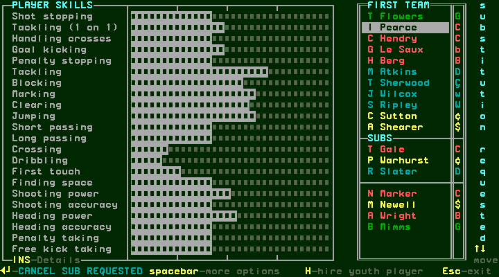
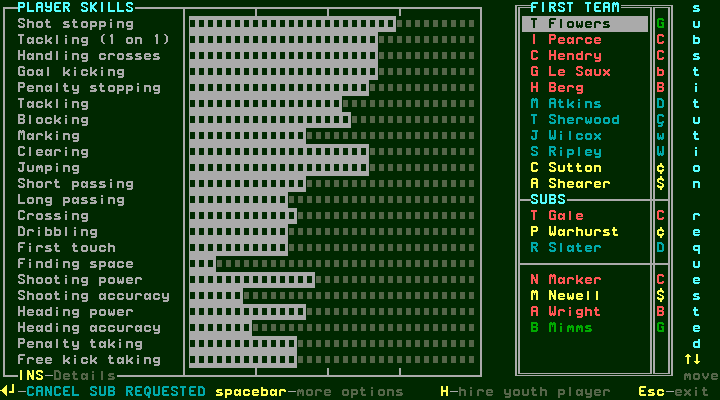

## W026: display and speed controls

[confirmed] The live footer advertises Up/Down for display, Left/Right for
speed, R for result, Space for commentary, F9 for sound and Escape/Enter for the
bench. Up/Down changed the pitch's player representation; captured variants
include rendered player figures and squad numbers. Right changed the displayed
speed from 23 to 24; Left restored 23. Evidence: steps 3, 10 and 16–19.
These captures establish the setting change, not its full range or a measured
relationship between that number and elapsed playing time.

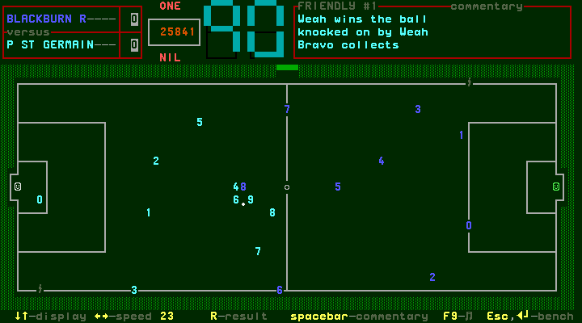
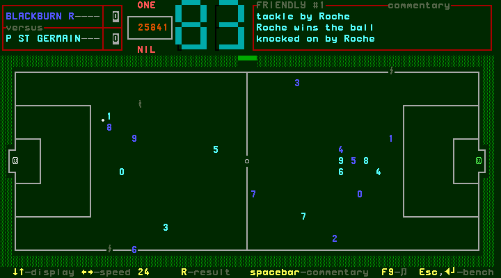

## W027: read detailed commentary history

[confirmed] Space on the pitch opens S037, an overlay containing a longer action
history. It advertises Up/Down, Page Up/Page Down, Home and End for viewing, and
Escape to play. Home moves to the opening entries, including Sutton winning the
toss and taking kickoff; End returns to recent entries; Page Up shows older
entries. Escape returns to the pitch. Evidence: steps 20–24.

[confirmed] The captured history describes actual named actions: Hendry tackles
and wins the ball; a high ball goes to Sutton; Roche challenges; Sutton heads on;
Shearer collects and runs; Roche tackles and wins the ball; Colleter collects
and passes; Berg heads on; Ripley receives the ball and runs. This is the
original's action history, not an added narration of inferred ball movement.
The brief upper commentary panel shows recent lines while the match is live.

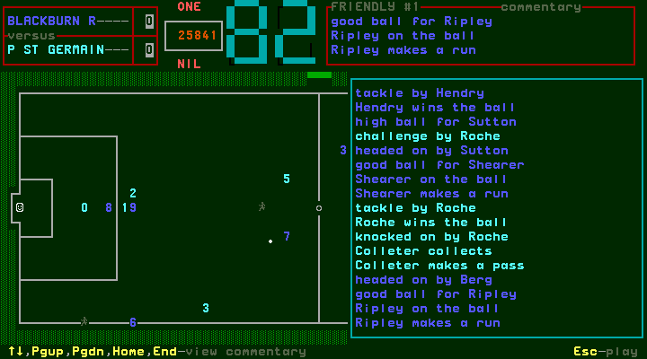
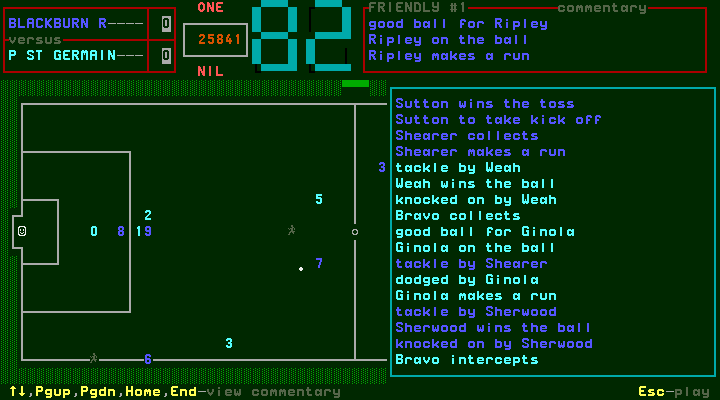
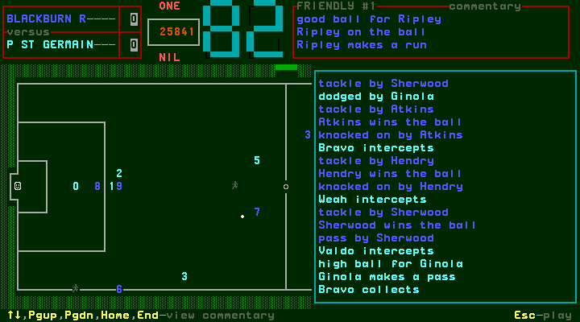

## W028: halftime and a legal replacement

[confirmed] The original stopped at halftime on its statistics screen (S038),
showing 1–1, A Shearer 35 and V Guerin 12, and “press any key”. Space returned to
the bench. Evidence: steps 34–36.

[confirmed] Space from the interval bench opens Players with **MAKE SUBSTITUTION**
in its footer. Select I Pearce and Enter to start PUT HERE replacement selection.
Escape cancels this operation and restores MAKE SUBSTITUTION without changing
the players. Enter starts it again; move the highlight to T Gale under SUBS,
then Enter confirms. T Gale now appears in the active eleven and I Pearce in
the substitutes list. Escape returns to the bench, where Remaining subs has
changed from 7 to 6. Enter on PLAY GAME resumes the second half.
Evidence: steps 37–46. The target is chosen by its actual highlighted name;
rapid harness arrows sometimes required an additional press before that name
was reached.

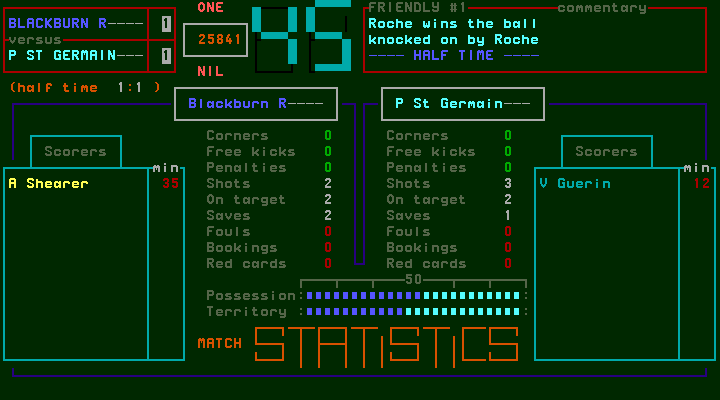

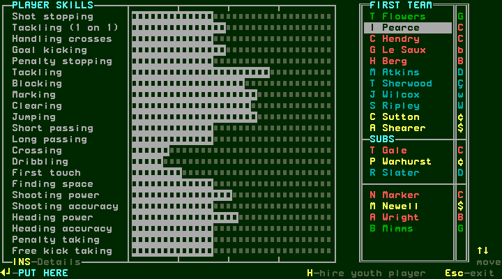
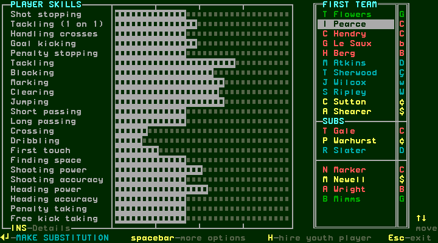
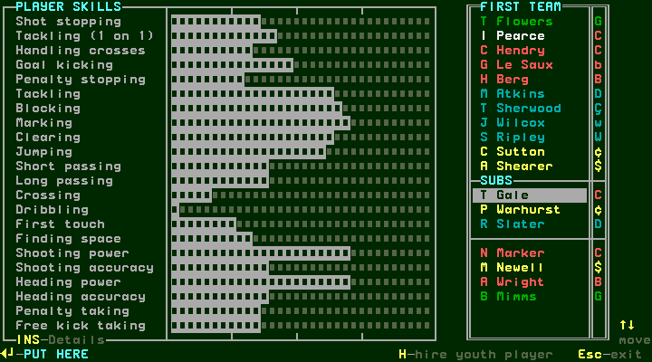
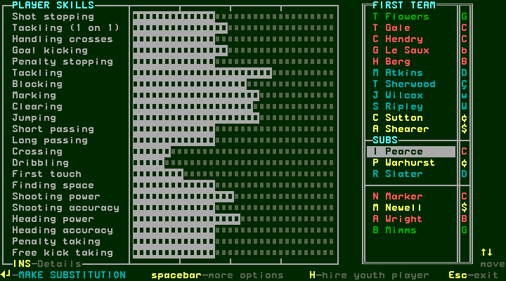
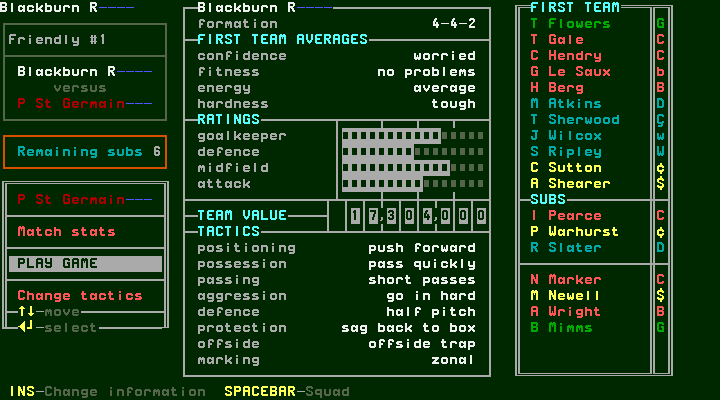

## W029: fulltime, commentary and final statistics

[confirmed] The original stops at fulltime with **---- FULL TIME ----** in the
commentary and a 1–2 score. The footer changes to Space to view commentary,
P to print commentary, Enter for bench, and any other key to exit. Space opens
the history; End shows its latest entries including the final whistle. Escape
returns to the completed pitch. Enter opens the bench, where **CONTINUE** has
replaced PLAY GAME. Evidence: steps 50–55. P printing was not exercised.

[confirmed] Up from CONTINUE selects Match stats; Enter opens final statistics.
This run shows halftime 1–1; A Shearer scored at 35 for Blackburn, V Guerin at12
and J Cobos at48 for P St Germain. D Ginola is MAN OF THE MATCH. These are this
fixture's observed results, not a universal seeded or quick/watched prediction.
The displayed counters are:

| Final counter | Blackburn R | P St Germain |
| --- | --- | --- |
| Corners | 0 | 0 |
| Free kicks | 2 | 1 |
| Penalties | 0 | 0 |
| Shots | 2 | 6 |
| On target | 2 | 5 |
| Saves | 4 | 2 |
| Fouls | 0 | 0 |
| Bookings | 0 | 0 |
| Red cards | 0 | 0 |

[confirmed] Evidence: steps 56–57. Space returns from the statistics to the
completed bench. The route back to management follows below.

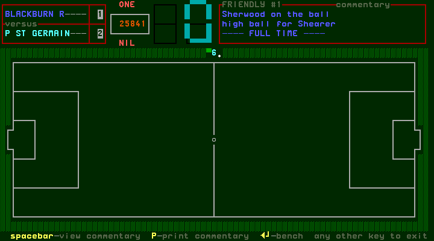
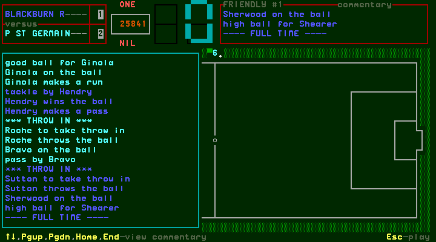
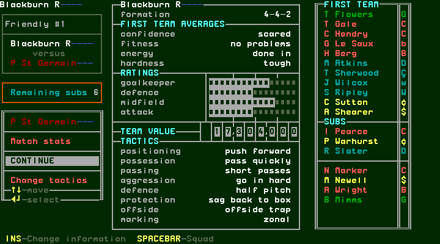
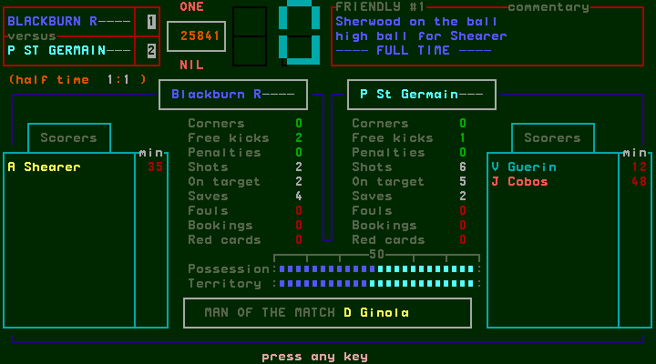

## W030: return to the next management week

[confirmed] CONTINUE in the completed bench returns to the fulltime pitch.
Press **N** as “any other key to exit”; the game shows the final statistics
again. Space continues to S043 CASH FLOW, with income/outgoing categories,
TOTAL IN 38,761, TOTAL OUT 69,270 and Club funds 421,491 in this run. Its footer
offers Insert to increase stadium capacity or any other key to continue.
The stadium action was not exercised here.

[confirmed] Space then shows S044 TRANSFER NEWS, with PLAYER/FROM/TO columns
and a “press any key” footer. Space returns to the main menu: Blackburn R,
1994/95, funds 421,491, next opponents Sevilla/Aragones, away Friendly #2.
The observed first-fixture completion has therefore advanced the management
workflow. League position remains 1; this friendly is not evidence of league
points being awarded.

[confirmed] Evidence: steps 58–65. The original changed its scratch SAVE1 game
file while completing this week; its resulting digest is recorded with the
private recovery archive. No original bytes enter git. This chapter does not
claim a fresh-process reload of the progressed week; setup/selection persistence
has separate demonstrated procedures.

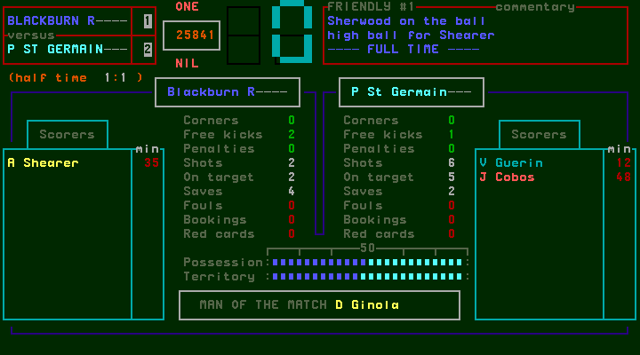
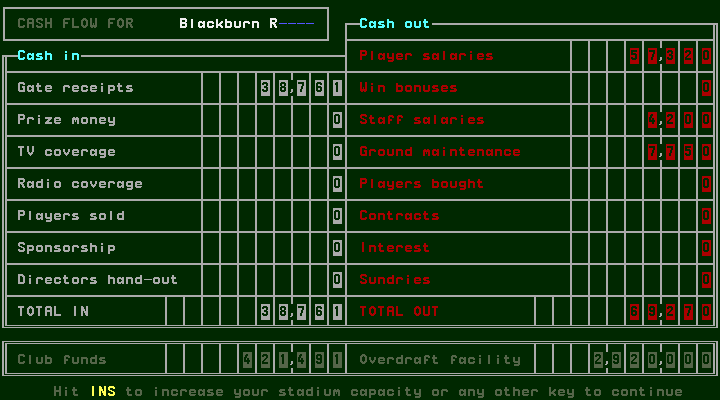
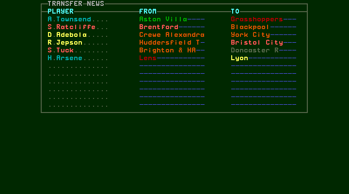
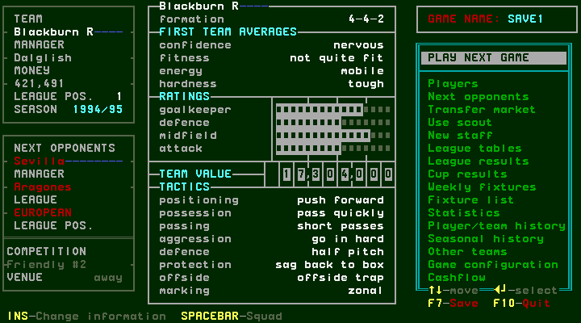

## Remaining coverage

R-result was not used to complete this watched fixture; that route and Watch-off
completion are separate procedures. F9 audio output is untested because this
research driver disables sound; the visible hint alone is not proof of audible
output. Illegal substitutions, quota exhaustion, goalkeeper-specific replacement
rules, speed bounds and other competition allowances remain conditional coverage.
